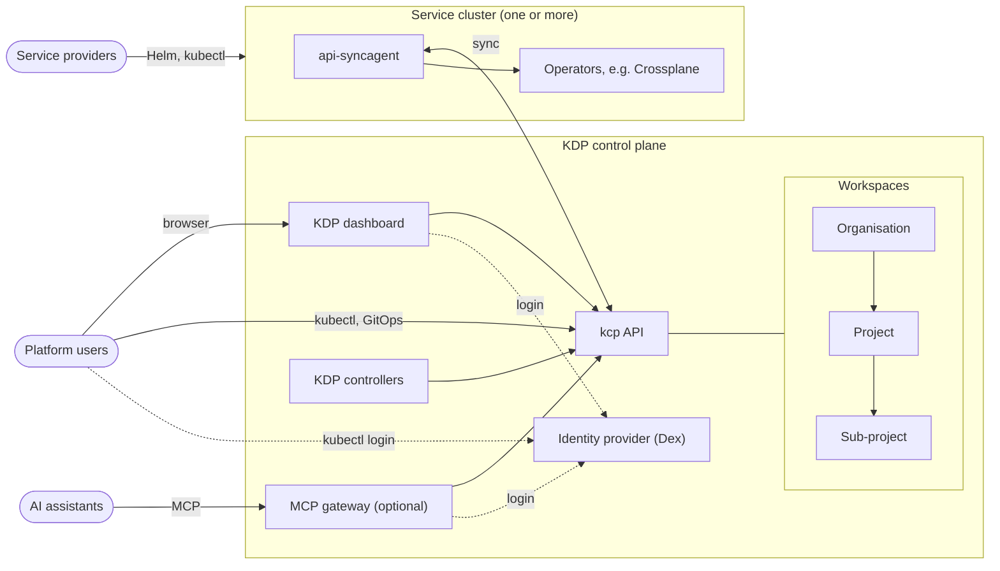

+++
title = "Kubermatic Developer Platform"
sidebarHomeTitle = "Overview"
+++

Kubermatic Developer Platform (KDP) is the control plane for an internal developer platform. Service
providers publish services, such as databases, certificates or whole application stacks, as
Kubernetes APIs. Platform users enable the services they need in their own workspace and create
objects to provision them, using the dashboard, `kubectl`, GitOps or an AI assistant.

KDP itself does not run the workloads behind a service. If a database service is offered, the
PostgreSQL pods run on the provider's own **service cluster**, not in KDP.

## How it fits together

- **kcp** is the API server at the centre. It runs many lightweight logical clusters called
  **workspaces**, each with its own Kubernetes API. In KDP, each **organisation** is a top-level
  workspace, and organisations contain **projects**, which can be nested. Each workspace has its
  own members, permissions and enabled services. See
  [Workspaces]().
- **Services** are APIs published into kcp. Enabling a service in a workspace makes its resource
  types available there, like CRDs in a normal cluster. See
  [Services]().
- The **[api-syncagent]()**
  runs on each service cluster. It publishes the provider's APIs into kcp and copies objects that
  users create down to the service cluster, where operators such as Crossplane do the actual work.
  Status flows back up to the user.
- The **dashboard** and the optional **MCP gateway** talk to the same kcp API as `kubectl`. There is
  no separate backend API, so anything you can do in the dashboard you can do through the API.

For more detail, see [Concepts]().

## Who it is for

- **Platform administrators** install and run KDP and grant top-level access. Start with
  [Platform Administration]().
- **Service providers** run service clusters and publish services onto the platform. Start with
  [Service Providers]().
- **Platform users**, usually application developers, consume services in their own organisations
  and projects. Start with [Platform Users]().

## Why KDP

Many internal developer platforms are portals: a catalogue that shows what exists, after which
developers still file a ticket to get anything. KDP is a platform. Creating an object provisions
the service, with no manual last mile.

- **Kubernetes-native APIs.** Every service is a real Kubernetes API you drive with `kubectl`, CI,
  GitOps and your existing automation. There is no bespoke SDK or plugin system to learn.
- **True multi-tenancy.** Each organisation and project gets its own isolated Kubernetes API,
  which is stronger and simpler than namespaces plus RBAC.
- **Service-owner self-service.** Service providers publish their own offerings, so the platform
  team is not a bottleneck. Higher-level offerings can be composed from existing services with
  [Blueprints]().
- **Ready for AI agents.** Because everything is a machine-readable API, AI assistants can discover
  and provision services too. See
  [AI Tooling]().

For the longer argument, see Kubermatic's
[Portal vs Platform](https://www.kubermatic.com/blog/portal-vs-platform/) article.

## Where to start

- New installation: [Get Started]().
- Upgrading from 1.1: [What's New]() and
  [Upgrading to 1.2]().
