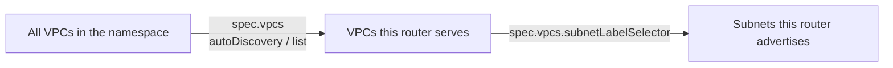

+++
title = "Attaching VPCs and Subnets"
date = 2026-09-08T00:00:00+00:00
weight = 10
+++

Two independent settings decide what an `AZEdgeRouter` serves:



- **VPC discovery** decides *which VPCs* the router attaches to.
- **Subnet discovery** decides *which of each VPC's subnets* the router advertises.

Both apply the same way in every transit mode. The examples use the `virtualization.k8c.io`
wrapper `VPC` and `Subnet` objects; `spec.vpcs.list[].name` and `spec.vpcs.labelSelector` resolve
against the `VPC` objects directly, which wrap the Kube-OVN VPC of the same name. By default these are the VPCs of
the router's namespace; see [Namespaces](#namespaces) for VPCs of other namespaces.

## Namespaces

### VPCs of other namespaces

By default a router attaches only the `VPC`s in **its own namespace**. To let one platform router carry the VPCs
of other namespaces, such as one per tenant, list those namespaces in `spec.vpcs.namespaces`
(`"*"` for every namespace):

```yaml
spec:
  vpcs:
    autoDiscovery: true
    namespaces: ["*"]          # or ["tenant-a", "tenant-b"]; empty means the router's own namespace
    labelSelector:
      matchLabels:
        virtualization.k8c.io/edge-router-attach: "true"
```

A VPC is attached only if its namespace is allowed **and** it carries the labels in `labelSelector`. An empty
`labelSelector` matches every VPC, so it only ever discovers the router's own namespace; set a selector to look
elsewhere. With an explicit `list`, an entry names its namespace itself:

```yaml
spec:
  vpcs:
    autoDiscovery: false
    list:
      - name: web
        namespace: tenant-b
```

`list` entries are not bounded by `spec.vpcs.namespaces`, but a listed VPC of another namespace is attached only if its
owner opted in with the label `virtualization.k8c.io/edge-router-attach=true`. References to a VPC elsewhere in the
router spec, such as `perVRFTransit.vpcVLANs[].vpc` and `internalPeers.perVPC[].vpc`, write it as
`<namespace>/<name>`; a bare name means the router's own namespace.

The owner of a VPC in another namespace is not the platform, so the router ignores the per-VPC routing annotations and
labels on it (NAD, peers, ASNs, accepted prefixes, API server proxy, egress source, EVPN VNI). Set those in the router
spec instead. Only the egress-enabled annotation is honoured. Native Kube-OVN VPCs are cluster-scoped, so
`namespaces` and `namespace` do not apply to them.

On the router, a VPC of another namespace is identified as `<name>--<digest of the namespace>`, for example
`web--db7243`, so two namespaces can each hold a VPC called `web`. This is the name you see in the router's status and
in the names of its per-VPC resources. A VPC of the router's own namespace keeps its plain name. The status entry
also records the real `namespace` and `vpcName`.

### Everything else

{}
`spec.managementSubnet`, the `UnderlaySubnet`s and `nadName` NADs named in `vpcVLANs`, and the `Subnet`s of the
router's own VPCs must live in the `AZEdgeRouter`'s namespace. They are not looked up across namespaces.
{}

Other references can name another namespace:

| Reference | Namespace field | Default |
|---|---|---|
| `spec.vlan`, `spec.serviceVlan` (NAD of the router's inbound VLANs) | `namespace` | the router's namespace |
| `EVPNPolicy.spec.targets[].azEdgeRouterRef` | `namespace` | none, set it to the router's namespace |
| `spec.vpcEdgeRouters[]` | `namespace` | the router's namespace |

An `EVPNPolicy` can therefore live in an admin namespace such as `network-admin` and target a router in `edge-frr`,
as in the [EVPN example](../evpn/#evpnpolicy).

## VPC discovery: auto-discovery vs. an explicit list

**Auto-discovery** attaches every `VPC` matching a label selector, so onboarding a tenant is
labeling its `VPC` object — no `AZEdgeRouter` edit:

```yaml
apiVersion: routing.virtualization.k8c.io/v1alpha1
kind: AZEdgeRouter
metadata:
  name: az-edge-router-region-a
  namespace: edge-frr
spec:
  vpcs:
    autoDiscovery: true
    labelSelector:
      matchLabels:
        virtualization.k8c.io/edge-router-attach: "true"
    # Required whenever the same VPC is served by more than one regional router.
    subnetLabelSelector:
      matchLabels:
        topology.kubernetes.io/zone: region-a
  # ... remaining spec as in the quick start
---
apiVersion: virtualization.k8c.io/v1alpha1
kind: VPC
metadata:
  name: tenant-a
  namespace: edge-frr
  labels:
    virtualization.k8c.io/edge-router-attach: "true"
spec: {}
```

An **explicit list** fits when attachment should be a deliberate, reviewed change — for example
a small, fixed set of tenants:

```yaml
spec:
  vpcs:
    autoDiscovery: false
    list:
      - name: tenant-a
      - name: tenant-b
```

Discovery only decides whether a VPC is *resolved*. How it plugs into the external plane is
mode-specific: see [`bgp-per-vrf`](../bgp-per-vrf/#attaching-a-vpcs-external-vlan) and
[EVPN](../evpn/).

## Subnet discovery: `subnetLabelSelector`

`spec.vpcs.subnetLabelSelector` is evaluated **per VPC, every reconcile**, against the labels on
each of that VPC's wrapper `Subnet` objects. It applies the same whether the VPC was found via
`autoDiscovery` or listed explicitly.

This is what lets several regional routers serve the *same* VPC without double-advertising: a
VPC spanning two regions has subnets labelled `topology.kubernetes.io/zone: region-a` and
`region-b`, and each router only installs routes for the subnets matching its own selector. If you also use
[regional scheduling](../../regional-scheduling/), label each subnet with `topology.kubernetes.io/region` as well;
that policy keys off the region label, while this selector uses the label you configure.

```yaml
apiVersion: virtualization.k8c.io/v1alpha1
kind: Subnet
metadata:
  name: tenant-a-workloads
  namespace: edge-frr
  labels:
    topology.kubernetes.io/zone: region-a   # advertised by az-edge-router-region-a
spec:
  vpc: tenant-a
---
apiVersion: virtualization.k8c.io/v1alpha1
kind: Subnet
metadata:
  name: tenant-a-workloads-b
  namespace: edge-frr
  labels:
    topology.kubernetes.io/zone: region-b   # NOT advertised by az-edge-router-region-a
spec:
  vpc: tenant-a
```

The selector matches labels on the `Subnet` object itself, not on the VPC.

{}
Omitting `subnetLabelSelector` includes every subnet of the VPC — there is no "unset =
advertise nothing" behavior, so a single-region deployment can simply leave it out.
{}

{}
A VPC with zero matching subnets still resolves: it keeps its transit `/30` (or larger) and a
`status.resolvedAZVPCs` entry with an empty `subnets` field. This keeps the transit NIC and VRF
in place while subnets are relabelled one at a time, instead of flapping the attachment.
{}

## Where to go next

- [`bgp-per-vrf` mode](../bgp-per-vrf/) or [EVPN mode](../evpn/): wire the attached VPCs to the fabric.
- [Multi-region](../multi-region/): the same VPC served from several regions.
