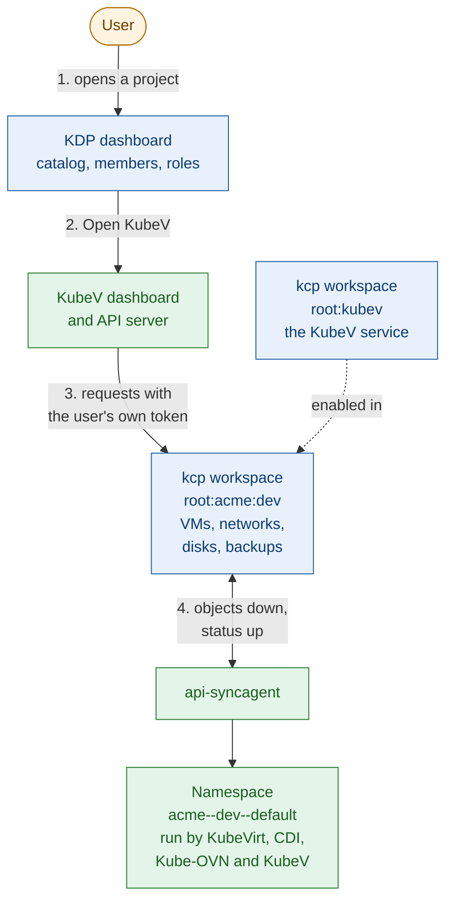

+++
title = "KDP Integration"
date = 2026-10-12T00:00:00+00:00
weight = 7
+++

Kubermatic Virtualization (KubeV) can run as a service of the
[Kubermatic Developer Platform](/developer-platform/v1.2/) (KDP). Teams then get virtual
machines, networks, disks and backups in their own KDP projects, from the same catalog as every
other service on the platform, while KubeV runs them on its own cluster.

In the diagrams of this section, blue is KDP, green is the KubeV cluster, and orange is outside both.

KDP stores each project's objects and decides who may do what. The api-syncagent copies the
objects to the KubeV cluster, where KubeVirt, Kube-OVN and the KubeV controllers run them, and
copies their status back. [How It Works]() explains every step.

## Read this first

{}
**The KDP dashboard is the entry point.** Organizations, projects, members, roles and services are
managed in KDP, never in KubeV. Users sign in to KDP, open a project, and choose
**Open KubeV Virtualization** there. KubeV then works in that one project, and has no
administration pages of its own.
{}

{}
**KubeV works in projects only.** Never create VMs or other KubeV resources in an organization, or
in a workspace nested below a project. KDP and kcp accept them there, but they never reach the KubeV
cluster and never run. See [Where KubeV works]().
{}

{}
**Organization and project names are limited.** At most 16 characters each, and no `--`. KDP accepts
longer names, but KubeV can't use such a project, and workspaces can't be renamed. Agree on naming
before teams create their projects: see
[Names KubeV can use]().
{}

## Installation modes

The installer offers three ways to run KubeV with KDP:

| Mode | KDP runs | The installer | Status |
| --- | --- | --- | --- |
| [**Bring your own KDP**]() | Wherever you already run it, KDP 1.2.1 or newer. | Connects the KubeV dashboard to your KDP. You register the KubeV service in KDP yourself. | Supported |
| [**Same layer**]() | On the KubeV cluster, next to KubeV. | Installs kcp and KDP, registers the KubeV service and enables it in every project. | Supported |
| [**Nested cluster**]() | In its own Kubernetes cluster, on KubeVirt VMs on the KubeV cluster. | Creates the VMs and the cluster, installs KDP in it, registers the KubeV service, and runs the api-syncagent on the KubeV cluster. | Experimental, not for production. No KubeV dashboard. |

[Installation]() compares them and lists what every mode needs.

## What changes in KDP mode

| | Standalone | With KDP |
| --- | --- | --- |
| **Tenancy** | Namespaces on the KubeV cluster. | KDP organizations and projects. Each project is isolated from the others. |
| **Users and roles** | KubeV `User`, `KubeVRole` and `KubeVRoleBinding` objects, managed in the KubeV dashboard. | KDP members and roles, managed in the KDP dashboard. |
| **Who decides what a user may do** | The KubeV API server. | kcp, the control plane behind KDP. KubeV forwards each request with the user's own token. |
| **Where users start** | The KubeV dashboard. | The KDP dashboard. |
| **Sign-in** | Basic, OIDC or none. | OIDC only, through the identity provider that KDP and KubeV share. |
| **Where VMs run** | The KubeV cluster. | The KubeV cluster, in a namespace for each project namespace. |

## What a project gets

Once KubeV is enabled in a project, the project serves these resources:

| Area | Resources |
| --- | --- |
| **Compute** | `VirtualMachine`, `VirtualMachineInstance`, `VirtualMachineInstanceMigration` (`kubevirt.io`), `VirtualMachinePool` (`pool.kubevirt.io`) |
| **Storage** | `DataVolume` (`cdi.kubevirt.io`), `Image` |
| **Networking** | `VPC`, `Subnet`, `UnderlaySubnet`, `SecurityGroup`, `NATGateway`, `ElasticIP` |
| **Access** | `SSHKey` |
| **Data protection** | `BackupStorageLocation`, `VMBackup`, `VMRestore` |
| **Migration** | `Provider`, `NetworkMap`, `StorageMap`, `Plan`, `Migration` (`forklift.konveyor.io`) |

Resources without an API group in brackets belong to `virtualization.k8c.io`.

Only the platform administrator manages these:

- edge routers (`AZEdgeRouter`, `EVPNPolicy`, `EVPNRouteReflector`), which projects can't
  create or change;
- cluster instance types and preferences, storage classes, priority classes and nodes, which
  projects can read but not change.

## Where to start

- **Platform administrators**: read [How It Works](), pick a mode in
  [Installation](), then [Access Control]()
  and [Operating the Platform]().
- **Project users**: start with [Using KubeV in a KDP Project]().

## Pages

{}
{}
