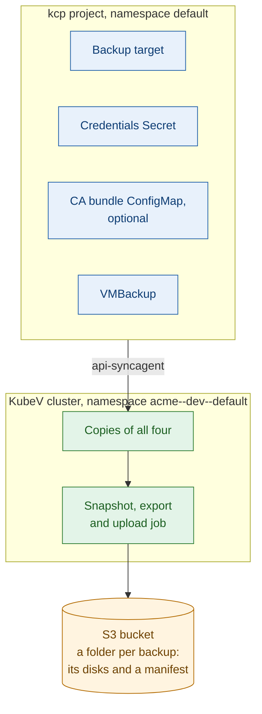
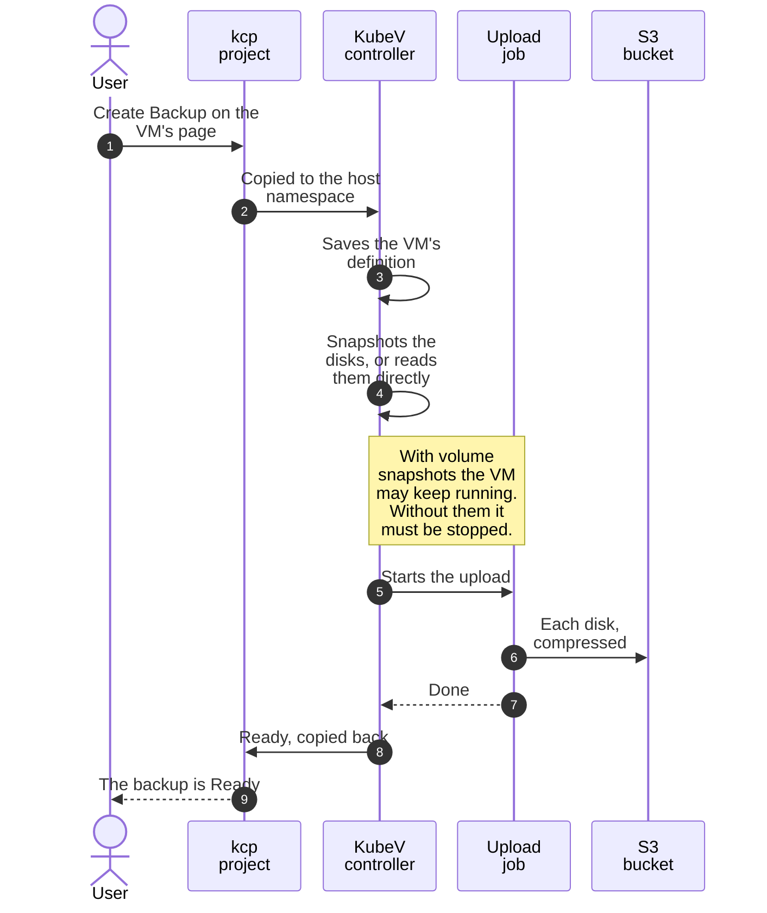
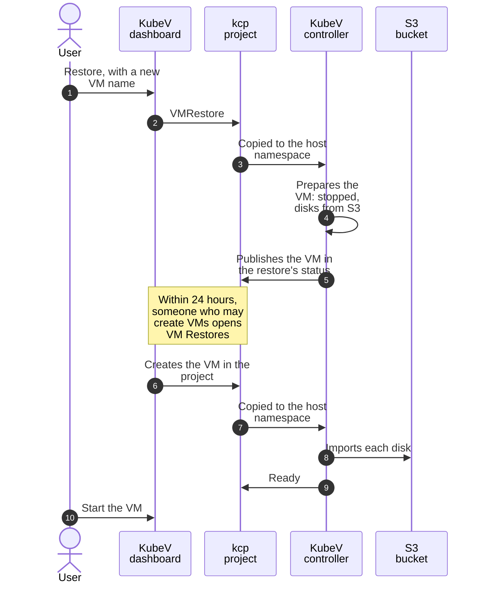

+++
title = "VM Backups and Restores"
date = 2026-10-12T00:00:00+00:00
weight = 5
+++

KubeV backs up virtual machines to S3-compatible object storage, and restores them as new VMs.
This page explains how backups and restores work in a KDP project, step by step, and what
differs from a standalone installation.

## The pieces

| Object | Dashboard name | What it is |
| --- | --- | --- |
| `BackupStorageLocation` | **Backup Target** | An S3-compatible bucket: AWS S3, MinIO, Ceph RGW or another S3 service. Its access key is kept in a Secret next to it. |
| `VMBackup` | **VM Backup** | One backup of one VM, to one target. |
| `VMRestore` | **VM Restore** | One restore of a backup, into a new VM. |

All three live in a namespace of your project. The api-syncagent copies them to the project's
namespace on the KubeV cluster, together with the target's Secret and CA bundle, and the backup
and restore jobs run there:

Each backup gets a folder in the bucket, `<prefix>/<namespace on the KubeV cluster>/<backup name>/`,
with one compressed file per disk and a `manifest.yaml` for disaster recovery. A restore uses the copy
of the VM's definition kept on the KubeV cluster, with the backup.

{}
**A backup can only be restored while its VM Backup object exists.** The restore reads the VM's
definition from the cluster, not from the bucket. Deleting the VM Backup also deletes its data in
the bucket.
{}

## Create a backup target

1. Go to **Data Protection** > **Backup Targets** and choose **New Backup Target**.
2. Fill in the form:

   | Field | What to enter |
   | --- | --- |
   | **Namespace** | The project namespace the target belongs to. Backups can only use a target in their own namespace. |
   | **Name** | A name for the target, for example `prod-backups`. |
   | **Bucket** | The bucket name. |
   | **Endpoint** | The S3 endpoint, as a full URL such as `https://s3.example.com:9000`. Leave it empty for AWS S3. |
   | **Region** | The bucket's region. `us-east-1` when empty. |
   | **Prefix** | Optional. A path inside the bucket, so several targets can share one bucket. |
   | **Access Key ID** / **Secret Key** | The S3 credentials. KubeV stores them in a Secret named `<name>-creds`. |
   | **Skip TLS verification** | Only for endpoints with a certificate the platform doesn't trust. See [Private certificate authorities](#private-certificate-authorities). |

3. Choose **Create Target**. The target turns **Ready** once its Secret has reached the KubeV
   cluster, usually within seconds. If the Secret hasn't arrived after two minutes, the target turns
   **Failed** with `credentials secret <name>-creds not found`, and is checked again every five
   minutes. KubeV checks the target's settings, not the bucket: a wrong key or bucket shows up when
   the first backup runs.

{}
**The endpoint must be outside the platform.** Backup and restore jobs run in your project's
namespace and connect to the endpoint from there. Use a fully qualified host name, such as
`s3.example.com`, or an IP address. `localhost`, names ending in `.svc` or `.cluster.local`, and
names without a dot are refused. For storage that runs inside the cluster, such as MinIO, use its
external address.
{}

### Private certificate authorities

For an endpoint whose certificate comes from a private CA, the backup and the restore need two
different settings:

- **Backups** upload with the platform's trusted CAs only. Turn on **Skip TLS verification**.
- **Restores** import the disks through CDI, which can't skip verification. Put the CA certificate
  in a ConfigMap in the target's namespace, and name it in the target's `spec.caBundleConfigMapRef`,
  with **Edit YAML** or `kubectl`. A target that skips verification without a CA bundle can be backed
  up to, but not restored from.

The ConfigMap is copied to the KubeV cluster like the Secret, which needs the project to grant
KubeV access to its ConfigMaps. Projects where the installer enabled KubeV grant it. In a project
where KubeV was enabled by hand without it, the target turns **Failed** with
`CA bundle configmap <name> not found` after two minutes: a project owner or service manager chooses
**Update Permissions** in the menu of the KubeV service's card in KDP, and grants `configmaps`.

## Back up a VM

1. Open the VM, and choose **Create Backup** in its actions menu or on its **Backups** tab.
2. Pick a **Backup Target** in the VM's namespace, and keep or change the **Backup Name**, at most
   50 characters.
3. Choose **Start Backup**. The backup appears on the VM's **Backups** tab and under
   **Data Protection** > **VM Backups**.

What KubeV does:

1. It saves the VM's definition, so the backup can rebuild the VM later.
2. It takes the disks' data in one of two ways, chosen automatically:
   - **From a snapshot**, when the storage of every disk supports volume snapshots. The VM can keep
     running.
   - **Directly from the disks**, otherwise. The VM must be **stopped**, or the backup fails.
3. An upload job streams each disk to the bucket, compressed.
4. The backup turns **Ready**, with the message `backup completed`.

A backup's status is **Pending** or **Provisioning** while it runs, then **Ready** or **Failed**.
Both are final: to retry a failed backup, delete it and create a new one.

{}
**Only disks backed by a DataVolume are backed up.** A backup fails at once when one of the VM's disks
uses a PersistentVolumeClaim directly, or when the VM has no DataVolume disk at all, because the
restore couldn't rebuild it. Container disks are left out. VMs created in the KubeV dashboard use
DataVolumes.
{}

## Restore a VM

A restore always creates a **new** VM, in the backup's namespace. The original VM is never changed.

1. Go to **Data Protection** > **VM Backups**, or open the backup.
2. Choose **Restore**. It is only offered for a **Ready** backup.
3. Enter a **New VM Name** that no VM in the namespace uses yet, and choose **Restore**.
4. Stay on **VM Restores**, or open the restore. KubeV creates the new VM in your project from there.
5. Once the restore is **Ready**, start the VM: restored VMs are created stopped.

In a KDP project, the KubeV cluster can't create a VM in your project itself, so the restore works in
two halves:

1. The KubeV cluster prepares the VM, stopped, with disks to import from the bucket, and publishes it
   in the restore's status.
2. The KubeV dashboard creates that VM in your project. It does so when someone who may create VMs
   opens **VM Restores** or the restore's page. The api-syncagent then copies the VM to the KubeV
   cluster, and CDI imports each disk from the bucket.

{}
**Open VM Restores within 24 hours.** A restore whose VM nobody creates within a day fails, with a
message that says so. Delete the restore, and the VM if it exists, before you try again. The disk
import itself must finish within an hour.
{}

Deleting a restore removes only the record: the restored VM stays.

## Delete backups and targets

- **Deleting a backup** also deletes its data in the bucket.
- **Deleting a target** deletes its credentials Secret, but leaves the backups in the bucket alone.
  Delete the backups first: a backup deleted after its target can't reach the bucket any more, and
  its data stays there.

## What differs from a standalone installation

| | Standalone | KDP project |
| --- | --- | --- |
| **Where targets live** | The KubeV namespace. | Any namespace of the project. |
| **Endpoint** | Any address. | Outside the platform only. |
| **CA bundle** | A ConfigMap next to the target. | The same, and the project must grant KubeV access to ConfigMaps. |
| **Restored VM** | Created by the KubeV cluster. | Created by the KubeV dashboard, when someone opens **VM Restores** within 24 hours. |
| **Snapshots, exports and jobs** | Visible on the cluster. | Exist on the KubeV cluster only. Projects see the backup's status. |

The platform administrator supplies the registry credentials the backup job pulls its image with:
KubeV copies them into each project namespace that runs a backup. A backup that waits with
`image pull secret ... is not available` is waiting for those.

## Troubleshooting

| Message | What to do |
| --- | --- |
| `this endpoint is inside the platform; KDP projects must use an external address` | Point the target at an external address. |
| `credentials secret must contain keys accessKeyId and secretKey` | Recreate the target's Secret with both keys. |
| `CA bundle configmap <name> not found` | Create the ConfigMap in the target's namespace, or grant KubeV access to ConfigMaps. See [Private certificate authorities](#private-certificate-authorities). |
| `volume snapshots are unavailable on this cluster; stop the virtual machine before creating a backup` | Stop the VM, delete the backup and create a new one. |
| `no VolumeSnapshotClass exists for CSI driver <driver>; create one, or stop the virtual machine before creating a backup` | Stop the VM and back it up again, or ask your platform administrator to add a VolumeSnapshotClass. |
| `virtual machine has no DataVolume-backed disks; ...` | The VM can't be backed up. See the note in [Back up a VM](#back-up-a-vm). |
| `volume "<name>" uses a PersistentVolumeClaim, which restore does not support; ...` | The VM can't be backed up as it is. See the note in [Back up a VM](#back-up-a-vm). |
| `upload job failed` | Check the target's bucket, credentials and endpoint, then create a new backup. |
| `target virtual machine "<name>" already exists` | Restore again with a name no VM uses. |
| `storage location "<name>" skips TLS verification but sets no caBundleConfigMapRef; ...` | Add a CA bundle to the target. See [Private certificate authorities](#private-certificate-authorities). |
| `timed out waiting for volume imports to complete` | The disks didn't import within an hour. Check that the bucket is reachable, then restore again. |
| `the restored virtual machine did not reach the host within 24 hours ...` | Delete the restore, and its VM if it exists, and restore again. Open **VM Restores** right after. |
