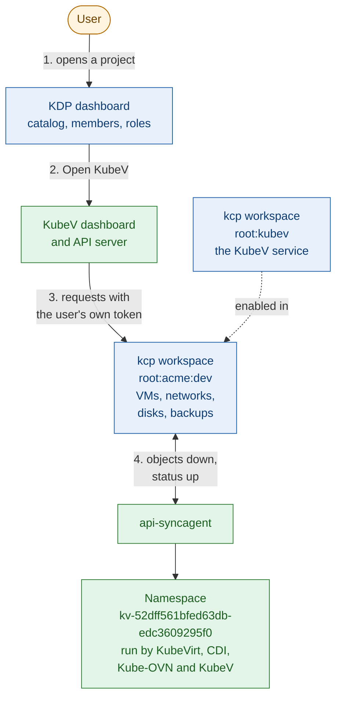
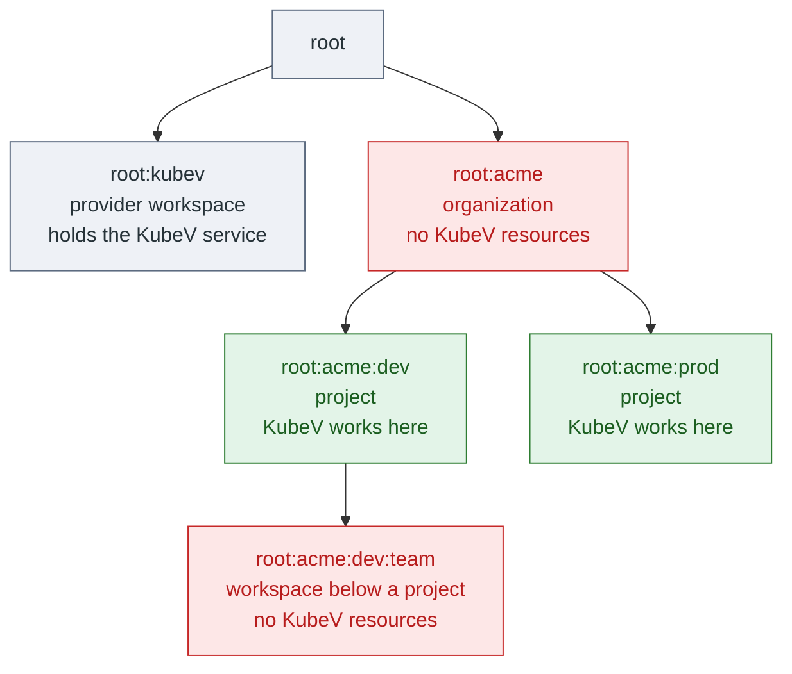
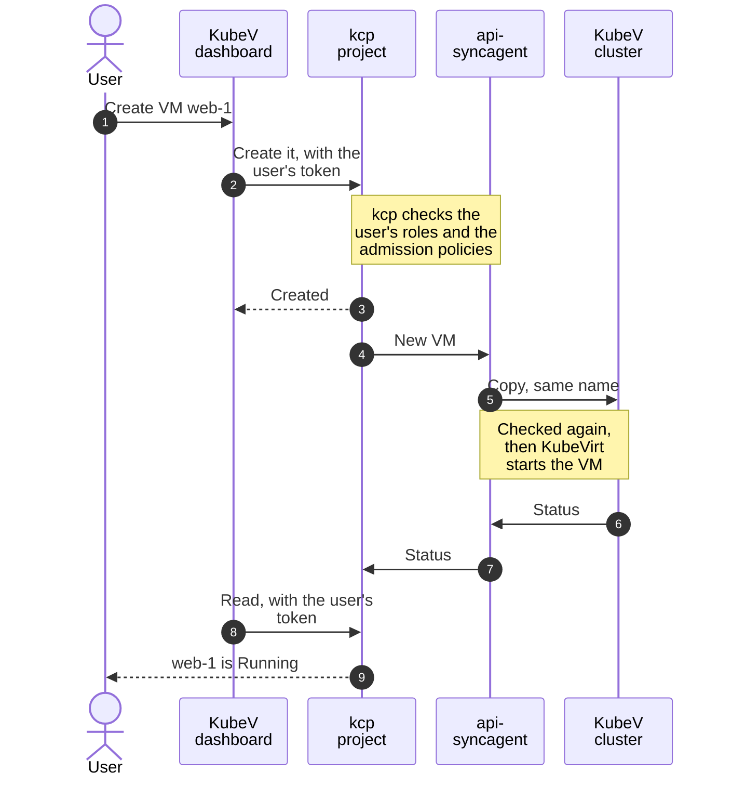
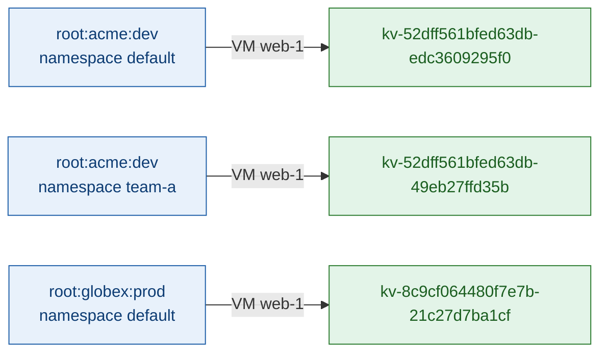
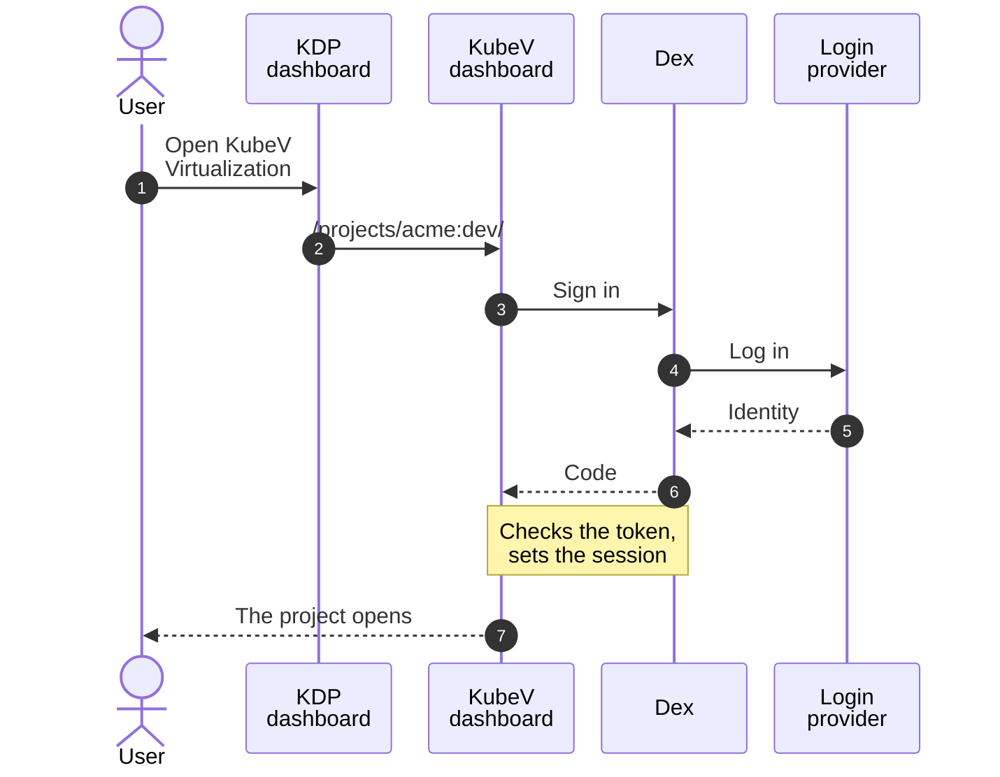
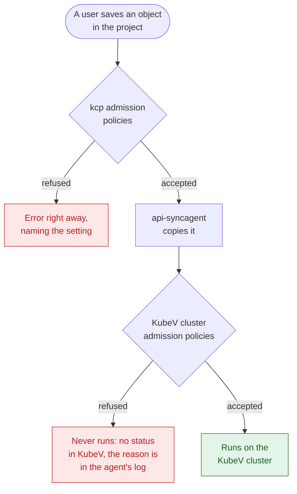

+++
title = "How It Works"
date = 2026-10-12T00:00:00+00:00
weight = 1
+++

This page explains what happens behind the scenes when KubeV runs with KDP: which component
does what, where a project's objects are stored and where they run, how a user signs in, and
which checks keep projects apart. Read it before you install, and come back to it when you
troubleshoot.

## The components

In the diagrams of this section, blue is KDP, green is the KubeV cluster, and orange is outside both.

| Component | Runs in | What it does |
| --- | --- | --- |
| **KDP dashboard** | KDP | Where users start. Organizations, projects, members, roles and the service catalog are all managed here. |
| **kcp** | KDP | The control plane behind KDP. Every organization and every project is a kcp *workspace*, with its own Kubernetes-like API. kcp stores a project's objects and checks every request against the user's roles. |
| **Provider workspace** | kcp, `root:kubev` by default | Holds the KubeV service, `virtualization.k8c.io`, which publishes KubeV's resource types to KDP, and the admission policies that check them. |
| **Project workspace** | kcp, `root:<organization>:<project>` | Holds the project's VMs, networks, disks and backups once KubeV is enabled there. |
| **KubeV dashboard and API server** | KubeV cluster | The KubeV user interface. The API server sends each request to kcp with the user's own token, and serves what kcp can't: VM consoles, and reads of shared objects such as nodes. |
| **api-syncagent** | KubeV cluster | Copies each object from a project to a namespace on the KubeV cluster, and copies its status back. |
| **KubeVirt, CDI, Kube-OVN, Forklift and the KubeV controllers** | KubeV cluster | Run the copies: virtual machines, disks, networks, backups and migrations, exactly as in a standalone installation. |
| **Identity provider** | Anywhere | Dex, or another OIDC provider. KDP, kcp and KubeV sign users in through it. |

KDP stores and authorizes; the KubeV cluster runs. No workload ever runs in KDP.

## Where KubeV works

KDP arranges workspaces in a tree. KubeV works in **projects only**: workspaces exactly one level
below an organization.

{}
**The KDP dashboard is the entry point.** Organizations, projects, members and roles are created
and changed in KDP, never in KubeV. Users open KubeV from a project's page in KDP, and KubeV then
works in that one project.
{}

{}
**Never create KubeV resources in an organization or in a workspace below a project.** The
api-syncagent only copies objects from projects to the KubeV cluster. In an organization, KDP
refuses new KubeV resources, with *The service is not allowed to be used in an organization*. With
your own KDP, that needs KDP's admission webhook, which KDP's chart turns on. In a
workspace nested below a project, kcp accepts them, but they never run, and the reason is only in
the api-syncagent's log. Create VMs, networks and every other KubeV resource in a project.
{}

## What happens when a user creates a VM

1. The KubeV dashboard sends the request to kcp, with the user's own token. The API server adds
   no permissions of its own.
2. kcp checks that the user's roles in the project allow it, and runs the admission policies of
   the KubeV service. A refused request fails at once, with a message that names the setting.
3. kcp stores the VM in the project.
4. The api-syncagent, which watches every project that enabled KubeV, copies the VM to the
   project's namespace on the KubeV cluster.
5. The KubeV cluster checks the copy again, and KubeVirt, CDI and Kube-OVN start the VM.
6. The api-syncagent copies the VM's status back to the project. The dashboard reads it from kcp,
   again with the user's token.

Status, and the Secrets that KubeV creates for a project, such as an SSH key's, flow back to the
project. Make every change in the project, never on the copy: the project's object is the source
of truth, and the api-syncagent applies it to the copy.

## Where the objects run

Each namespace of a project gets its own namespace on the KubeV cluster, its host namespace. The
name is made of two hashes, `kv-<project hash>-<namespace hash>`: the first 16 hex characters of the
SHA3-256 of the project's workspace path, `root:<organization>:<project>`, then the first 12 of the
SHA3-256 of that path followed by `/<namespace>`. Labels on the host namespace name its
organization, project and namespace:

Objects keep their names, so references between them, such as a subnet's VPC or a VM's SSH key,
still work. Two projects can use the same names without touching each other, even projects with the
same name in different organizations. The host namespaces of one project all start with the same
`kv-<project hash>-`, which is how the platform keeps a VM's networks inside its project. To find
the host namespaces of a project, see
[Finding a project's objects]().

### Projects KubeV can use

The length of a host namespace's name doesn't depend on the names in KDP, so KubeV can use every
project, whatever its organization, project and namespaces are called. It only needs the workspace
to be a project, exactly `root:<organization>:<project>`: see
[Where KubeV works](#where-kubev-works).

## How users sign in

KDP and KubeV use the same OIDC client, so kcp accepts the token KubeV gets for the user. The link
behind KDP's **Open KubeV Virtualization** button carries no credential: it names the project, and
marks the page as opened from KDP, so KubeV signs in again on every click and always runs as the
user who clicked. Every request then reaches kcp with that user's own identity.

## What keeps projects apart

Every object from a project is checked twice: by kcp when it is saved, and by the KubeV cluster
before it runs.

The checks keep a project's VMs on its own networks and away from the platform's nodes and internal
services. A project can't:

- attach a VM to a network outside the project, or to the platform's pod network;
- set annotations that pick networks, sidecars or security profiles for the VM's pod, except
  Kube-OVN settings that name the project's own networks, subnets and security groups;
- mount a service account token into a VM;
- choose nodes: node selectors, tolerations, affinity, another scheduler, a `system-*` priority
  class, or a probe that names a host;
- import a disk, or reach a backup target, at an address inside the platform: `localhost`, names
  ending in `.svc` or `.cluster.local`, names without a dot, and loopback and link-local addresses;
- clone a disk from another namespace, or use a VDDK image of its own;
- migrate VMs from anything but vSphere, or into another namespace, or with hooks, custom
  conversion images, transfer networks, copy offload or service accounts.

Most of these checks run in kcp, so users get a clear error when they save. A few need to know the
KubeV cluster, such as whether a network belongs to the project, and run there only. An object
refused there stays in the project but never runs: KubeV shows no status for it, kcp shows at most a
generic warning event, and the reason is in the api-syncagent's log on the KubeV cluster.

{}
These checks block the obvious ways out of a project, but they can't tell every internal address
from an external one. A private IP of a node, or a name that cluster DNS resolves, such as
`kubernetes.default`, passes them. Platform administrators add network policies as a second line;
see [Network hardening]().
{}
