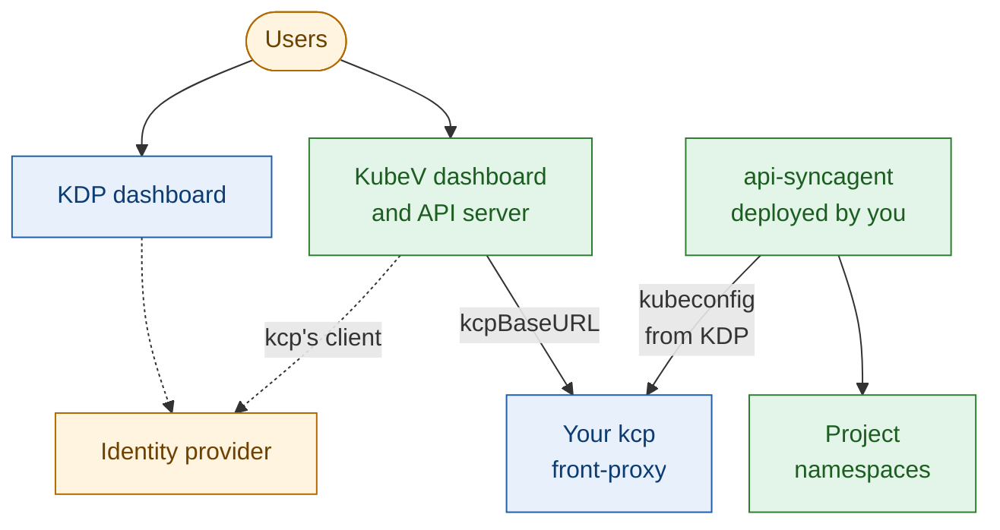
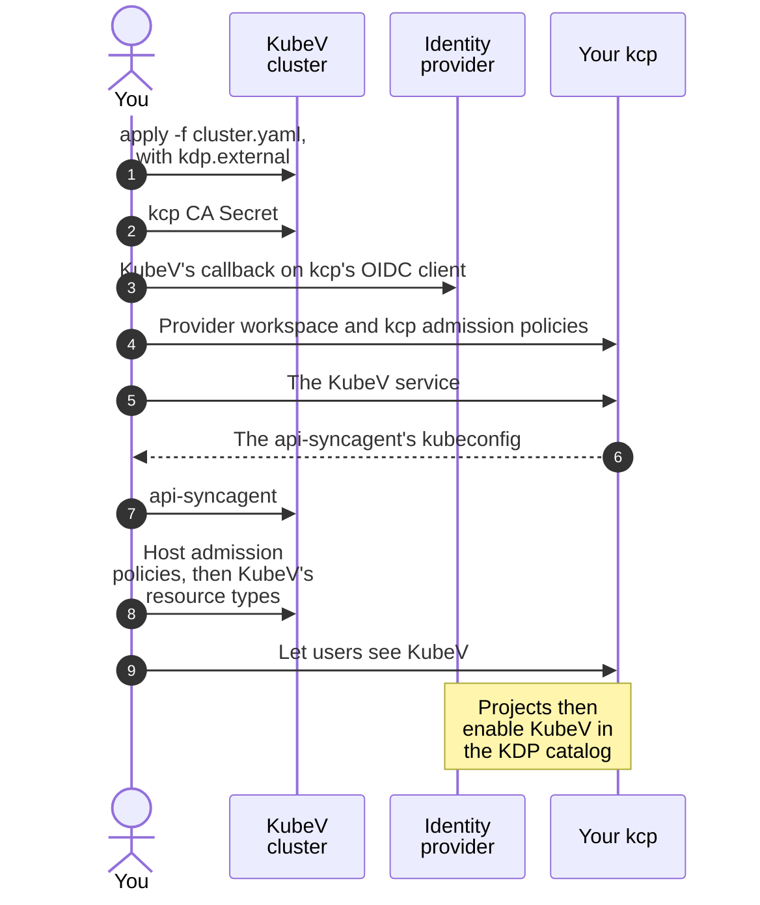

+++
title = "Bring Your Own KDP"
date = 2026-10-12T00:00:00+00:00
weight = 1
+++

In this mode, KubeV joins a KDP you already run, configured with `kdp.external`. The installer
sets up the KubeV dashboard and API server to work with your KDP, but changes nothing on the KDP
side: you register the KubeV service in KDP, and run the api-syncagent that connects it to the
KubeV cluster, yourself.



## The flow

These are the steps of this guide, and where each one happens:



The order matters in two places. The kcp admission policies go in before the KubeV service is
used, and the host admission policies before the resource types are published: otherwise a
project could create an object that nothing has checked yet.

## Before you start

| What | Why |
| --- | --- |
| **KDP 1.2.1 or newer** | Both the `developer-platform` and the `developer-platform-dashboard` charts. Older releases don't show the button that opens KubeV. |
| **Administrator access to your kcp** | To create the provider workspace, the KDP service and the RBAC that lets users bind it. Install the [kcp kubectl plugins](/developer-platform/v1.2/tutorials/kcp-command-line/) for `kubectl ws`. |
| **Access to the OIDC client kcp trusts** | kcp accepts tokens issued to one OIDC client only. KubeV must sign users in with that same client, so you need its ID and secret, and you must add KubeV's callback to it. |
| **Network access from the KubeV cluster to kcp** | The KubeV API server and the api-syncagent both connect to kcp's front-proxy. |
| **The KubeV KDP manifests** | The admission policies, the api-syncagent RBAC and the PublishedResources for your KubeV version. Get them from Kubermatic for the release you install. |

## Step 1: Configure and install KubeV

Point the dashboard at the OIDC provider your KDP uses, and add a `kdp` section with an
`external` block:

```yaml
dashboard:
  enabled: true
  dashboardURL: "https://kubev.example.com"
  auth:
    oidc:
      issuerURL: "https://dex.example.com"   # the issuer your kcp trusts
      clientID: "kdp-dashboard"              # the client ID kcp accepts
      clientSecret: "<that client's secret>"
      redirectURL: "https://kubev.example.com/auth/callback"
      scopes: ["openid", "email", "profile", "groups"]

kdp:
  enabled: true
  providerWorkspace: "root:kubev"
  external:
    kcpBaseURL: "https://kcp.example.com:8443"
    caSecretName: "kubev-kcp-ca"
  tenantUnderlayInterfaces:
    - "ens[0-9]*"
```

| Field | Required | Default | Description |
| --- | --- | --- | --- |
| `external.kcpBaseURL` | Yes, unless `domains.kcp` or `domains.base` is set | — | The address of kcp's front-proxy, as the KubeV API server reaches it from the KubeV cluster. Must be `https`, without a trailing slash or a `/clusters/...` path. |
| `external.caSecretName` | Yes | — | Secret in the `kubermatic-virtualization` namespace with the CA that signs kcp's certificate, under the key `ca.crt`. |
| `providerWorkspace` | No | `root:kubev` | The workspace where you register the KubeV service in [Step 3](#step-3-register-the-kubev-service). |
| `tenantUnderlayInterfaces` | No | empty | Host network interfaces that projects may use for underlay subnets. See [Underlay networks for projects](). |

`admin` and `adminGroup` are ignored in external mode: platform administrators are whoever
administers your KDP.

Run the installer, then create the CA Secret on the KubeV cluster. The KubeV API server can't
reach kcp until the Secret exists, and picks it up within about a minute once it does, without a
restart. Create it also when kcp has a publicly trusted certificate: put the public root CA that
signs it in `ca.crt`.

```bash
export KUBEV_USERNAME=<your-username>
export KUBEV_PASSWORD=<your-password>
kubermatic-virtualization apply -f cluster.yaml
kubectl -n kubermatic-virtualization create secret generic kubev-kcp-ca --from-file=ca.crt=kcp-ca.pem
```

At the end, the installer lists the remaining steps, and prints the exact link for the KubeV
service and the OIDC client entry for your installation. They are the steps below.

## Step 2: Add KubeV to the OIDC client

Add KubeV's callback to the redirect URIs of the client kcp trusts, next to the KDP
dashboard's own. In Dex:

```yaml
staticClients:
  - id: kdp-dashboard
    name: KDP Dashboard
    secret: "<that client's secret>"
    redirectURIs:
      - https://kdp.example.com/api/auth/callback/oidc   # already there: the KDP dashboard
      - https://kubev.example.com/auth/callback          # add: dashboard.auth.oidc.redirectURL
oauth2:
  skipApprovalScreen: true
```

`skipApprovalScreen` stops Dex from asking users to approve KubeV each time they open it from
KDP.

## Step 3: Register the KubeV service

Run these steps with a kcp administrator's kubeconfig.

The provider workspace is a KDP organization that holds the KubeV service, `root:kubev` in
this guide. Create it in the KDP dashboard like any other organization, or with `kubectl`,
then change into it. Organizations serve KDP's `Service` resource:

```bash
kubectl ws :root
kubectl ws create kubev --type=root:kdp-organization
kubectl ws :root:kubev
kubectl api-resources --api-group=core.kdp.k8c.io   # must list "services"
```

Apply the kcp side of KubeV's admission policies in the provider workspace. kcp then refuses
objects that would break out of their project when they are written, with a clear message,
instead of letting them hang. Apply them **only** in kcp, never on the KubeV cluster:

```bash
kubectl apply -f kcp-admission-kubevirt.yaml
kubectl apply -f kcp-admission-forklift.yaml
```

Register the service. Set the link to your `dashboard.dashboardURL` followed by
`/projects/{{project}}/`. KDP fills in the project, and shows a button labelled
**Open** followed by the service's title:

```yaml
apiVersion: core.kdp.k8c.io/v1alpha1
kind: Service
metadata:
  name: virtualization.k8c.io
  annotations:
    catalog.kdp.k8c.io/external-link-url: "https://kubev.example.com/projects/{{project}}/"
spec:
  apiGroup: virtualization.k8c.io
  catalogMetadata:
    title: "KubeV Virtualization"
    shortDescription: "SSH keys, networking and virtual machines by KubeV"
    description: "Provision KubeV virtualization resources from a KDP workspace."
    category: "Infrastructure"
  kubeconfig:
    name: virtualization-servlet-kubeconfig
    namespace: default
```

{}
Keep the name and `apiGroup` `virtualization.k8c.io`: the KubeV dashboard, the
PublishedResources and the admission policies all expect it. If you apply the Service with
Helm, escape the braces in the link: `{{ "{{project}}" }}`.
{}

KDP creates the `virtualization.k8c.io` APIExport and writes a kubeconfig for the
api-syncagent into the Secret named in `spec.kubeconfig`. Save it:

```bash
kubectl apply -f service.yaml
kubectl -n default get secret virtualization-servlet-kubeconfig \
  -o jsonpath='{.data.kubeconfig}' | base64 -d > servlet-kubeconfig.yaml
```

## Step 4: Deploy the api-syncagent

On the KubeV cluster, create the agent's namespace, its kcp kubeconfig, its ServiceAccount
and its permissions. `rbac-syncagent.yaml` holds the agent's ClusterRole: every resource type
KubeV publishes, and the Secrets, ConfigMaps and namespaces that travel with them.

```bash
kubectl create namespace kubev-syncagent
kubectl -n kubev-syncagent create secret generic kcp-kubeconfig \
  --from-file=kubeconfig=servlet-kubeconfig.yaml
kubectl -n kubev-syncagent create serviceaccount kubev-syncagent
kubectl apply -f rbac-syncagent.yaml
kubectl create clusterrolebinding kubev-syncagent:resources \
  --clusterrole=kubev-syncagent:resources \
  --serviceaccount=kubev-syncagent:kubev-syncagent
kubectl apply -f crd-syncagent.yaml
kubectl wait --for=condition=Established crd/publishedresources.syncagent.kcp.io
```

Then deploy the agent:

```yaml
apiVersion: apps/v1
kind: Deployment
metadata:
  name: kubev-api-syncagent
  namespace: kubev-syncagent
  labels: { app.kubernetes.io/name: api-syncagent, app.kubernetes.io/instance: kubev }
spec:
  replicas: 1
  selector:
    matchLabels: { app.kubernetes.io/name: api-syncagent, app.kubernetes.io/instance: kubev }
  template:
    metadata:
      labels: { app.kubernetes.io/name: api-syncagent, app.kubernetes.io/instance: kubev }
    spec:
      serviceAccountName: kubev-syncagent
      containers:
        - name: api-syncagent
          image: ghcr.io/kcp-dev/api-syncagent:v0.7.0
          args:
            - --agent-name=kubev
            - --namespace=kubev-syncagent
            - --kcp-kubeconfig=/kcp/kubeconfig
            - --apiexportendpointslice-ref=virtualization.k8c.io
            - --published-resource-selector=kdp.k8c.io/syncagent=kubev
          volumeMounts:
            - { name: kcp-kubeconfig, mountPath: /kcp, readOnly: true }
      volumes:
        - name: kcp-kubeconfig
          secret: { secretName: kcp-kubeconfig }
```

Use api-syncagent v0.7.0: KubeV's PublishedResources need it.

## Step 5: Publish KubeV's resources

Apply the remaining manifests on the KubeV cluster, **in this order**. Each admission policy
goes first, so that no object from a project reaches the cluster before the policy that
guards it:

```bash
kubectl apply -f admission-kubevirt.yaml
kubectl apply -f publishedresources-virtualization.yaml
kubectl apply -f publishedresources-kubevirt.yaml
kubectl apply -f admission-forklift.yaml
kubectl apply -f publishedresources-forklift.yaml
```

The agent turns each PublishedResource into a resource type of the APIExport. Check that all
of them made it. This prints nothing when they did:

```bash
kubectl get publishedresources.syncagent.kcp.io -o json \
  | jq -r '.items[] | select(.status.resourceSchemaName == null) | .metadata.name'
```

## Step 6: Let users see KubeV

KDP lists a service in its catalog, and shows its button, to users who may **bind** its
APIExport, and in projects where the service is already enabled. Users also need `bind` to
enable KubeV in a project. In the provider workspace, grant it to the users who should get
KubeV, for example every signed-in user:

```yaml
apiVersion: rbac.authorization.k8s.io/v1
kind: ClusterRole
metadata:
  name: kubev:virtualization:binder
rules:
  - apiGroups: ["apis.kcp.io"]
    resources: ["apiexports"]
    resourceNames: ["virtualization.k8c.io"]
    verbs: ["get", "bind"]
---
apiVersion: rbac.authorization.k8s.io/v1
kind: ClusterRoleBinding
metadata:
  name: kubev:virtualization:consumers
roleRef:
  apiGroup: rbac.authorization.k8s.io
  kind: ClusterRole
  name: kubev:virtualization:binder
subjects:
  - apiGroup: rbac.authorization.k8s.io
    kind: Group
    name: system:authenticated
```

This only makes KubeV visible and lets users enable it. What they can do in a project still
depends on their roles there; see [Access Control](). To offer
KubeV to fewer people, bind the role to an OIDC group instead, written `oidc:<group>`.

### If new organizations and projects take minutes to become ready

kcp makes a new organization or project ready only once it has checked that its creator may bind
KDP's own core API, and retries for several minutes when nobody may. If your KDP shows that delay,
let every signed-in user bind it. Apply this in `root`:

```yaml
apiVersion: rbac.authorization.k8s.io/v1
kind: ClusterRole
metadata:
  name: kubev:kdp-core-binder
  annotations:
    internal.kcp.io/replicate: apis.kcp.io
rules:
  - apiGroups: ["apis.kcp.io"]
    resources: ["apiexports"]
    resourceNames: ["core.kdp.k8c.io"]
    verbs: ["bind"]
---
apiVersion: rbac.authorization.k8s.io/v1
kind: ClusterRoleBinding
metadata:
  name: kubev:kdp-core-binder
  annotations:
    internal.kcp.io/replicate: apis.kcp.io
roleRef:
  apiGroup: rbac.authorization.k8s.io
  kind: ClusterRole
  name: kubev:kdp-core-binder
subjects:
  - apiGroup: rbac.authorization.k8s.io
    kind: Group
    name: system:authenticated
```

## Step 7: Enable KubeV in projects

{}
**Enable KubeV in projects only.** KDP also lets you add a service to an organization, or to a
workspace below a project. Don't do that for KubeV: objects created there are accepted by kcp but
never run. See [Where KubeV works]().
{}

In this mode, KubeV is enabled per project in KDP, the same way as any other service. See
[Enabling a service](/developer-platform/v1.2/platform-users/consuming-services/#enabling-a-service)
in the KDP documentation. In the wizard:

- keep **Create default roles for resources managed by this service** selected, so that
  KDP's Developer and Member roles cover KubeV;
- grant **every resource** listed under **Resources**. KubeV needs each of them to copy
  Secrets, ConfigMaps, events and namespaces between the project and the KubeV cluster.

KubeV only works in projects whose names it can use: see
[Names KubeV can use]().

## Upgrading KubeV

When you upgrade KubeV, get the manifests for the new release and repeat
[Step 3](#step-3-register-the-kubev-service) for the kcp admission policies and
[Step 5](#step-5-publish-kubevs-resources) for the rest, in the same order. Apply
`rbac-syncagent.yaml` before the PublishedResources.

`kubectl apply` never deletes a PublishedResource that a release dropped. Delete those
yourself, then restart the agent:

```bash
kubectl get publishedresources.syncagent.kcp.io -l kdp.k8c.io/syncagent=kubev
kubectl delete publishedresources.syncagent.kcp.io <dropped-name>
kubectl -n kubev-syncagent rollout restart deployment kubev-api-syncagent
```

A leftover PublishedResource is not harmless: once its permissions are gone, the agent's
controllers fail to start.
