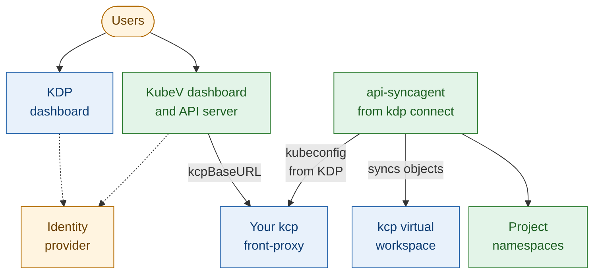
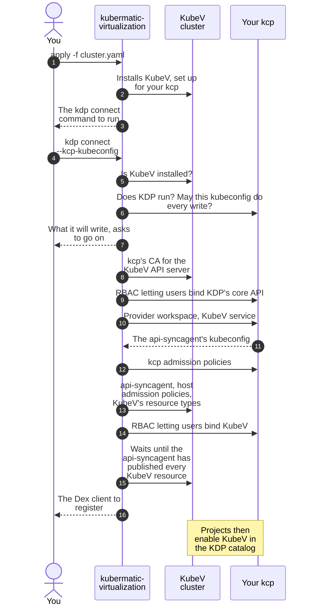

+++
title = "Bring Your Own KDP"
date = 2026-10-12T00:00:00+00:00
weight = 1
+++

In this mode, KubeV joins a KDP you already run, configured with `kdp.external`. Two commands set
it up:

1. `kubermatic-virtualization apply` installs KubeV and points its dashboard and API server at your
   kcp. It installs nothing on your KDP.
2. `kubermatic-virtualization kdp connect` registers KubeV in your KDP, with the kubeconfig of a kcp
   administrator, and connects it to the KubeV cluster.

Your identity provider is the only thing left to change by hand: `kdp connect` prints the client
KubeV needs there.



The api-syncagent runs on the KubeV cluster and talks to your kcp at two addresses: the front-proxy,
with the kubeconfig KDP issues for the KubeV service, and kcp's virtual workspace, through which it
syncs every object.

## How `kdp connect` helps

Registering KubeV in KDP takes dozens of objects in two places, in kcp and on the KubeV cluster,
and some of them must be applied in a set order. `kdp connect` does all of it in one run:

| | By hand | With `kdp connect` |
| --- | --- | --- |
| **Rights** | You find out what is missing when a step fails halfway. | It checks every right it needs in kcp before it writes anything, and lists each one that is missing, with its workspace. |
| **What changes** | You read the manifests to know. | It shows what it will write, and where, and asks before it goes on. |
| **Order** | The admission policies must go in before the resource types are published, or a project could create objects nothing has checked yet. You keep track of that. | It applies everything in the right order. |
| **The api-syncagent's credentials** | You wait for KDP to issue them, copy them out of kcp and into a Secret on the KubeV cluster. | It waits for them and installs them. |
| **kcp's CA** | You work out which CA signs kcp's certificate, and create the Secret the KubeV API server needs. | It fills the Secret from the kcp kubeconfig, after checking, where it can reach kcp, that the CA verifies kcp. |
| **Checking that it works** | You look at the agent's log and at the APIExport. | It waits until the agent has published every KubeV resource type in kcp, which proves the agent reaches kcp. |
| **Upgrades** | You apply the new manifests in the same order, and delete the resource types a release dropped. | You run it again. It brings everything to the new version, deletes the resource types a release dropped, and restarts the agent only when the agent or something it uses changed. |

`kdp connect` is safe to run again at any time: a second run changes only what differs.

## The flow



## Before you start

| What | Why |
| --- | --- |
| **KDP 1.2.1 or newer** | Both the `developer-platform` and the `developer-platform-dashboard` charts. Older releases don't show the button that opens KubeV. |
| **The kubeconfig of a kcp administrator** | `kdp connect` writes in kcp's `root` workspace and in the provider workspace. [Rights `kdp connect` checks](#rights-kdp-connect-checks) lists what it needs, and [Get a kcp administrator's kubeconfig](#get-a-kcp-administrators-kubeconfig) how to get one. Exec plugins such as `kubectl oidc-login`, tokens and client certificates all work, as in `kubectl`. |
| **One identity provider for kcp, KDP and KubeV** | kcp accepts tokens issued to its own OIDC client only, so KubeV must sign users in with that same client. You need its ID and secret, and you must be able to add KubeV's callback to it. |
| **Network paths from the KubeV cluster** | The KubeV API server must reach kcp's front-proxy at `kdp.external.kcpBaseURL`, and your identity provider. The api-syncagent must reach your KDP's front-proxy URL, which the kubeconfig KDP issues names, and kcp's virtual workspace address, kcp's `--shard-virtual-workspace-url`, which must accept the client certificate KDP issues. |
| **Network paths from where you run `kdp connect`** | To kcp, at the address in the kcp kubeconfig, and to the KubeV cluster's API server. When `kdp.external.kcpBaseURL` is another address, `kdp connect` also tries to reach it, to check kcp's certificate there; see [kcp's CA](#kcps-ca). |

To see the virtual workspace address your kcp advertises, list the endpoints of KDP's own APIExports
in `root`:

```bash
kubectl --kubeconfig kcp-admin.kubeconfig get apiexportendpointslices \
  -o jsonpath='{.items[*].status.endpoints[*].url}'
```

Each address must be one the KubeV cluster reaches, such as
`https://kcp.example.com:8443/services/apiexport/...` on the front-proxy, not a name inside the KDP
cluster such as `https://kcp:6443/...`.

{}
**Don't use a `system:masters` identity for the first run.** kcp records no creator for a workspace
that a member of `system:masters` creates, and KDP then never finishes setting up the provider
workspace. `kdp connect` refuses to create it as such a user, and also when kcp can't say who the
kubeconfig signs in as. A client certificate with the organization `system:masters`, as used for
direct access to a kcp shard, is one. Use another administrator, or have one create the provider
workspace, type `kdp-organization`, first. Later runs may use a `system:masters` kubeconfig.
{}

{}
**The kcp kubeconfig must verify kcp's certificate.** `kdp connect` refuses a kubeconfig with
`insecure-skip-tls-verify`, because it installs the kubeconfig KDP hands back on the KubeV cluster,
and stores kcp's CA for the KubeV API server. Add kcp's CA to the kubeconfig instead.
{}

### Get a kcp administrator's kubeconfig

Any administrator of `root` can run the first `kdp connect`, through OIDC or a client certificate:
your own OIDC user, if your KDP binds it to `cluster-admin` in `root`, or a client certificate in
the group `system:kcp:admin`, which kcp lets administer every workspace. kcp records such a user as
the creator of the provider workspace: it skips only `system:masters`.

On a KDP installed with the kcp Helm chart, cert-manager issues such a certificate from the
front-proxy's client issuer, in the namespace kcp runs in:

```yaml
apiVersion: cert-manager.io/v1
kind: Certificate
metadata:
  name: kubev-connect
  namespace: <kcp namespace>
spec:
  secretName: kubev-connect
  commonName: kubev-connect
  subject:
    organizations: ["system:kcp:admin"]
  usages: ["client auth"]
  duration: 24h
  issuerRef:
    name: kcp-front-proxy-client-issuer
    kind: Issuer
```

Build the kubeconfig from its Secret, with the front-proxy's address and the CA that signs the
front-proxy's certificate, which the chart keeps in the Secret `kcp-ca`, as `tls.crt` and `ca.crt`:

```yaml
apiVersion: v1
kind: Config
clusters:
  - name: kcp
    cluster:
      server: https://kcp.example.com:8443/clusters/root
      certificate-authority-data: <base64 of kcp-ca's tls.crt followed by its ca.crt>
users:
  - name: kcp-admin
    user:
      client-certificate-data: <base64 of kubev-connect's tls.crt>
      client-key-data: <base64 of kubev-connect's tls.key>
contexts:
  - name: kcp-admin
    context: {cluster: kcp, user: kcp-admin}
current-context: kcp-admin
```

Delete the Certificate and its Secret once `kdp connect` is done, and issue a new one for the next
run. The kubeconfig in the chart's Secret `kcp-external-admin-kubeconfig` doesn't do: its user can
only read `root`, and `kdp connect` lists the rights it lacks.

## Step 1: Configure KubeV for your KDP

Add the dashboard's sign-in and a `kdp` section with an `external` block to your KubeV
configuration:

```yaml
dashboard:
  enabled: true
  dashboardURL: "https://kubev.example.com"      # where users open KubeV; KDP links here
  auth:
    oidc:
      issuerURL: "https://dex.example.com"        # the issuer your kcp trusts
      clientID: "kdp-kubelogin"                   # the client ID kcp accepts
      clientSecret: "<that client's secret>"
      redirectURL: "https://kubev.example.com/auth/callback"
      scopes: ["openid", "email", "profile", "groups"]

kdp:
  enabled: true
  providerWorkspace: "root:kubev"                 # created by kdp connect if missing
  external:
    kcpBaseURL: "https://kcp.example.com:8443"    # kcp's front-proxy, no /clusters path
  tenantUnderlayInterfaces:
    - "ens[0-9]*"
```

| Field | Required | Default | Description |
| --- | --- | --- | --- |
| `external.kcpBaseURL` | Yes, unless `domains.kcp` or `domains.base` is set | — | The address of kcp's front-proxy, as the KubeV API server reaches it from the KubeV cluster. Must be `https`, without a trailing slash or a `/clusters/...` path. |
| `providerWorkspace` | No | `root:kubev` | The workspace that holds the KubeV service, written `root:<name>`, directly below `root`. `kdp connect` creates it if it is missing. Pick a name no one uses yet: an existing organization of that name becomes the provider workspace. |
| `admin` / `adminGroup` | No | — | Makes `kdp connect` grant this user or OIDC group what the installer grants the platform administrators of a KDP it installs: creating organizations and projects in `root`, and ownership of the provider workspace. When both are set, only the group is granted. `kdp connect` grants them as `oidc:<value>`, so your kcp must use the `oidc:` prefix for OIDC users and groups. Your KDP has administrators of its own, so you can leave both out. |
| `external.caSecretName` | No | — | A Secret you create and keep up to date in the `kubermatic-virtualization` namespace, with the CA that signs kcp's certificate under the key `ca.crt`, or an empty `ca.crt` for a publicly trusted certificate. Leave it out, and `kdp connect` fills one for you; see [kcp's CA](#kcps-ca). |
| `tenantUnderlayInterfaces` | No | empty | Host network interfaces that projects may use for underlay subnets. See [Underlay networks for projects](). |

## Step 2: Install KubeV

```bash
kubermatic-virtualization apply -f cluster.yaml
```

In this mode, `apply` installs KubeV and sets its dashboard and API server up for your kcp, and changes
nothing on your KDP. At the end, it prints the `kdp connect` command to run next. It writes the KubeV
cluster's kubeconfig, `kubev-cluster-kubeconfig`, to the directory it runs in: `kdp connect` uses it.

Until you run `kdp connect`, the KubeV dashboard opens but answers 502 for every project: its API
server has no kcp CA yet. Without `external.caSecretName`, `apply` warns about it too.

`kdp connect` reaches the KubeV cluster at the address in `kubev-cluster-kubeconfig`,
`apiEndpoint.host`. To run it from another machine, or through a tunnel or a port-forward, that
address must work from there and be in the API server's certificate: list it in
`apiEndpoint.alternativeNames` before you run `apply`, for example `127.0.0.1` and `localhost` for a
port-forward, and point the kubeconfig's `server` at it.

## Step 3: Connect KubeV to KDP

From the same directory, run `kdp connect` with the kcp administrator's kubeconfig:

```bash
kubermatic-virtualization kdp connect -f cluster.yaml --kcp-kubeconfig kcp-admin.kubeconfig
```

| Flag | Meaning |
| --- | --- |
| `-f`, `--file` | The configuration `apply` used. Required. |
| `--kcp-kubeconfig` | The kubeconfig of a kcp administrator of your KDP. Required. |
| `--kcp-context` | The context of that kubeconfig to use. Default: its current context. |
| `--kubeconfig` | The KubeV cluster's kubeconfig. Default: `kubev-cluster-kubeconfig` in the current directory. `kdp connect` never falls back to `KUBECONFIG` or `~/.kube/config`, so it can't write to another cluster by mistake. |
| `--forward-connector` | Makes KDP's link to KubeV name the login method the user signed in to KDP with, so Dex skips its chooser. See [Skip Dex's chooser](#skip-dexs-chooser). |
| `-y`, `--auto-approve` | Skips the confirmation prompt. Needed when `kdp connect` runs without a terminal, for example in a pipeline. |
| `-v`, `--verbose`, `--log-format` | More output, and `text` or `json` logs, as for `apply`. |

`kdp connect` works in this order, and stops at the first problem:

1. **It checks.** KubeV must be installed on the KubeV cluster, the kcp the kubeconfig reaches must run
   KDP, and the kubeconfig must be allowed every write that follows in kcp. kcp answers these
   questions itself, through access reviews. A missing right is named, with its workspace:

   ```text
   Error: the kcp kubeconfig (user "oidc:jane@example.com") may not do everything kdp connect does in kcp; use the kubeconfig of a kcp admin. Missing:
     - create workspaces.tenancy.kcp.io in workspace root
     - use workspacetypes.tenancy.kcp.io kdp-organization in workspace root
   ```

2. **It shows what it will write, and asks.** The output includes lines like:

   ```text
   kdp connect will register KubeV in the KDP at https://kcp.example.com:8443 as <kcp user>:
     in kcp, workspace root:kubev (created if missing): the KDP Service virtualization.k8c.io, the KubeV admission policies, and RBAC letting every signed-in user bind it
     in kcp, workspace root: RBAC letting every signed-in user bind KDP's core export, so new organizations and projects are ready at once
     on the KubeV cluster at https://203.0.113.10:6443: the api-syncagent in namespace kubev-syncagent, its RBAC, the KubeV admission policies and the PublishedResources
     on the KubeV cluster: the kcp CA for the api-server, in Secret kubermatic-virtualization/kubev-kcp-front-proxy-ca, unless you wrote that Secret yourself
   ```

3. **It writes** everything in [What `kdp connect` writes](#what-kdp-connect-writes), in this order:
   kcp's CA for the KubeV API server; the RBAC in `root` that lets every signed-in user bind KDP's
   core API, before the provider workspace exists, so that kcp can finish setting it up; the provider
   workspace and the KubeV service; then, once KDP has issued the api-syncagent's kubeconfig, the kcp
   admission policies and everything on the KubeV cluster; and last, the RBAC that lets users bind
   KubeV. Waiting for KDP can take several minutes on the first run, while kcp sets up the provider
   workspace.
4. **It waits** until the api-syncagent runs and has published every KubeV resource type in kcp, for
   up to five minutes. You stop it with Ctrl-C at any point: running it again finishes the job.

   ```text
   Waiting for the api-syncagent to publish the KubeV resources in kcp...
   ✓ The api-syncagent published every KubeV resource in root:kubev
   ```

5. **It prints** the client KubeV needs on your Dex, for [Step 4](#step-4-register-kubev-on-your-dex),
   and what to do next.

It also warns when your KDP's front-proxy URL, or kcp's virtual workspace address, looks like an
address inside the KDP cluster, which the api-syncagent on the KubeV cluster can't reach.

### What `kdp connect` writes

| Where | Object | Why |
| --- | --- | --- |
| kcp, `root` | Workspace `kubev`, from `kdp.providerWorkspace`, type `kdp-organization`, if it is missing | The provider workspace, which holds the KubeV service. |
| kcp, `root` | ClusterRole and ClusterRoleBinding `kubev:kdp-core-binder` | Let every signed-in user bind KDP's own core API. Without them, a new organization or project can take minutes to become ready. |
| kcp, provider workspace | KDP Service `virtualization.k8c.io` | Makes KDP create the KubeV APIExport and issue the api-syncagent's kubeconfig. It carries KDP's link to KubeV, and keeps KubeV out of organizations. |
| kcp, provider workspace | ValidatingAdmissionPolicies `kubev-kcp-kubevirt` and `kubev-kcp-forklift`, with their bindings | kcp refuses, when it is saved, an object the KubeV cluster would refuse later. |
| kcp, provider workspace | ClusterRole `kubev:virtualization:binder`, ClusterRoleBinding `kubev:virtualization:consumers` | Let every signed-in user bind the KubeV service, so KDP lists it in its catalog. What users may do in a project is still decided by their roles there. |
| kcp, `root` and provider workspace | `kubev:tenancy:workspaces-manager`, `kubev:tenancy:project-type-user`, `kubev:provider-owner`, binding `kubev:virtualization:binder` | Only with `kdp.admin` or `kdp.adminGroup`: the platform administrators' grants. |
| KubeV cluster | Namespace `kubev-syncagent`, with the Deployment `kubev-api-syncagent`, its ServiceAccount, and the Secret `kcp-kubeconfig` holding the kubeconfig KDP issued | The api-syncagent, which copies projects' objects to the KubeV cluster and their status back. |
| KubeV cluster | ClusterRole and ClusterRoleBinding `kubev-syncagent:resources`, CRD `publishedresources.syncagent.kcp.io` | The api-syncagent's rights, and the API that tells it what to publish. |
| KubeV cluster | ValidatingAdmissionPolicies `kubev-kdp-kubevirt` and, with `migration.enabled`, `kubev-kdp-forklift`, with their bindings | Keep every object from a project inside the project. Each is applied before the resource types it checks are published. |
| KubeV cluster | One PublishedResource for each KubeV resource type whose CRD is installed | What KubeV offers in KDP. The migration types only when `migration.enabled` is on. |
| KubeV cluster | Secret `kubermatic-virtualization/kubev-kcp-front-proxy-ca` | The CA the KubeV API server verifies kcp with, unless you name your own. |

### kcp's CA

The KubeV API server verifies kcp's certificate with the CA in a Secret in its own namespace, and
can't reach kcp at all while that Secret is missing. An empty `ca.crt` means the publicly trusted
CAs. The API server reads the Secret again when it changes, without a restart.

- **With `external.caSecretName`**, the Secret is yours: `kdp connect` never writes it, and warns while
  it is missing.
- **A `kubev-kcp-front-proxy-ca` Secret you created yourself** is left as it is too.
- **Otherwise**, `kdp connect` fills `kubev-kcp-front-proxy-ca` from the kcp kubeconfig:
  - when the kubeconfig names the same address as `kdp.external.kcpBaseURL`, with the kubeconfig's
    CA, or an empty one when the kubeconfig names none;
  - when it names another address, such as a kcp shard, with the kubeconfig's CA if kcp's certificate
    at `kdp.external.kcpBaseURL` verifies with it, or an empty one if the publicly trusted CAs verify
    it. If neither does, it stores nothing and asks you to name your own Secret;
  - when it can't reach `kdp.external.kcpBaseURL` from where it runs, it keeps a CA it stored earlier.
    With none stored yet, it stores the kubeconfig's CA, unchecked, and warns.

### Rights `kdp connect` checks

`kdp connect` asks kcp whether the kubeconfig may do each of these, and lists every one it may not:

| Workspace | Rights |
| --- | --- |
| `root` | `get` workspaces; `create` workspaces and `use` the `kdp-organization` workspace type when the provider workspace is missing, `update` workspaces when it exists; `get`, `create` and `update` ClusterRoles and ClusterRoleBindings; `escalate` and `bind` ClusterRoles |
| Provider workspace, when it exists | `get`, `create` and `update` KDP Services, ValidatingAdmissionPolicies, ValidatingAdmissionPolicyBindings, ClusterRoles and ClusterRoleBindings; `escalate` and `bind` ClusterRoles; `get` Secrets in `default` and APIExportEndpointSlices |

kcp keeps RBAC per workspace: `cluster-admin` in `root` covers `root` only. When `kdp connect` creates
the provider workspace, kcp makes the kubeconfig's user its administrator, which covers the second
row. Later, the provider workspace's administrators are whoever created it, `kdp.admin` or
`kdp.adminGroup` once `kdp connect` has run, and anyone granted `cluster-admin` there.

## Step 4: Register KubeV on your Dex

Your Dex knows nothing of KubeV yet. Add KubeV's callback to the client kcp trusts, next to the KDP
dashboard's own. Edit that client: a second client with the same ID doesn't work. `kdp connect`
prints the whole entry; the change is:

```yaml
staticClients:
  - id: kdp-kubelogin                     # the client kcp trusts, dashboard.auth.oidc.clientID
    redirectURIs:
      - https://kdp.example.com/api/auth/callback/oidc   # already there: the KDP dashboard's
      - https://kubev.example.com/auth/callback          # add: KubeV's
oauth2:
  skipApprovalScreen: true
```

`skipApprovalScreen` stops Dex from asking users to approve KubeV each time they open it from KDP.

### Skip Dex's chooser

If your Dex offers more than one login method, users pick theirs on Dex's page each time they open
KubeV from KDP. To skip that page, KDP's link can name the login method the user signed in to KDP
with:

1. Have your KDP dashboard ask Dex for the `federated:id` scope, in its
   `authentication.oidc.additionalScopes` setting. Without it, KDP doesn't know the login method and
   shows no button at all for such a link.
2. List your Dex's login methods, its connector IDs, in `dashboard.auth.oidc.connectors`, and run
   `apply` again:

   ```yaml
   dashboard:
     auth:
       oidc:
         connectors: ["local", "github", "google"]
   ```

3. Run `kdp connect` again, with `--forward-connector`. Pass it on every later run too: a run without
   it takes the login method back out of KDP's link.

A user whose KDP session started before you added the scope sees no button until they sign in to KDP
again.

## Step 5: Enable KubeV in a project and check it

1. In the KDP dashboard, open a project, and enable **KubeV Virtualization** on its **Services**
   page. In the wizard, keep **Create default roles for resources managed by this service** selected,
   and grant every resource listed under **Resources**: KubeV needs each of them.
2. On the project, choose **Open KubeV Virtualization**. KubeV opens in the project, signed in as you.
3. Create an SSH key in KubeV. It appears on the KubeV cluster in the project's namespace there:

   ```bash
   kubectl --kubeconfig kubev-cluster-kubeconfig get sshkeys.virtualization.k8c.io -A
   ```

{}
**Enable KubeV in projects only.** The KubeV service asks KDP to refuse KubeV resources in
organizations, and KubeV can't run anything created in a workspace below a project. See
[Where KubeV works](), and the
[names KubeV can use]().
{}

## Upgrading KubeV

Run `kdp connect` again after every `apply` that upgrades KubeV. In this mode, `apply` doesn't touch
the api-syncagent, its rights, the admission policies or the published resource types, and a new
release may change any of them. The second run:

- brings every object in [What `kdp connect` writes](#what-kdp-connect-writes) to what the new version
  ships;
- deletes the PublishedResources the new version no longer publishes;
- restarts the api-syncagent only when its kubeconfig, its rights or what it publishes changed, or
  when the new release changes the agent itself.

Pass the same flags as before, `--forward-connector` included.

## Troubleshooting

| Message or symptom | Cause and fix |
| --- | --- |
| `may not do everything kdp connect does in kcp` | The kcp kubeconfig lacks the rights listed. Use an administrator of `root`. |
| `a member of system:masters ...`, or `could not tell who the kcp kubeconfig signs in as` | See the warning in [Before you start](#before-you-start). Use another kcp administrator, or create the provider workspace first. |
| `may not use the workspace root:kubev (it is Initializing)` | The provider workspace never finished initializing, for example because a `system:masters` user created it. Delete the workspace, and run `kdp connect` again with an administrator outside `system:masters`. |
| `skips TLS verification` | Add kcp's CA to the kcp kubeconfig, instead of `insecure-skip-tls-verify`. |
| `needs a terminal` | Pass `--auto-approve`. |
| `has no kdp-organization workspace type in root: is KDP installed there?` | The kubeconfig reaches a kcp without KDP, or KDP hasn't finished setting up yet. |
| `KubeV is not installed on this cluster` | Run `apply` first, or point `--kubeconfig` at the KubeV cluster. |
| `no kubev-cluster-kubeconfig in the current directory` | Run `kdp connect` where `apply` ran, or pass `--kubeconfig`. |
| `refused the credentials of the kcp kubeconfig`, or `may not read the workspace types in root` | The kcp kubeconfig is expired, or isn't an administrator's. |
| `refusing to grant platform administration` | `kdp.admin` or `kdp.adminGroup` names a group that contains every user, such as `system:authenticated`. Name a narrower group. |
| `--forward-connector needs dashboard.auth.oidc.connectors` | List your Dex's login methods in `dashboard.auth.oidc.connectors`, and run `apply` again. |
| `must be a workspace directly below root` | Set `kdp.providerWorkspace` to a workspace such as `root:kubev`. |
| `already exists with type` | A workspace of that name exists, but isn't a KDP organization. Choose another `kdp.providerWorkspace`. |
| `Workspace kubev is still initializing: ...` | kcp is still setting the provider workspace up; the message gives its reason. `kdp connect` keeps waiting, for up to 20 minutes. |
| `KDP did not write the servlet kubeconfig` | KDP's controller-manager didn't process the KubeV service. Check that it runs, and its log. |
| `the api-syncagent did not become available` | The agent doesn't start, for example because it can't pull its image. Check `kubectl -n kubev-syncagent get pods` on the KubeV cluster. |
| `the api-syncagent has not published ...` | The agent can't reach kcp at the address in KDP's kubeconfig, or doesn't trust its certificate. Its log says which: `kubectl -n kubev-syncagent logs deployment/kubev-api-syncagent`. Fix the path, and run `kdp connect` again. |
| Warning: `looks cluster-internal` | Your KDP's front-proxy URL, or kcp's virtual workspace address, is a name inside the KDP cluster. The agent on the KubeV cluster can't use it, unless KDP runs on that same cluster. |
| Objects in projects never get a status, and nothing appears on the KubeV cluster | The resource types are published, but the agent can't sync through kcp's virtual workspace: the address is unreachable from the KubeV cluster, or refuses KDP's client certificate. The agent's log names the address. |
| The KubeV dashboard answers 502 for every project | The KubeV API server can't reach `kdp.external.kcpBaseURL`, or can't verify kcp's certificate. Check its log, and [kcp's CA](#kcps-ca). |

## If KubeV may not write to your KDP

If you can't give `kdp connect` an administrator's kubeconfig, an administrator of your KDP can create
the same objects by hand: everything in [What `kdp connect` writes](#what-kdp-connect-writes), with the
admission policies before the PublishedResources. Get the manifests for your KubeV version from
Kubermatic. `apply` prints the list of steps in this mode.

## Removing KubeV from your KDP

First disable the KubeV service in every project in KDP, so that no project uses it any more. Then
remove what `kdp connect` wrote. On the KubeV cluster:

```bash
export KUBECONFIG=kubev-cluster-kubeconfig
kubectl -n kubev-syncagent delete deployment kubev-api-syncagent
kubectl delete publishedresources.syncagent.kcp.io -l kdp.k8c.io/syncagent=kubev
kubectl delete namespace kubev-syncagent
kubectl delete clusterrolebinding,clusterrole kubev-syncagent:resources
kubectl delete crd publishedresources.syncagent.kcp.io
kubectl delete validatingadmissionpolicybinding kubev-kdp-kubevirt kubev-kdp-forklift --ignore-not-found
kubectl delete validatingadmissionpolicy kubev-kdp-kubevirt kubev-kdp-forklift --ignore-not-found
# Only if kdp connect created it: without it, the KubeV API server can't reach kcp.
kubectl -n kubermatic-virtualization delete secret kubev-kcp-front-proxy-ca
unset KUBECONFIG
```

In kcp, with the administrator's kubeconfig:

```bash
KCP=https://kcp.example.com:8443
k() { kubectl --kubeconfig kcp-admin.kubeconfig --server "$KCP/clusters/root" "$@"; }
# The provider workspace, with the KubeV service and the admission policies in it.
k delete workspace kubev
# Only with kdp.admin or kdp.adminGroup: the platform administrators' grants in root.
k delete clusterrolebinding kubev:tenancy:workspaces-manager
k delete clusterrole kubev:tenancy:workspaces-manager kubev:tenancy:project-type-user
```

The copies of the projects' objects stay on the KubeV cluster, in their
`<organization>--<project>--<namespace>` namespaces, until you delete them. Keep
`kubev:kdp-core-binder` in `root`: it helps every new organization and project in your KDP, not only
the ones that use KubeV.
