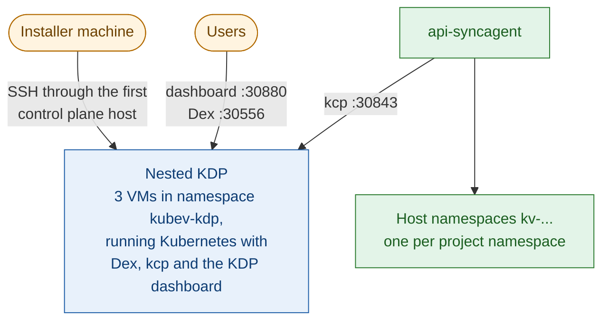

+++
title = "Nested Cluster"
date = 2026-10-12T00:00:00+00:00
weight = 3
+++

{}
**Experimental. Don't use it in production.** In this release, the nested mode is meant for trying
KDP out, for example in a lab, and needs a lot of work by hand to be usable: see
[What you set up by hand](#what-you-set-up-by-hand). The next release improves it and makes it ready
for production. Until then, for a platform people depend on, use
[Same Layer]() or [Bring Your Own KDP]().
{}

In the **nested** mode, the installer creates three KubeVirt VMs on the KubeV cluster, installs a
separate Kubernetes cluster in them, and runs Dex, kcp and KDP there. It then registers the KubeV
service in that KDP, and deploys the api-syncagent on the KubeV cluster.



## Limits

Before you start, know what this mode doesn't do:

- **No KubeV dashboard.** The installer refuses `dashboard.enabled: true` in this mode, so KDP shows
  no **Open KubeV Virtualization** button. Users work with KubeV resources in KDP's own pages or with
  `kubectl`.
- **One login.** The nested Dex has a single built-in user, `admin`, and no login methods of its
  own, so `adminGroup` can't work.
- **One address.** KDP is configured for the first VM's address, `kdp-cp-0`. If that VM is down,
  KDP is down.
- **Install once.** Each run of the installer writes a new SSH key for the VMs, but VMs that already
  exist keep the key of their first boot, so a second run can't reach them. Change the nested KDP's
  settings by recreating it; see [Removing it](#removing-it).
- **No uninstall.** Remove the nested KDP by hand; see [Removing it](#removing-it).

## What you set up by hand

The installer creates the nested KDP and connects KubeV to it, but it stops at the edge of the KubeV
cluster: making KDP usable for anyone outside it is your job.

- **Exposing KDP.** The KDP dashboard, kcp's API and Dex listen as NodePorts on the VMs, on ports
  30880, 30843 and 30556, at the VMs' addresses on the KubeV cluster's pod network. Only the cluster
  reaches those. The installer publishes none of them: set up the load balancer, proxy or tunnel that
  brings your users to them.
- **Load balancing.** Nothing spreads your users' traffic over the three VMs. The NodePorts are open
  on all of them, so a load balancer in front of the three can. KDP itself is still configured for
  the first VM, `kdp-cp-0`: if that VM is down, KDP is down.
- **DNS.** `dashboard.<base>`, `kcp.<base>` and `dex.<base>` must resolve, for your users, to whatever
  you put in front of the VMs.
- **Certificates.** kcp and Dex use certificates from the nested KDP's own CA, unless you give it one
  with `kdp.ca`, and the KDP dashboard is plain HTTP. Every user's browser must trust that CA: see
  [Step 3](#step-3-reach-kdp).

The next release takes over most of this work.

## Requirements

| What | Why |
| --- | --- |
| **The StorageClass `longhorn`** on the KubeV cluster | The VMs' disks are created on it, whatever `storage` says. Without it, the VMs never start. |
| **Room for three VMs** | 4 vCPUs, 8 GiB of memory and a 20 GiB disk each, unless you set `cluster.vms`. |
| **SSH to the first control plane host** | The installer reaches the VMs through `controlPlane.hosts[0]`, with that host's `sshUsername` and `sshPrivateKeyFile`. It must be a key file: an SSH agent isn't used. |
| **A route from the installer machine to the VMs** | The installer connects to kcp in the VMs at the first VM's pod-network address, without a tunnel. Run it from a machine that reaches the cluster's pod network, such as one of its nodes. |
| **Internet access** | From the installer machine, for the Dex, kcp, cert-manager, local-path-provisioner and KDP charts. From the KubeV cluster, for the VMs' Ubuntu cloud image. From the VMs, for operating system packages and container images. |
| **Registry credentials** | `KUBEV_USERNAME` and `KUBEV_PASSWORD` for the KDP charts, on every run. |

## Step 1: Write the configuration

```yaml
dashboard:
  enabled: false                       # not supported beside a nested KDP

kdp:
  enabled: true
  admin: "admin"                       # the nested Dex's built-in user
  domains:
    base: kdp.example.com              # dex., kcp. and dashboard.kdp.example.com
  cluster:
    vms:
      cpu: 4
      memory: 8Gi
      diskSize: 20Gi
    network:                           # must not overlap the KubeV cluster's networks
      networkCIDR: 10.18.0.0/16
      serviceCIDR: 10.112.0.0/12
```

- **Always set `cluster.network`.** Without it, the nested cluster falls back to Kubernetes' default
  pod and Service networks, which the KubeV cluster may be using too.
- **`domains`** holds host names only: each service gets its port, `https://dex.<base>:30556`,
  `https://kcp.<base>:30843` and `http://dashboard.<base>:30880`. Without `domains`, the KDP
  dashboard and kcp fall back to `localhost`, and Dex to a name inside the cluster, so nobody can
  sign in from a browser.
- **`kdp.ca`** takes a CA of your own, as `certificate` and `privateKey` in PEM, to sign the nested
  KDP's certificates. Without it, the installer creates a self-signed CA.
- **`cluster.sshPrivateKeyFile`** is where the installer writes the VMs' SSH key, `id_rsa` in the
  current directory by default. The installer overwrites that file.

## Step 2: Run the installer

```bash
export KUBEV_USERNAME=<your-username>
export KUBEV_PASSWORD=<your-password>
kubermatic-virtualization apply -f cluster.yaml
```

After the KubeV installation, the installer works through these phases. The waits for the VMs and
for SSH can take up to 20 minutes each, the others up to 10:

| Phase | It prints |
| --- | --- |
| Creates the VMs `kdp-cp-0` to `kdp-cp-2` in namespace `kubev-kdp` | `Creating the disks and virtual machines of the KDP cluster...` |
| Waits for them to run and accept SSH | `Waiting for the KDP virtual machines to start and accept SSH...` |
| Installs Kubernetes on them, with cert-manager and local-path storage | `Installing Kubernetes on the KDP virtual machines, with cert-manager and local-path storage...` |
| Sets up the CA and Dex's certificate, then Dex and kcp | `Deploying Dex and kcp on the KDP cluster...` |
| Installs KDP and the KDP dashboard | `Deploying the KDP developer platform and dashboard...` |
| Registers the KubeV service and deploys the api-syncagent | `✓ KubeV is registered in KDP: ...` |

It writes two files in the current directory:

- `kdp-cluster-kubeconfig`, an administrator kubeconfig for the nested cluster;
- the VMs' SSH key, `id_rsa` unless you set `cluster.sshPrivateKeyFile`.

## Step 3: Reach KDP

The three services listen on the VMs' pod-network addresses, which only the KubeV cluster reaches.
Bring your users to them as [What you set up by hand](#what-you-set-up-by-hand) describes: with a load
balancer in front of the three VMs, or, for a quick test, an SSH tunnel through one of the cluster's
nodes to the first VM. Then point the names `dex.<base>`, `kcp.<base>` and `dashboard.<base>` at it.

Unless you set `kdp.ca`, browsers must trust the self-signed CA. Export it with the nested cluster's
kubeconfig, and install it as trusted on your users' machines:

```bash
kubectl --kubeconfig kdp-cluster-kubeconfig -n kdp-system get secret kdp-root-ca \
  -o jsonpath='{.data.tls\.crt}' | base64 -d > kdp-ca.crt
```

It is a single root CA. On Windows, in PowerShell run as administrator:

```powershell
Import-Certificate -FilePath .\kdp-ca.crt -CertStoreLocation Cert:\LocalMachine\Root
```

On Linux, for command-line tools and for Chrome and Chromium (Debian and Ubuntu shown):

```bash
sudo cp kdp-ca.crt /usr/local/share/ca-certificates/
sudo update-ca-certificates
certutil -d sql:$HOME/.pki/nssdb -A -t "C,," -n "KDP root CA" -i kdp-ca.crt
```

[Trust kcp's certificate]() in the same layer
guide explains these commands, the variants for other systems, and Firefox. Restart the browser after
the import.

## Step 4: Sign in

Sign in to the KDP dashboard, at `http://dashboard.<base>:30880`, as `admin`. The password is random,
and kept in a Secret on the nested cluster:

```bash
kubectl --kubeconfig kdp-cluster-kubeconfig -n kdp-system \
  get secret kubev-kdp-dex-admin -o jsonpath='{.data.password}' | base64 -d
```

Then create an organization and a project, and enable **KubeV Virtualization** in the project from
KDP's catalog. In this mode, KubeV isn't enabled in projects automatically. Enable it in projects
only: see [Where KubeV works]().

## Removing it

There is no uninstall command. To remove the nested KDP, remove `kdp.cluster` from the configuration
first, so that the next run doesn't create it again. Then delete these namespaces on the KubeV
cluster:

- `kubev-kdp`, which holds the VMs and their disks. Every organization, project and object in that
  KDP is lost with it;
- `kubev-syncagent`, which holds the api-syncagent;
- the projects' host namespaces, which still hold the copies of the projects' VMs, disks and
  networks. `kubectl get namespaces -l kdp.kubev.k8c.io/project-hash` lists them.

The api-syncagent also left cluster-wide objects behind: the PublishedResources and their CRD
`publishedresources.syncagent.kcp.io`, the ClusterRole and ClusterRoleBinding
`kubev-syncagent:resources`, and the admission policies and bindings `kubev-kdp-kubevirt` and
`kubev-kdp-forklift`.
