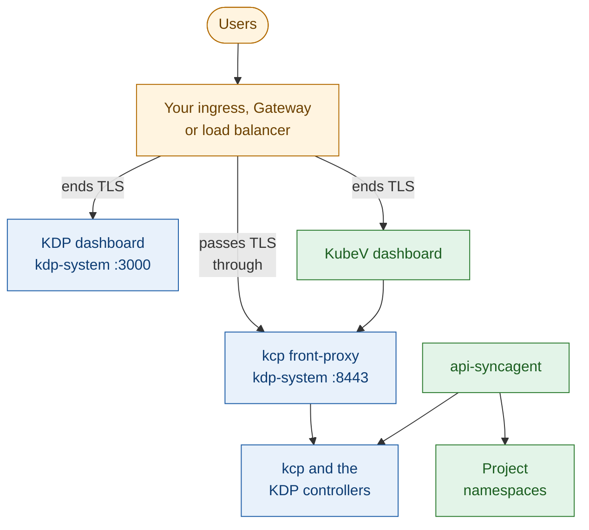
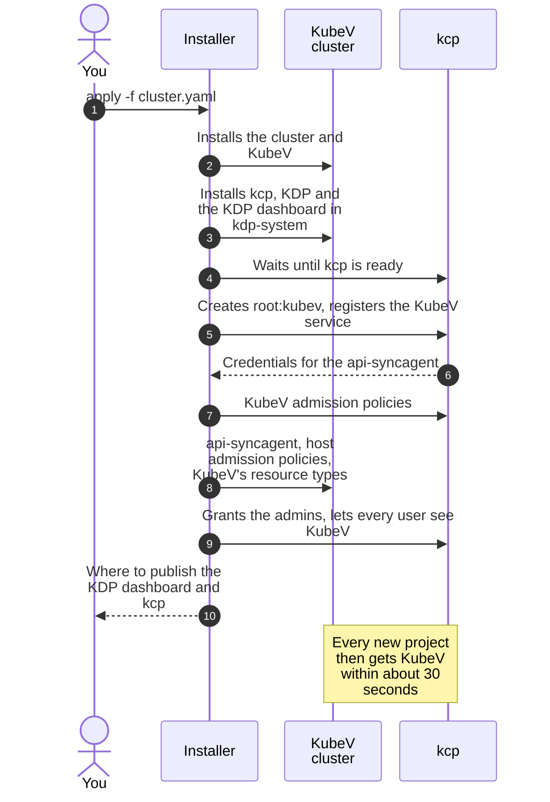

+++
title = "Same Layer"
date = 2026-10-12T00:00:00+00:00
weight = 2
+++

In the **same layer** mode, the installer runs KDP on the KubeV cluster itself, next to KubeV. It
installs kcp, KDP and the KDP dashboard, registers the KubeV service, and enables KubeV in every
project. This is the mode with the least work for you.



The installer creates no Ingress, Gateway or load balancer for KDP, and none for the KubeV dashboard
or Dex either. You publish them, in [Step 5](#step-5-publish-the-kdp-dashboard-and-kcp).

## Step 1: Plan the addresses

Users reach four services, each at its own host name:

| Service | Example address | Runs as | Publish it with |
| --- | --- | --- | --- |
| **KubeV dashboard** | `https://kubev.example.com` | Service `kubermatic-virtualization/kubev-dashboard`, port 8080 | TLS terminated in front of it, as in any KubeV installation. |
| **KDP dashboard** | `https://kdp.example.com` | Service `kdp-system/kdp-dashboard`, port 3000, plain HTTP | TLS terminated in front of it. |
| **kcp** | `https://kcp.example.com:8443` | Service `kdp-system/kcp-front-proxy`, port 8443 | **TLS passed through.** kcp terminates TLS itself, with its own certificate. |
| **Dex** | `https://dex.example.com` | Service in namespace `dex`, when the installer deploys Dex | TLS terminated in front of it, with a publicly trusted certificate. |

Create the DNS records now. The KDP dashboard and kcp addresses are built into KDP's configuration
and kcp's certificate, and kcp only accepts browser requests from the exact KDP dashboard address.

{}
**Browsers talk to kcp directly.** The KDP dashboard runs in the browser and calls kcp at its public
address. So kcp must be reachable from your users' machines, not only from the cluster, and their
browsers must trust its certificate: see [Step 6](#step-6-trust-kcps-certificate).
{}

## Step 2: Prepare sign-in

KDP mode uses **one** OIDC client, the one in `dashboard.auth.oidc`. The KubeV dashboard and the KDP
dashboard both sign users in with it, and kcp accepts only tokens issued to it. kcp identifies users
by their `email` claim, and reads their groups from the `groups` claim, both prefixed with `oidc:`.

- Every user needs an email address in their token, and every login method must only assert email
  addresses its users own.
- Request the `groups` scope. Without it, nothing granted to a group in KDP applies in KubeV,
  `adminGroup` included.
- Limit social logins such as GitHub to your own organizations. kcp trusts the `groups` claim, so
  anyone who can create a group with a privileged name could otherwise claim it.

Who registers the client depends on who runs Dex:

| Your setup | What to do |
| --- | --- |
| **The installer deploys Dex** (`idp.dex`) | Nothing. The installer registers the client with both callbacks, the KubeV dashboard's `redirectURL` and the KDP dashboard's `https://<KDP dashboard address>/api/auth/callback/oidc`, and turns off Dex's approval screen. If you list the client in `idp.dex.staticClients` yourself, the installer leaves it alone: add both callbacks there. |
| **You run the OIDC provider** (`idp.none`) | Register the client yourself, with both callbacks. The installer prints a Dex `staticClients` entry you can copy. |

Give Dex a publicly trusted certificate. The KDP dashboard and the KubeV API server check Dex's
certificate against the publicly trusted CAs only. `kdp.dexCASecretName` makes kcp trust a private CA,
but nothing else does.

## Step 3: Write the configuration

Add three sections to your KubeV configuration. This example deploys Dex, signs users in with
Google, and makes `alice@example.com` the first platform administrator:

```yaml
apiVersion: virtualization.k8c.io/v1alpha1
kind: KubeVCluster

# ... controlPlane, networkConfiguration, storage, loadBalancer and the rest of
# your KubeV configuration ...

idp:
  dex:
    issuer: "https://dex.example.com"
    connectors:
      - type: oidc
        id: google
        name: Google
        config:
          issuer: https://accounts.google.com
          clientID: "your-google-client-id"
          clientSecret: "your-google-client-secret"
          redirectURI: "https://dex.example.com/callback"

dashboard:
  enabled: true
  dashboardURL: "https://kubev.example.com"
  auth:
    oidc:
      issuerURL: "https://dex.example.com"       # the same issuer as idp.dex.issuer
      clientID: "kubev-dashboard"
      clientSecret: "a-strong-client-secret"
      redirectURL: "https://kubev.example.com/auth/callback"
      scopes: ["openid", "email", "profile", "groups"]

kdp:
  enabled: true
  admin: "alice@example.com"
  domains:
    dashboard: kdp.example.com                   # https://kdp.example.com
    kcp: kcp.example.com:8443                    # https://kcp.example.com:8443
  tenantUnderlayInterfaces:
    - "ens[0-9]*"
```

Notes on the example:

- **`dashboard.auth.oidc` is required**, even if you turn the KubeV dashboard off: the KDP dashboard
  signs in with the same client.
- **`admin` or `adminGroup`.** A group is easier to maintain, but Google through Dex's `oidc`
  connector puts no groups in the token. Use `adminGroup` with a login method that does, such as
  LDAP, or GitHub limited to your organizations.
- **`dashboard.auth.oidc.connectors`**, with your Dex's login methods, lets users skip Dex's chooser
  when they open KubeV from KDP; see [Signing in]().
  Set it only when the issuer is a Dex.
- **`domains`** must match the addresses you publish in Step 5 exactly. A host name without a port
  means HTTPS on port 443. Without `domains`, KDP is set up for a local test through port-forwards
  on `http://localhost:30880` and `https://localhost:30843`.
- **Storage.** kcp keeps its data on a volume: `longhorn` when `storage.longhorn` is configured,
  the cluster's default StorageClass otherwise.

[The `kdp` section]() lists every field.

## Step 4: Run the installer

```bash
export KUBEV_USERNAME=<your-username>
export KUBEV_PASSWORD=<your-password>
kubermatic-virtualization apply -f cluster.yaml
```

The registry credentials are required even when the configuration sets `imagePullSecret`: the KDP
charts are pulled with them.



The installer first sets up the cluster and KubeV as usual. KDP's charts are installed with the rest
of KubeV's, and once everything runs, the installer registers KubeV in KDP. Among the lines it
prints:

```text
Setting up KDP (Kubermatic Developer Platform)...
Configuring KDP on the KubeV host cluster...
kcp is ready on the host cluster (OIDC issuer https://dex.example.com)
Registering the KubeV service in KDP and granting the platform admin...
Waiting for KDP to create its workspace types and root RBAC...
Provider workspace root:kubev is ready
Registered the KubeV APIExport; KDP issued the servlet kubeconfig
Applied the KubeV admission policies in root:kubev
Deployed the api-syncagent, publishing 21 resources
✓ KubeV is registered in KDP: the platform admin can now sign in, create tenant workspaces and onboard projects
KDP dashboard: publish Service kdp-system/kdp-dashboard port 3000 at https://kdp.example.com (the Service speaks plain HTTP, so terminate TLS in front of it)
kcp:           publish Service kdp-system/kcp-front-proxy port 8443 at https://kcp.example.com:8443 (the Service terminates TLS itself, so pass TLS through)
```

The KDP part takes several minutes on a first installation, most of it while KDP prepares the
provider workspace. The installer retries a failed step, and stops with an error that names the step
and the reason if it keeps failing.

## Step 5: Publish the KDP dashboard and kcp

Publish both Services at the addresses in `kdp.domains`, with an ingress controller, a Gateway or
load balancers. What matters is that TLS **ends in front of** the KDP dashboard, and **passes
through** to kcp.

For example, with a Gateway API implementation that supports TLS passthrough, and cert-manager
issuing the KDP dashboard's certificate:

```yaml
apiVersion: gateway.networking.k8s.io/v1
kind: Gateway
metadata:
  name: kdp
  namespace: kdp-system
  annotations:
    cert-manager.io/cluster-issuer: letsencrypt      # your ClusterIssuer
spec:
  gatewayClassName: <your-gateway-class>
  listeners:
    - name: dashboard
      hostname: kdp.example.com
      port: 443
      protocol: HTTPS
      tls:
        mode: Terminate
        certificateRefs:
          - name: kdp-dashboard-tls
    - name: kcp
      hostname: kcp.example.com
      port: 8443
      protocol: TLS
      tls:
        mode: Passthrough
---
apiVersion: gateway.networking.k8s.io/v1
kind: HTTPRoute
metadata:
  name: kdp-dashboard
  namespace: kdp-system
spec:
  parentRefs:
    - name: kdp
      sectionName: dashboard
  hostnames: ["kdp.example.com"]
  rules:
    - backendRefs:
        - name: kdp-dashboard
          port: 3000
---
apiVersion: gateway.networking.k8s.io/v1
kind: TLSRoute
metadata:
  name: kcp
  namespace: kdp-system
spec:
  parentRefs:
    - name: kdp
      sectionName: kcp
  hostnames: ["kcp.example.com"]
  rules:
    - backendRefs:
        - name: kcp-front-proxy
          port: 8443
```

`TLSRoute` is in the Gateway API standard channel since v1.5. Older releases serve it as
`v1alpha2`, from the experimental channel. For cert-manager to issue certificates for a Gateway,
install the Gateway API CRDs and set `certManager.gatewayAPI: true` in the KubeV configuration.

Publish the KubeV dashboard and Dex the same way, with TLS terminated in front of them.

## Step 6: Trust kcp's certificate

{}
**kcp serves a certificate from its own private CA.** Browsers and `kubectl` on your users' machines
must trust that CA, or KDP pages fail to load. The installer keeps the CA in a Secret on the KubeV
cluster. Export it:

```bash
kubectl -n kubermatic-virtualization get secret kubev-kcp-front-proxy-ca \
  -o jsonpath='{.data.ca\.crt}' | base64 -d > kcp-ca.pem
```

The file holds two certificates, kcp's intermediate CA and its root CA. Install both as trusted
authorities on your users' machines: kcp doesn't send the intermediate. If your tool imports one
certificate per file, split the file first.
{}

## Step 7: Sign in and create the first project

1. Open the KDP dashboard and sign in as the platform administrator, `alice@example.com` in the
   example.
2. Create an organization, and a project in it. Keep both names to 16 characters or less, without
   `--`. Both are ready within seconds.
3. Open the project's **Services** page. Within about 30 seconds, **KubeV Virtualization** is listed
   as enabled.
4. Add the project's members on its **Members** page, with the roles in
   [Access Control]().
5. Choose **Open KubeV Virtualization**. The KubeV dashboard opens in the project.

## Step 8: Check the installation

On the KubeV cluster, check that KDP runs, that the api-syncagent runs, and that every KubeV resource
type made it to KDP. The last command prints nothing when all of them did:

```bash
kubectl -n kdp-system get pods
kubectl -n kubev-syncagent get deployment kubev-api-syncagent
kubectl get publishedresources.syncagent.kcp.io -o json \
  | jq -r '.items[] | select(.status.resourceSchemaName == null) | .metadata.name'
```

## Changing the installation

The installer is idempotent. To change a KDP setting, edit the configuration and run
`kubermatic-virtualization apply -f cluster.yaml` again. It keeps the generated keys and all of KDP's
data: organizations, projects, members and the objects in them.
