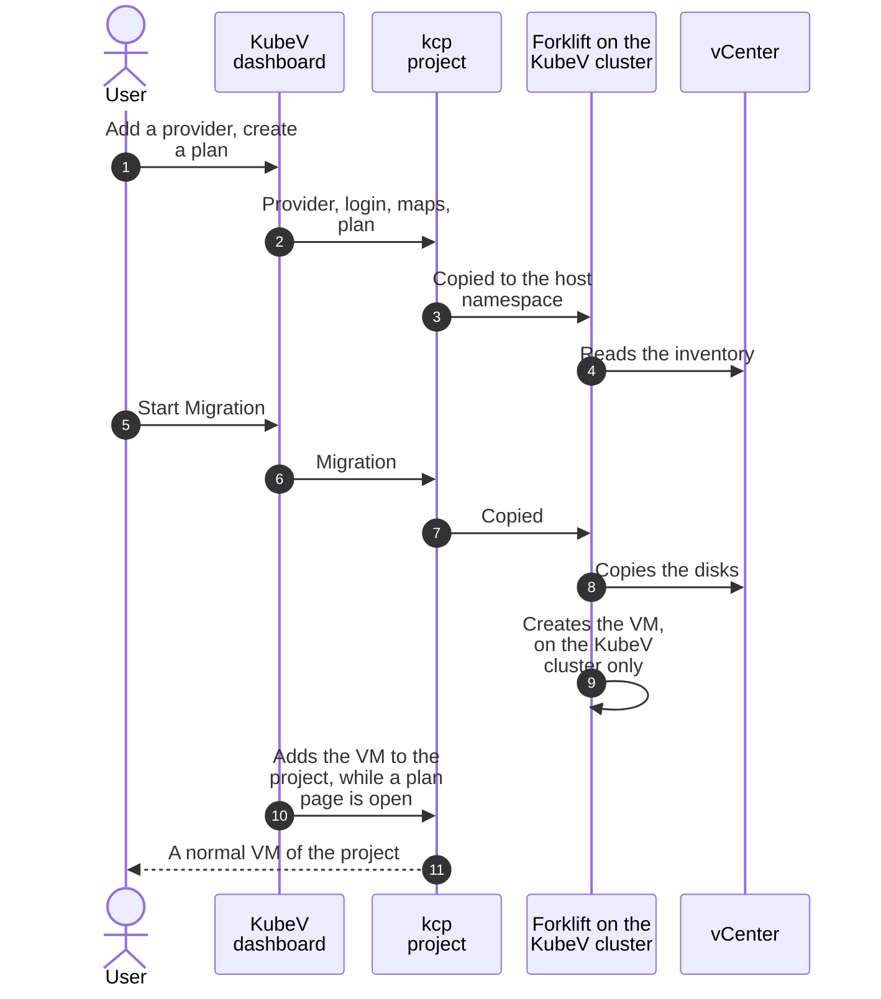

+++
title = "Migrating VMs from vSphere"
date = 2026-10-12T00:00:00+00:00
weight = 6
+++

The **Migration** section of the KubeV dashboard moves virtual machines from a VMware vCenter into
a KDP project. KubeV uses [Forklift](https://github.com/kubev2v/forklift) for it,
running on the KubeV cluster. This page explains how a migration flows through KDP, and walks
through one.

## How it works



Your providers, maps, plans and migrations are objects in the project, like your VMs. The
api-syncagent copies them to the project's namespace on the KubeV cluster, where Forklift does the
work. Forklift creates each migrated VM on the KubeV cluster only, so the KubeV dashboard then adds
it to your project. From that moment it is a normal VM of the project.

## Before you start

- **Your role.** The Migration section shows when you may view migration providers. Adding a
  provider also needs permission to create Secrets in the project, and adding migrated VMs to the
  project needs permission to create VMs. **Owner** has all of these; for other roles, see
  [What Developer and Member don't cover]().
- **One namespace.** Providers, maps, plans and the migrated VMs all live in the project's
  `default` namespace.
- **The vCenter address** must use `https`, with a fully qualified host name such as
  `vcenter.example.com`, or an IP address. Short names such as `https://vcenter` are refused. The
  vCenter must be reachable from the KubeV cluster.
- **VDDK comes from the platform.** A project can't bring its own VDDK image. When the platform
  administrator sets one for the whole platform, providers use it, and warm migration is offered:
  the provider form says VDDK is provided by the platform. Without it, migrations are cold only,
  disks are copied over the vCenter's HTTPS datastore path, and VMs on vSAN storage can't be
  migrated.
- **No copy offload and no transfer network** in a project.

## 1. Add the vCenter

1. Open **Migration** > **Source Providers** and choose **Add Provider**.
2. Enter a name, the vCenter URL, the user name and the password. Paste the vCenter's CA certificate,
   or choose to skip certificate verification.
3. Choose **Test Connection** to check the login, then save.

The provider shows **Inventorying** while Forklift reads the vCenter, then **Ready**.

{}
**The vCenter login is a Secret in the project.** It is stored as `<provider>-vsphere-creds` in the
`default` namespace, and anyone who may read Secrets there can read it. Use a vCenter account with
only the rights a migration needs.
{}

## 2. Create a plan

1. For a cold migration, power off the VMs in vSphere: it copies disks at rest. A warm migration,
   offered when the platform provides VDDK, copies the disks while the VMs run and needs Changed
   Block Tracking on them.
2. Open **Migration** > **Migration Plans** and choose **New Plan**.
3. Pick the source provider and select the VMs.
4. Map each source network to a subnet of the project, or leave it out. The platform's pod network is
   not offered.
5. Map each source datastore to a storage class.
6. Choose **Create Plan**. KubeV first checks that the new VM names are free, and that the VMs' MAC
   addresses aren't used on the platform.

## 3. Run it

Open the plan and choose **Start Migration**. The plan's page shows each VM's progress. You can
cancel one VM or the whole run there.

## 4. Get the VMs into the project

The KubeV dashboard adds each migrated VM to the project as soon as its migration succeeds, from the
plan's page or the **Migration Plans** list.

{}
**Keep the plan open until the run is done, and don't delete a plan before its VMs are in the
project.** VMs are only added while someone who may create VMs has the plan or the plans list open.
A plan deleted too early leaves its migrated VMs on the KubeV cluster, outside your project. Open the
plans list later to add VMs that finished while nobody was looking.
{}

The plan's page names each VM it could not add, and why:

| The plan says | What to do |
| --- | --- |
| *could not be added to the project: another virtual machine there already has that name* | Ask your platform administrator before you delete either VM. |
| *cannot be added to the project*, followed by a reason | The VM has settings the platform refuses in a project, such as the pod network or a node selector. Ask your platform administrator. |
| *migrated, but no virtual machine of it was found in this namespace* | Forklift reports the VM migrated, but it isn't on the KubeV cluster. Ask your platform administrator. |
| *could not be added to the project. Reload the page to try again.* | KDP didn't accept the VM, for example because of a quota. Reload the page: adding it again is safe. |

Once added, a migrated VM is a normal VM of the project. Deleting it also deletes its disks.

## For platform administrators

To give projects VDDK and warm migration, set a VDDK image for the whole platform in the KubeV
configuration, with the credentials of its registry if it needs them, and run the installer:

```yaml
migration:
  vddk:
    image: registry.example.com/vddk:8.0.3
    imagePullSecret: |
      {"auths":{"registry.example.com":{"auth":"<base64 of username:password>"}}}
```

KubeV copies the pull Secret into the namespace of every plan while the plan exists, where anyone who
may read Secrets in that namespace can read it. Use a token that can only pull.

## With kubectl

You can create the same objects with `kubectl` in the project, if your role allows it. Keep the
provider, its Secret, the maps, the plan and the migration in one namespace, and use the destination
provider `host`, which the dashboard creates with the first provider. Migrated VMs are only added to
the project by the dashboard: after a run, open the plan, or the plans list, in KubeV.
