+++
title = "AZ Edge Routers"
date = 2026-10-19T00:00:00+00:00
weight = 4
+++

This guide reads the state of your AZ edge routers in the dashboard's admin panel and changes what they
carry: which VPCs, which subnets, and which fabric peers. Every step shows the dashboard first, then the
equivalent `kubectl` command.

An AZ edge router is one FRR gateway per availability zone that connects many tenant VPCs to the upstream
network at once. Each VPC it carries gets its own transit interface and its own VRF on the router, so
tenants stay isolated while sharing one gateway. Traffic inside a VPC never touches it; only traffic that
leaves the VPC does.

## Before you start

- An administrator account. In OIDC mode that is a user bound to a role with full wildcard rules, such as
  the built-in admin role, see the [Access Control Guide](). In basic
  and none mode every user is the administrator.
- At least one `AZEdgeRouter` object. The dashboard reads and adjusts edge routers, but does not create
  or delete them: a platform administrator applies the router with `kubectl`, usually in the namespace of
  the VPCs it serves. With `spec.vpcs.namespaces` a router can also carry VPCs of other namespaces whose
  owners opted in with the label `virtualization.k8c.io/edge-router-attach=true`.
- Running KubeV inside a KDP project? Edge routers are not shown there. The platform administrator manages
  them on the host cluster with `kubectl`.

| Object | Dashboard name | What it is |
| --- | --- | --- |
| `AZEdgeRouter` (`routing.virtualization.k8c.io`) | **Edge Router** | One gateway per zone, running as a StatefulSet of FRR pods. |
| `VPC` | **VPC** | A tenant network. A label on it attaches it to a router. |
| `Subnet` | **Subnet** | A network inside a VPC. A label on it lets the router advertise it. |
| `UnderlaySubnet` | **Underlay subnet** | A pre-provisioned VLAN that carries one VPC's BGP session to the fabric. |

The pages live in the admin panel: choose **Admin** in the top right of the header, then **Network** >
**Edge Routers** in the sidebar. The pages refresh on their own every ten seconds.

## Step 1: Read the list

The list shows every edge router in the cluster, across all namespaces.

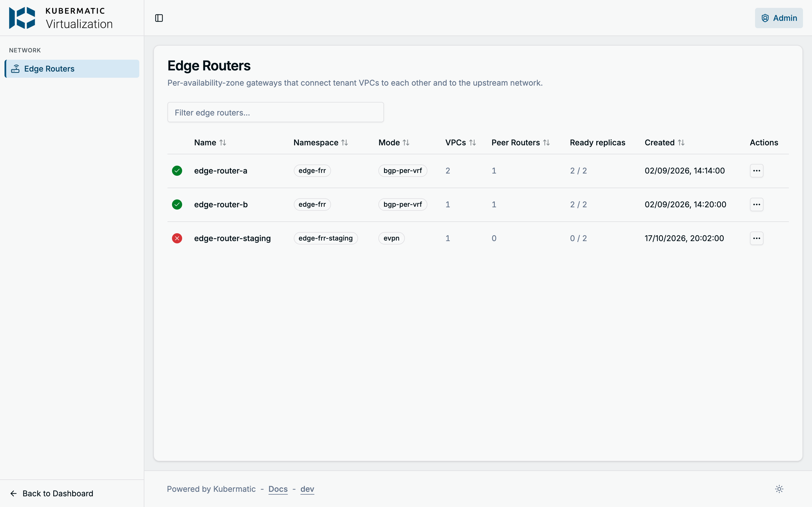

| Column | What it shows |
| --- | --- |
| Status icon | The router's `Ready` condition: a green check when it is `True`, a red cross when it is `False` (hover the icon for the condition's message) or the router is being deleted. A spinner means there is no `Ready` condition for the router's current generation yet: blue when some replicas are ready, grey when none. |
| **Mode** | `bgp-per-vrf` when `spec.ovnTransitMode` is set to it, `evpn` when the router has an ASN, otherwise `static`. `static` is the dashboard's name for a router without an ASN, not a spec value. |
| **VPCs** | How many VPCs the router has resolved. |
| **Peer Routers** | How many paired routers it has resolved. |
| **Ready replicas** | Ready FRR pods out of `spec.replicaCount`, where 0 counts as the default 2. |

In the screenshot, `edge-router-staging` is not ready: none of its two replicas is up. The
row's **Actions** menu opens the router's page or its YAML, read-only.

**The same with kubectl**

```bash
kubectl get azedgerouters -A -o wide
```

The `Ready` column is the condition, `Reason` says why it is `False`, and `ReadyReplicas` is the first
number of the dashboard's **Ready replicas**.

## Step 2: Inspect a router

Open a router from the list. The header repeats its status and ready replicas; the tiles below it show
the router's transit mode, ASN, replica, VPC and peer counts, management and transit subnet, transit
CIDR, and its router-wide VLAN and service VLAN NADs. **YAML** shows the whole object, including its
status.

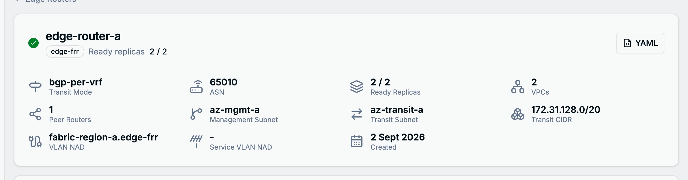

The tabs below, except **VPC Attachment** (Step 3), read the router's status.

### Resolved VPCs

The VPCs the router carries, with each one's VNI, transit addresses (one per replica), subnets, egress
and API server proxy settings. Open a row for the details the router resolved for that VPC: its routing
table, NIC, gateway, accepted prefixes and, in `bgp-per-vrf` mode, its external VLAN and fabric peers.

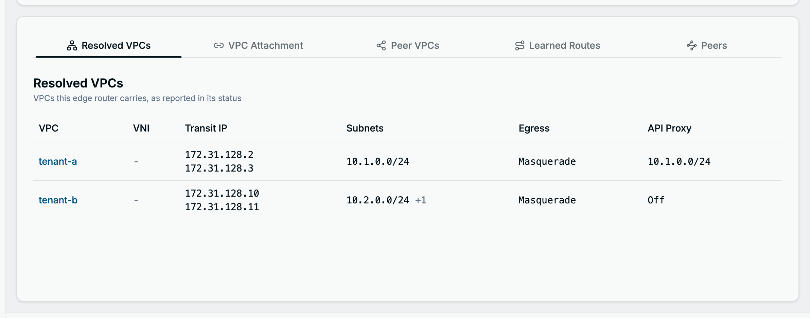

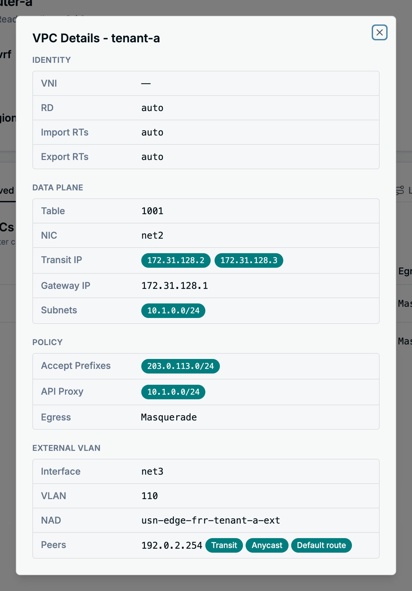

### Peer VPCs

The VPCs of the routers named in `spec.peerAZEdgeRouters` (same namespace), as this router mirrors them
in its status. Those VPCs also get transit interfaces on this router.

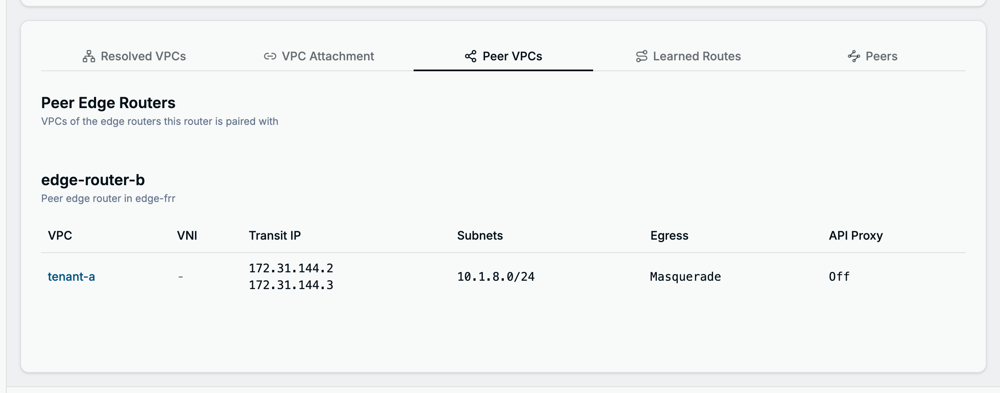

### Learned Routes

Prefixes that BGP speakers inside the VPCs, such as MetalLB, advertise to the router, with the next hop
of each.

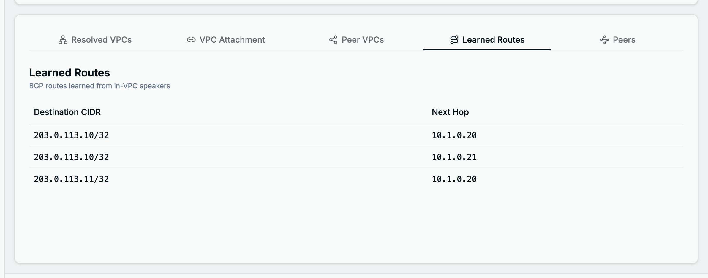

### Peers

Everything the router peers with:

- **Fabric Peers**: the upstream neighbour of each VPC, with the roles it was given (**Transit** receives
  the VPC's subnets, **Anycast** receives the anycast addresses, **Default route** carries the VRF's
  default route), its BFD setting, and the live BGP session of every replica with the prefixes received
  and sent. The session state is what FRR reports: green **Established** is healthy, blue states such as
  **Active** or **Connect** mean the session is still being set up, and a red **Idle (...)** means the
  session was torn down, for example by a prefix limit. On a multi-replica router, a replica that has
  sessions but none with this peer shows **no session**; a replica that reports no sessions at all is
  counted below the table.
- **In-VPC Speakers**: whether speakers inside the VPCs may peer with the router, and the sessions they
  opened, one per router replica.
- **Peer Edge Routers**: the paired routers and the subnets they serve.
- Outside `bgp-per-vrf` mode also the configured EVPN and BGP peers and the peers discovered through the
  route reflector.

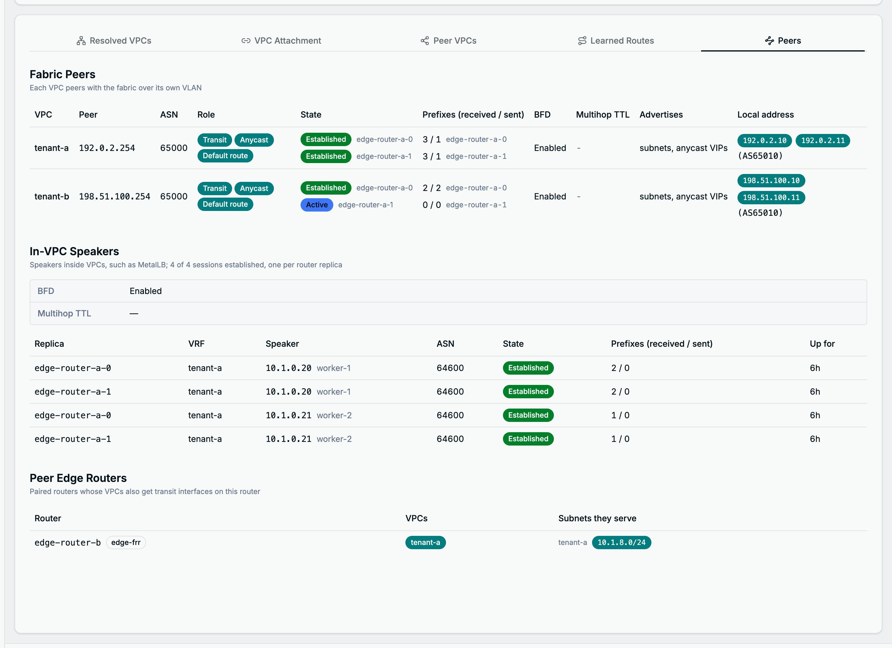

In the screenshot, replica `edge-router-a-1` has not established its session with the fabric peer of
`tenant-b` yet.

**The same with kubectl**

```bash
kubectl -n edge-frr get azedgerouter edge-router-a -o yaml
```

The tabs map to the status fields `resolvedAZVPCs`, `peerResolvedAZVPCs`, `learnedBGPRoutes` and
`bgpSessions`. For the condition and the router's events:

```bash
kubectl -n edge-frr get azedgerouter edge-router-a \
  -o jsonpath='{.status.conditions[?(@.type=="Ready")]}'
kubectl -n edge-frr describe azedgerouter edge-router-a
```

## Step 3: Attach or detach a VPC

Open the **VPC Attachment** tab. **Onboarding Mode** shows how the router finds its VPCs: by label, with
the VPC selector and the subnet selector from its spec, or from an explicit list. The switches below are
available for routers that select VPCs by a plain label match. A router with an explicit list shows its
VPCs and subnet selection read-only; its external VLANs (Step 5) can still be edited.

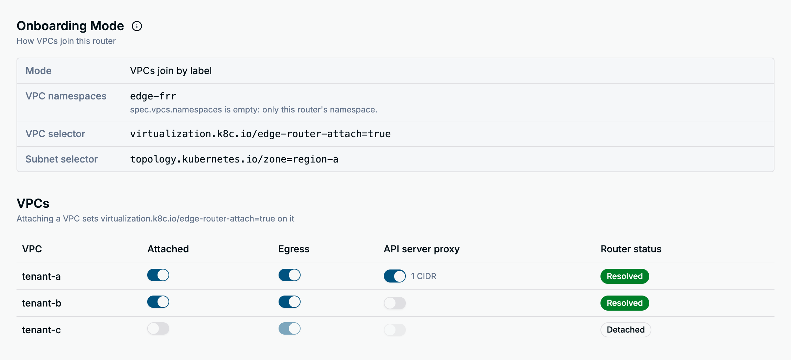

The **VPCs** table lists every VPC in the router's namespaces, a VPC from another namespace as
`namespace/name`. Each row has three switches:

| Switch | What it does |
| --- | --- |
| **Attached** | Sets the router's selector label on the VPC, so the router picks it up on its next reconcile. **Router status** turns from **Pending** to **Resolved** once the router has carried it. Turning it off asks for confirmation, because the VPC's traffic through the edge stops. |
| **Egress** | On by default, available once the VPC is attached. Turning it off stops SNAT and egress routing for the VPC, after a confirmation. |
| **API server proxy** | Lets the VPC's workloads reach the infrastructure cluster's API server through the router, after a confirmation. Only available on routers with `spec.apiServerViaInternalProxy` set, and once the VPC is attached. Narrow it to single subnets in [Step 4](#step-4-choose-the-advertised-subnets). |

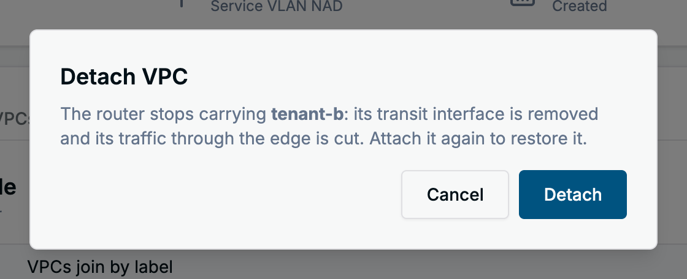

A VPC labelled for another router cannot be attached here: the switch is disabled and its tooltip names
the label to remove first. For a VPC from another namespace the router reads only the egress annotation,
so the API server proxy switch has no effect there.

**The same with kubectl**

The switches on this tab write labels and annotations on the VPC, not on the router. The label is the
router's VPC selector, shown under **Onboarding Mode**; the example router selects
`virtualization.k8c.io/edge-router-attach=true`.

```bash
# attach, then detach (detaching also clears the proxy annotations)
kubectl -n edge-frr label vpcs.virtualization.k8c.io tenant-c virtualization.k8c.io/edge-router-attach=true
kubectl -n edge-frr label vpcs.virtualization.k8c.io tenant-c virtualization.k8c.io/edge-router-attach- \
  && kubectl -n edge-frr annotate vpcs.virtualization.k8c.io tenant-c \
  az-edge-router.virtualization.k8c.io/apiserver-proxy- az-edge-router.virtualization.k8c.io/apiserver-proxy-subnets-

# egress off, and on again
kubectl -n edge-frr annotate vpcs.virtualization.k8c.io tenant-c az-edge-router.virtualization.k8c.io/egress-enabled=false
kubectl -n edge-frr annotate vpcs.virtualization.k8c.io tenant-c az-edge-router.virtualization.k8c.io/egress-enabled-

# API server proxy for one subnet of the VPC
kubectl -n edge-frr annotate vpcs.virtualization.k8c.io tenant-c \
  az-edge-router.virtualization.k8c.io/apiserver-proxy=true \
  az-edge-router.virtualization.k8c.io/apiserver-proxy-subnets=10.3.0.0/24
```

## Step 4: Choose the advertised subnets

Further down the **VPC Attachment** tab, **Subnet Advertisement** lists the subnets of one attached VPC.
Pick the VPC, then turn **Advertised by this router** on or off per subnet. The **Zone** column shows the
label the router looks for; **None** means the subnet is not advertised, and a value from another router
means that router advertises it, so stop it there first.

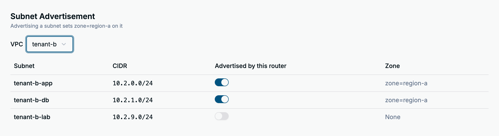

Turning advertisement off asks for confirmation, because the subnet stops being reachable through the
router. On a router with an API server proxy, and for a VPC with the proxy switched on, an extra
**API server proxy** column narrows the proxy to single IPv4 subnets; the last allowed subnet cannot be
switched off here, turn the proxy off for the VPC instead.

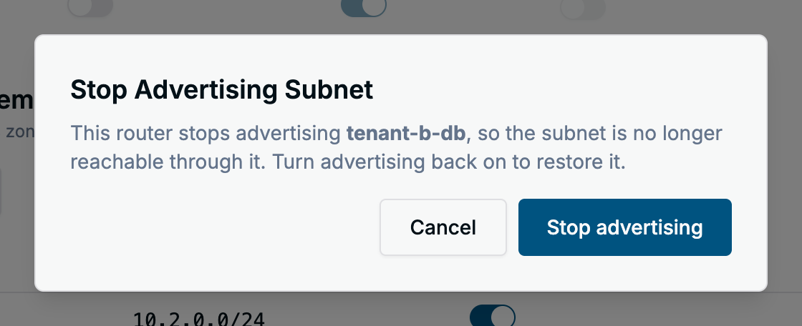

A router whose subnet selector is empty or not a plain label match advertises every subnet of its VPCs,
and this section says so instead of listing them. For a router with an explicit VPC list the section
says subnets cannot be chosen here.

**The same with kubectl**

The switch sets the router's subnet selector label on the Subnet. **Onboarding Mode** > **Subnet
selector** shows the full key; this section shortens it to its last part, `zone=region-a`.

```bash
kubectl -n edge-frr label subnets.virtualization.k8c.io tenant-b-lab topology.kubernetes.io/zone=region-a
kubectl -n edge-frr label subnets.virtualization.k8c.io tenant-b-lab topology.kubernetes.io/zone-
```

## Step 5: Set a VPC's external VLAN

In `bgp-per-vrf` mode each VPC peers with the fabric over its own underlay VLAN. **External VLAN
Attachment**, at the bottom of the **VPC Attachment** tab, lists each VPC's VLAN source, the router's
local addresses on it and its fabric peers. The menu at the end of a row, boxed in the screenshot because
it has no label, offers **Edit**, or **Attach** for a VPC without a VLAN yet, and **Remove attachment**
when the router's spec has an entry for the VPC.

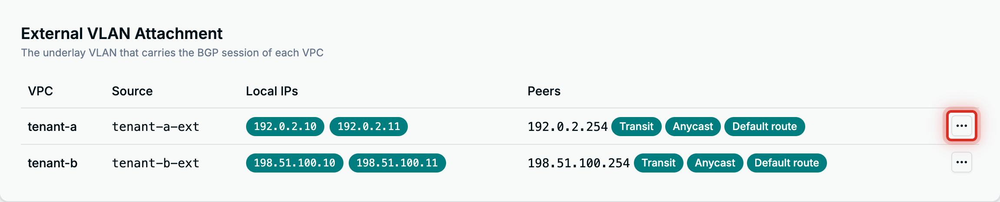

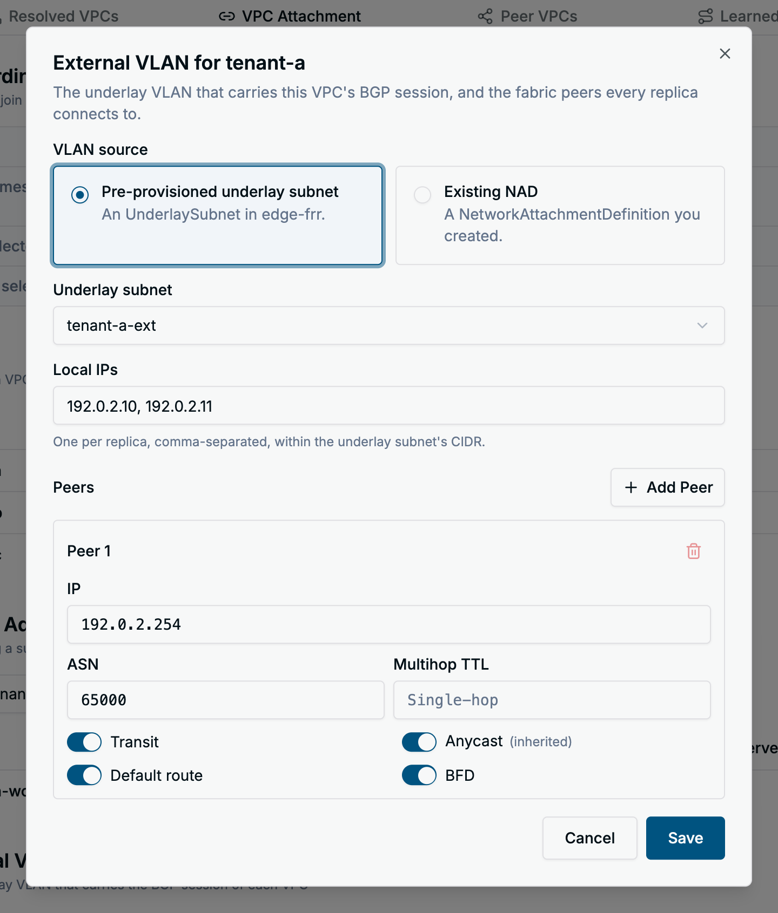

| Field | What to enter |
| --- | --- |
| **VLAN source** | A pre-provisioned **underlay subnet** in the router's namespace, or the name of an existing **NAD** (NetworkAttachmentDefinition). |
| **Local IPs** | The router's addresses on the VLAN, one per replica, inside the underlay subnet's CIDR. |
| **Peers** | The fabric neighbours: IP, ASN (empty takes the router's default peer ASN), multihop TTL, and the **Transit**, **Anycast**, **Default route** and **BFD** switches. **Add Peer** adds another neighbour. |

**Save** stays disabled until a source is chosen, every local IP is a distinct IPv4 address inside the
underlay subnet's CIDR, one per replica, and every peer has a distinct IPv4 address.

A VPC configured through annotations on the VPC object shows its values as inherited. Saving copies the
inherited peers and local IPs into the router, so later annotation changes to those stop applying; a
VLAN source left on **From VPC annotation** keeps following the annotation. Annotations on a VPC from
another namespace are ignored, so its VLAN must be set here.

**Save** writes the entry into the router's `spec.perVRFTransit.vpcVLANs`. **Remove attachment** deletes
the entry after a confirmation and tears the VPC's session down, unless the VPC's own annotations still
describe a VLAN, in which case the router falls back to them.

**The same with kubectl**

```yaml
# in spec.perVRFTransit of the AZEdgeRouter
vpcVLANs:
  - vpc: tenant-a
    underlaySubnet: tenant-a-ext
    localIPs: ["192.0.2.10", "192.0.2.11"]
    peers:
      - ip: 192.0.2.254
        asn: 65000
        advertiseOVNSubnets: true
        defaultRoute: true
        bfd: true
```

```bash
kubectl -n edge-frr edit azedgerouter edge-router-a
```

## What the dashboard does not do

Creating and deleting routers, and changing their ASN, replicas, peer routers, fabric peers in `evpn`
mode or in-VPC speaker settings, is `kubectl` work on the `AZEdgeRouter` object. The dashboard's **YAML**
dialog shows the object but does not edit it.

## Troubleshooting

Hover the status icon in the list, or read the router's conditions. Besides `Ready`, the router reports
`ReplicasSchedulable` (why a replica stays `Pending`), `ReplicaRedundancy` (replicas sharing a node) and
`ConfigValid` (VPCs or settings the router rejected, such as a missing opt-in label); the dashboard shows
only `Ready`.

```bash
kubectl -n edge-frr get azedgerouter edge-router-a \
  -o jsonpath='{range .status.conditions[*]}{.type}={.status} {.reason}: {.message}{"\n"}{end}'
```

The reason tells you where to look.

| Reason or symptom | What to do |
| --- | --- |
| `ManagementSubnetUnavailable` | The subnet named in `spec.managementSubnet` could not be read in the router's namespace, usually a missing subnet or a wrong name; nothing else ran. The message has the error. |
| `TaskFailed` | A reconcile step failed; the message names it. `kubectl describe` the router for the matching event. |
| `WaitingForTransitSubnets` | A newly attached VPC's transit subnet is still being created; the message and a Warning event name it. If it stays, check that subnet, and that `spec.transitSubnet.cidr` does not overlap kube-ovn's join subnet (`100.64.0.0/16`) and has room for every VPC. |
| `PodsNotReady` | No FRR replica is ready. Look at the router's pods in its namespace: `kubectl -n <namespace> get pods -l app.kubernetes.io/instance=<router>`. Replicas stay `Pending` when fewer nodes match `spec.nodeSelector` than there are replicas, since replicas never share a node unless `spec.allowColocatedReplicas` is set; `ReplicasSchedulable` carries the scheduler's reason. |
| `StatefulSetUnavailable` | The router's StatefulSet cannot be read. Usually brief; if it persists, check the controller's logs. |
| Ready, but fewer ready replicas than configured | Traffic flows through the ready replicas. Find the missing pod as for `PodsNotReady`. |
| A fabric peer's session is not **Established** | Check the peer's IP and ASN, the VLAN and the matching VRF on the upstream router. **Prefixes** stays `0 / 0` until the session is up. A session that stays in **Active** or **Connect** cannot reach the peer. |
| **no session** for one replica, or `1 of 2 replicas reports no sessions` under the table | That replica has no BGP session with the peer. Check whether the replica's pod runs and has the VLAN interface. |
| A VPC stays **Pending** on the VPC Attachment tab | The router has not resolved it. Wait for the next reconcile, then check the `Ready` condition. |
| A VPC is attached but has no fabric session | Its external VLAN could not be set up. The reason is in `status.resolvedAZVPCs[].externalVLANError` of the router, which the dashboard does not show: an incomplete VLAN annotation (`nad-name`, `peer-ip` and `local-ips` go together), a number of local IPs that differs from the replica count, zone-scoped annotations on a router without `spec.zone`, or a peer list that resolves to no peer. When the field is empty, check that the underlay subnet exists in the router's namespace and is **Ready**; the router waits for it without an error. |
| **Labelled ... for another router** on the attach switch | The VPC carries the selector label with another router's value. Detach it from that router first. |
| `The router is busy with other changes. Try again.` after Save | The router kept changing during the save, usually status updates; the dashboard retried twice and kept your edit. Save again. |
| `The attachment for <vpc> changed and was reloaded.` after Save | Someone else changed this VPC's VLAN entry meanwhile. The dialog shows the new values; reapply your changes. |
