+++
title = "Create a Virtual Machine"
date = 2026-10-19T00:00:00+00:00
weight = 1
+++

This guide creates a virtual machine in the dashboard: a name, a size, a boot disk from an image, a network
interface and a cloud-init login. Every step shows the dashboard first, then the equivalent YAML for `kubectl`.
The objects behind a VM are described in [VirtualMachines Resources]().

## Before you start

- A namespace you can create VMs in. The dashboard creates the VM in the namespace you are working in.
- An **Image** under **Storage** > **Images**: an HTTP or S3 URL, a container registry image or an existing
  PersistentVolumeClaim that holds a disk image. The VM's boot disk is copied from it.
- A **VPC** with a **Ready** subnet, or a ready **Underlay Subnet**, under **Network**. Every VM needs at least
  one network interface, and each interface needs a subnet. See [VMs Network Assignment]().
- Optional: an **SSH Key** under **Security**, so cloud-init can install your public key instead of a password.
- Instance types and operating system presets. The installer deploys KubeVirt's common instance types and
  preferences by default (`kubevirt.commonInstancetypesDeployment.enabled` in the
  [configuration guide]()).

## Step 1: Open the form

Go to **Compute** > **Virtual Machines** and choose **New VM**.

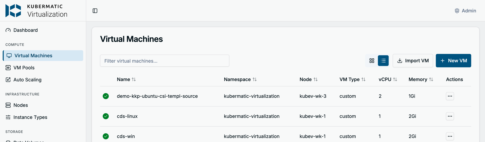

The form is one page. The **Sections** list on the right shows what each section currently holds and jumps to
it. **Create VM** sits in the page header, and nothing is created until you choose it.

## Step 2: Name, placement and operating system

| Field | What to enter |
| --- | --- |
| **Name** | Lowercase letters, digits and `-`, at most 63 characters, unique in the namespace. The VM's hostname is the same. |
| **Node** | **Auto-select** lets the scheduler place the VM and allows live migration (on storage that supports ReadWriteMany). Pin a node only when the VM must run there. |
| **Run Strategy** | **Always** starts the VM right after creation and restarts it when it stops. **Halted** creates it stopped. **Manual**, **Once** and **RerunOnFailure** are the KubeVirt run strategies of the same name. |
| **Operating System Preset** | The operating system the disk image contains. Pick one when you can. |

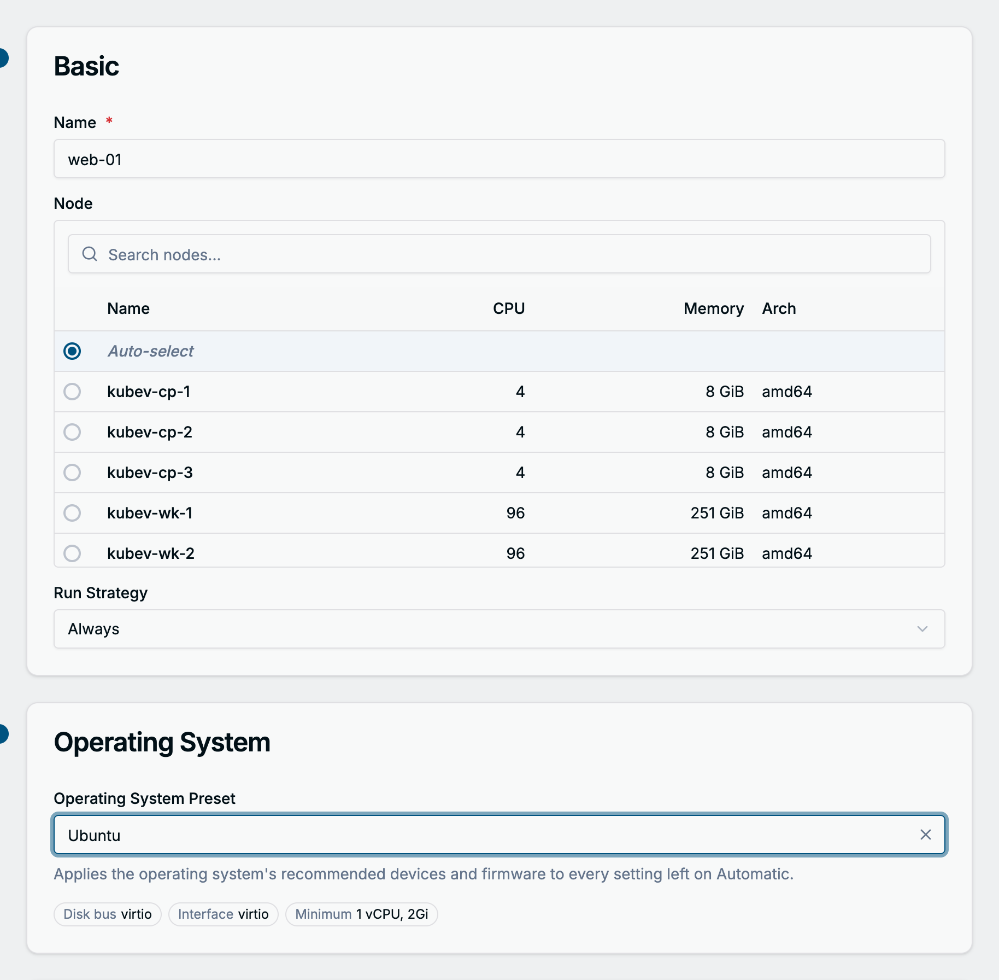

A preset is a KubeVirt cluster preference. It sets the disk bus, network interface model and firmware for
everything you leave on **Automatic**, preselects a matching image in the first disk, and shows its minimum CPU
and memory below the field. A size below that minimum is refused when you create the VM.

**Metadata** adds labels and annotations. Both land on the VM and on the pods it runs in.

**The same with YAML**

```yaml
apiVersion: kubevirt.io/v1
kind: VirtualMachine
metadata:
  name: web-01
  namespace: kubermatic-virtualization
spec:
  runStrategy: Always
  preference:
    kind: VirtualMachineClusterPreference
    name: ubuntu
```

```bash
kubectl get virtualmachineclusterpreferences
```

## Step 3: Choose a size

**CPU / Memory** offers two ways to fill the required **VM Type**.

**Instance type**: the **CPU** and **GPU** tabs list the cluster's instance types with their vCPU count, memory
and, on the GPU tab, their GPUs. The second line of each name is its series, such as Universal (burstable CPU,
1 vCPU to 4 GiB) or Compute Exclusive (dedicated CPUs with hugepages). Search by name or series, sort any column,
and pick a row. The selection shows above the tabs.

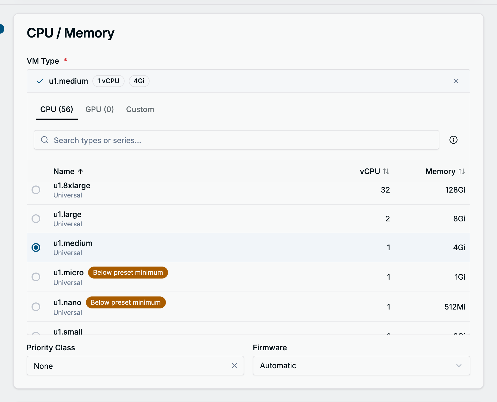

Two badges can appear next to a name:

- **Below preset minimum**: smaller than the operating system preset requires. Creating the VM with it fails
  with "Below the preset minimum".
- **No fitting node**: the type needs dedicated CPUs or hugepages that no schedulable node provides. Selecting it
  shows **This instance type may not schedule** with the missing feature. Creation is not blocked, but the VM
  stays unschedulable until a node provides the feature. Enable the kubelet's static CPU manager policy or
  reserve hugepages on a node, or pick another type.

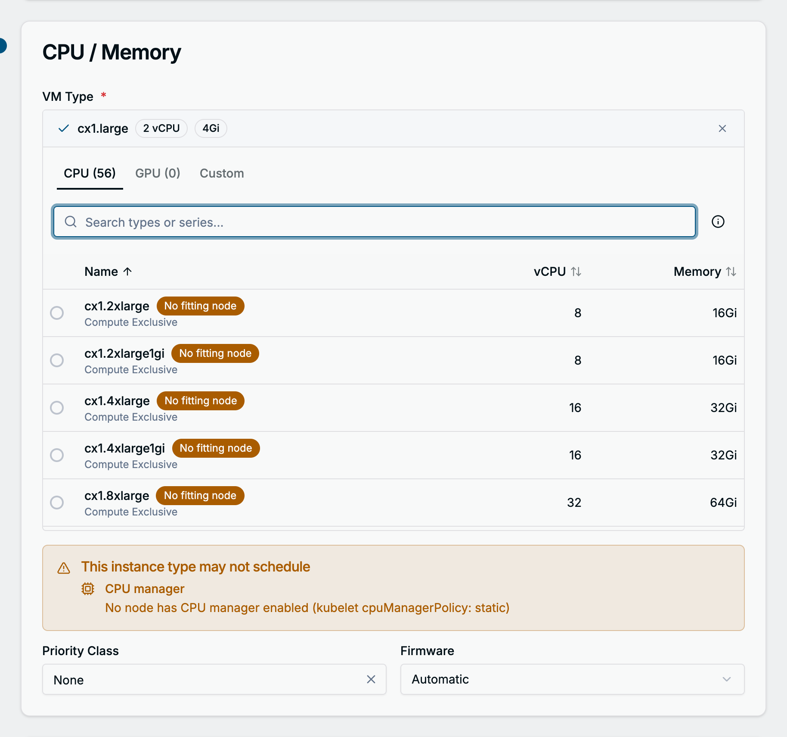

A VM that cannot be scheduled says so on its page: a **Cannot be scheduled** banner with the scheduler's
message and the likely causes. A stopped VM whose instance type fits no node shows **This VM may not start**,
and **Start** asks for confirmation.

**Custom**: enter **Sockets**, **Cores**, **Threads** and **Memory (GB)** yourself. The Custom tab is also
where GPUs are attached: **Add GPU**, pick the **Device** from the devices the cluster permits (or type the
resource name when none are advertised), keep or change the **Name**, and set a **Count**. **vGPU Display**
turns on the virtual display of one GPU, for guests that need a GPU-backed display.

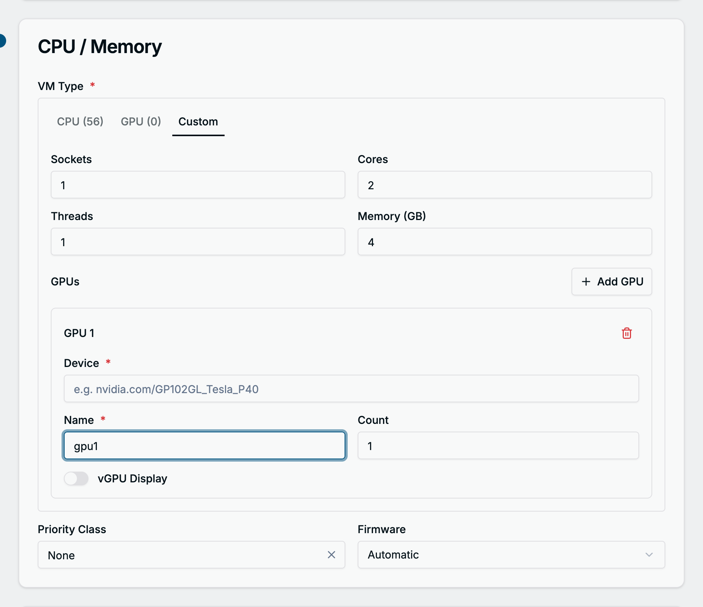

**Priority Class** and **Firmware** (**Automatic**, **BIOS** or **UEFI**, with a **Secure Boot** switch for
UEFI) sit below the size.

**The same with YAML**

```yaml
spec:
  # Instance type
  instancetype:
    kind: VirtualMachineClusterInstancetype
    name: u1.medium
```

```yaml
spec:
  # Custom size with one GPU, instead of spec.instancetype
  template:
    spec:
      domain:
        cpu:
          sockets: 1
          cores: 2
          threads: 1
        resources:
          requests:
            memory: 4Gi
        devices:
          gpus:
            - name: gpu1
              deviceName: nvidia.com/GP102GL_Tesla_P40
```

```bash
kubectl get virtualmachineclusterinstancetypes
```

## Step 4: Disks

The form starts with one disk of type **Image**. Choose **Select image...** and pick an image of the namespace.

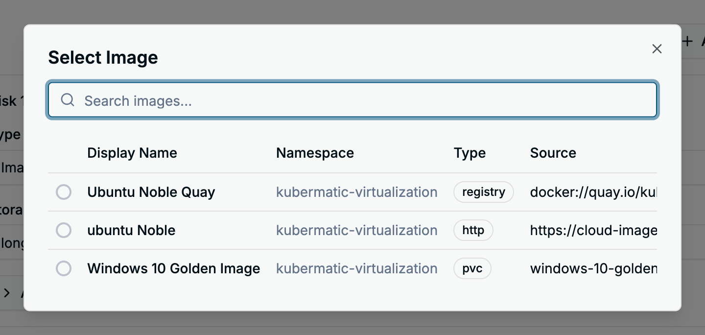

| Field | What to enter |
| --- | --- |
| **Type** | **Image** copies an image into a new disk. **Blank** creates an empty disk. **DataVolume** attaches an existing DataVolume as it is. |
| **Size (GB)** | The disk size, at least as large as the image. Not editable for an existing DataVolume. |
| **Storage Class** | Prefilled with the cluster's default storage class. |
| **Boot Order** | Unique per disk. The lowest boots first. |

**Advanced options** holds the **Access Mode**, **Volume Mode**, **Bus** and **Cache** of the disk. On
**Automatic** the storage class' StorageProfile decides access and volume mode, and the operating system preset
decides the bus. The form warns when the storage class has no StorageProfile capabilities; set the modes
explicitly then.

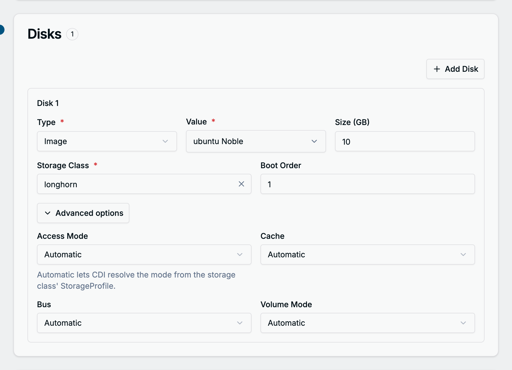

**Add Disk** adds a second disk with the next boot order. The dashboard creates one DataVolume per Image or
Blank disk, named `<vm name>-disk<n>`, before it creates the VM. The disks of an existing VM are managed on its
**Disks** tab.

**The same with YAML**

A DataVolume copies the image into a PersistentVolumeClaim. The dashboard creates it as a separate object;
with `kubectl` you can embed it in the VM as a `dataVolumeTemplates` entry, as in the full example at the end.

```yaml
apiVersion: cdi.kubevirt.io/v1beta1
kind: DataVolume
metadata:
  name: web-01-disk0
  namespace: kubermatic-virtualization
spec:
  storage:
    storageClassName: longhorn
    resources:
      requests:
        storage: 10Gi
  source:
    http:
      url: https://cloud-images.ubuntu.com/noble/current/noble-server-cloudimg-amd64.img
```

```bash
kubectl get datavolumes -n kubermatic-virtualization
```

## Step 5: Networking

The form starts with one empty **NIC**. Nothing is preselected: pick a **VPC** and then a **Subnet** of that
VPC on the **Overlay** tab, or a ready **Underlay Subnet** on the **Underlay** tab. The subnet's default
gateway appears under the field, and the VM gets an address from the subnet when it starts.

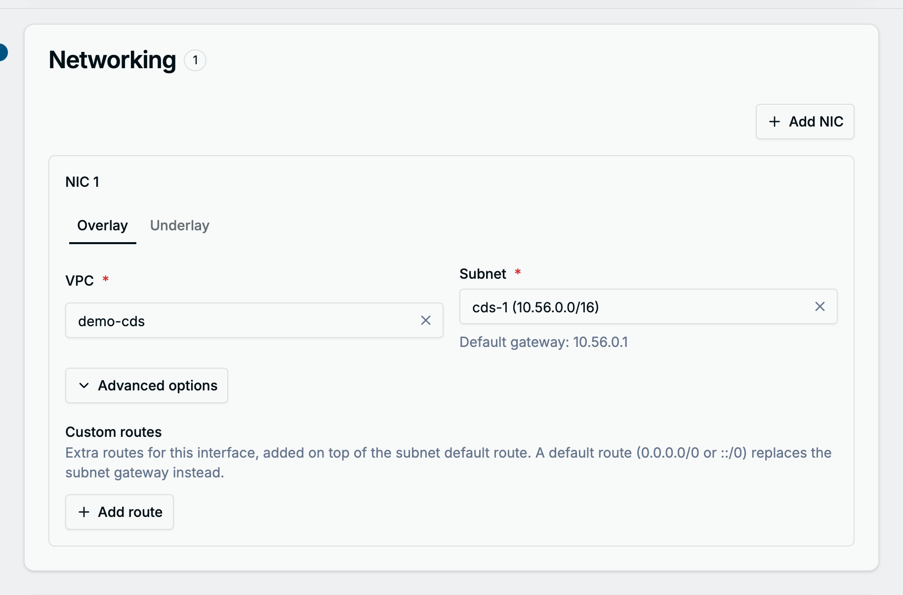

**Advanced options** holds **Custom routes**: extra routes for this interface on top of the subnet's default
route. A route to `0.0.0.0/0` or `::/0` replaces the subnet gateway instead.

**Add NIC** attaches another subnet; a subnet can be used by one NIC only. The first NIC is the VM's default
network.

**The same with YAML**

Each NIC becomes a Multus network on the subnet's NetworkAttachmentDefinition, and the pod template names the
subnet in a Kube-OVN annotation. [VMs Network Assignment]()
explains how to find the NetworkAttachmentDefinition and the real name of a subnet.

```yaml
spec:
  template:
    metadata:
      annotations:
        kubermatic-virtualization-cds-1-sn.kubermatic-virtualization.ovn.kubernetes.io/logical_switch: kubermatic-virtualization-cds-1-sn
    spec:
      domain:
        devices:
          interfaces:
            - name: net0
              bridge: {}
      networks:
        - name: net0
          multus:
            networkName: kubermatic-virtualization/kubermatic-virtualization-cds-1-sn
            default: true
```

## Step 6: Cloud-init

**Cloud Init** is enabled by default and runs once, on the VM's first boot. **Driver** is the bus of the
cloud-init disk; leave it on **Automatic** unless the guest cannot read it.

**Guided** asks for a **Username** and either a **Password** or an **SSH Key** from the SSH Keys page, and
takes an **Init Script** that runs line by line at the end of the first boot. The user gets passwordless sudo.
Without a username no user is created, and the VM has no login.
A password is stored in plain text in the VM definition and expires at the first login, so prefer an SSH key.

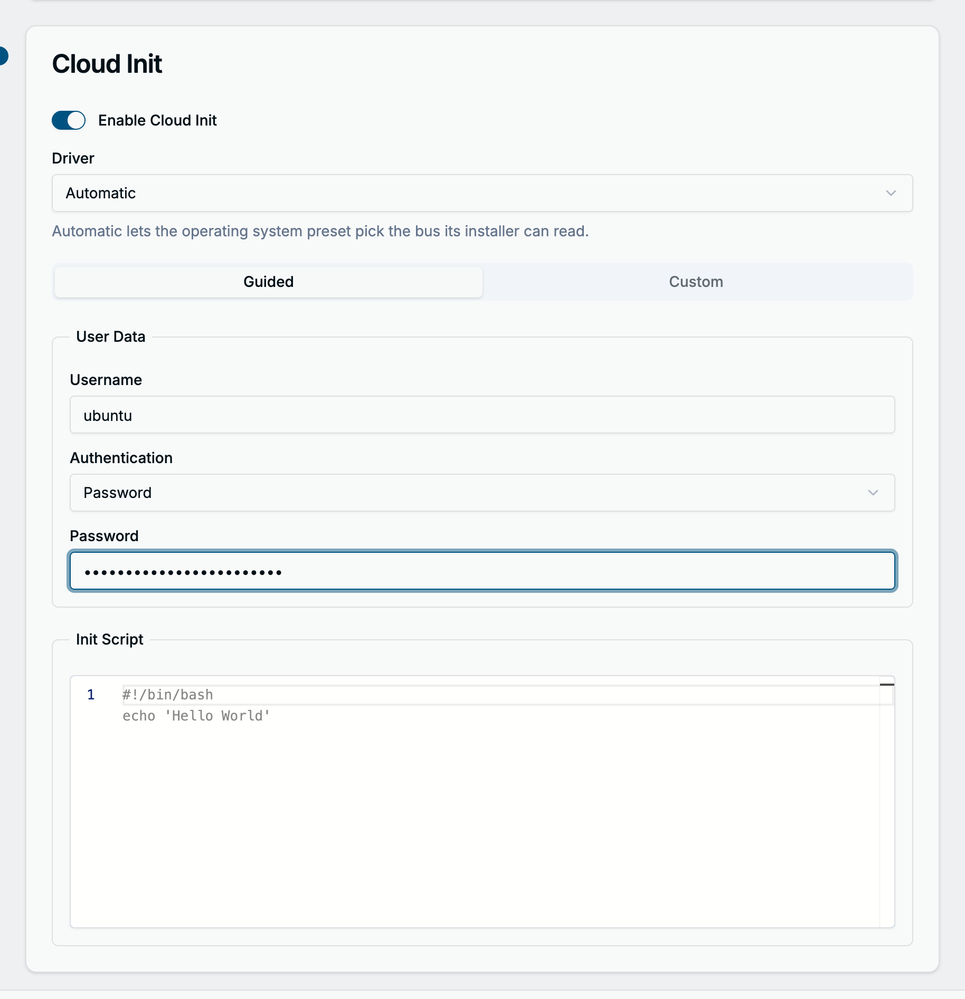

**Custom** shows the full cloud-init **User Data** and an optional **Network Data** document in a YAML editor
with validation. Switching to Custom fills the editor from the guided values, so an existing cloud-config can
start from there. Once you edit the text, the form never overwrites it.

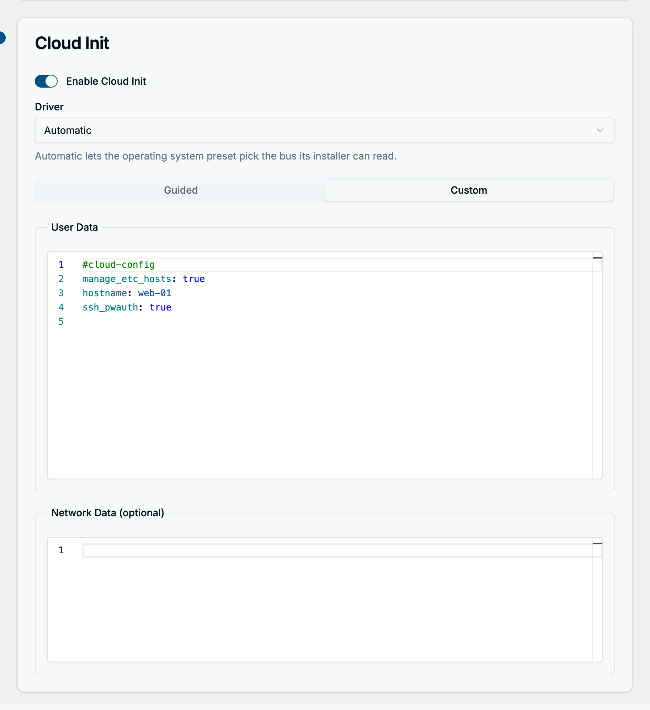

**The same with YAML**

```yaml
spec:
  template:
    spec:
      domain:
        devices:
          disks:
            - name: cloudinitdisk
              disk: {}
      volumes:
        - name: cloudinitdisk
          cloudInitNoCloud:
            userData: |
              #cloud-config
              hostname: web-01
              manage_etc_hosts: true
              users:
                - name: ubuntu
                  sudo: ALL=(ALL) NOPASSWD:ALL
                  shell: /bin/bash
                  ssh_authorized_keys:
                    - ssh-ed25519 AAAA... user@example.com
              runcmd:
                - apt-get update
```

## Optional: Edit as YAML

**Edit as YAML** in the page header shows the VirtualMachine manifest the form would create, generated from
everything you filled in so far, and lets you change it in a YAML editor before creating. Use it for settings
the form has no field for.

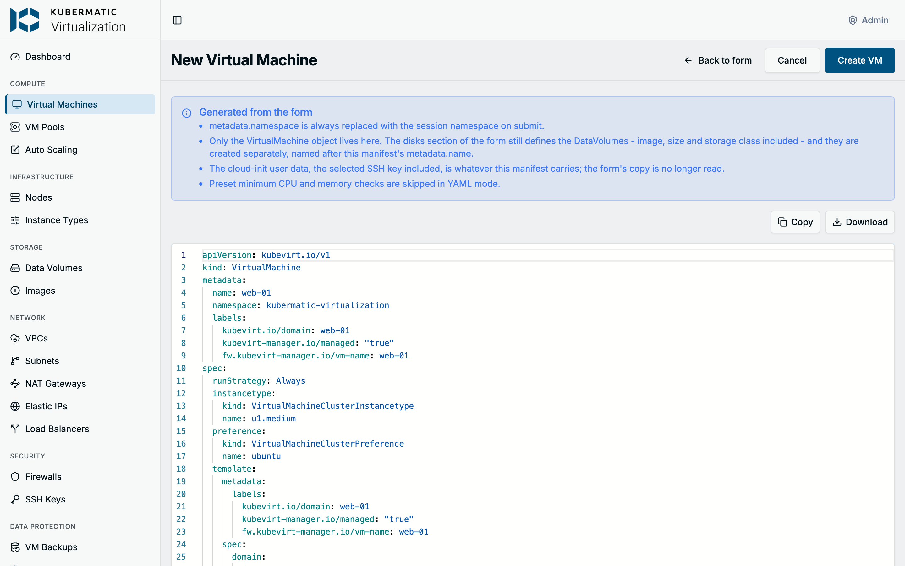

What applies in YAML mode:

- Your edits are created only while YAML mode is open. **Back to form** keeps them, but as long as the form is
  open it is the form's values that are created.
- Only the VirtualMachine lives in the editor. The disks and their DataVolumes still come from the **Disks**
  section and are named after the manifest's `metadata.name`.
- The cloud-init user data is whatever the manifest carries; the form's copy is no longer read.
- `metadata.namespace` is always replaced with the namespace you work in.
- The dashboard skips its preset minimum check, but KubeVirt still rejects a VM below the minimum.

**Copy** and **Download** export the manifest for `kubectl`.

## Step 7: Create the VM

Choose **Create VM**. The dashboard checks the name, creates the DataVolumes, then the VirtualMachine, and opens
the VM's page. With **Run Strategy** on **Always**, the VM boots as soon as its disks are imported.

**The same with YAML**

A complete VM from the steps above, with the boot disk as a DataVolume template. Replace the subnet names with
the real name of your subnet.

```yaml
apiVersion: kubevirt.io/v1
kind: VirtualMachine
metadata:
  name: web-01
  namespace: kubermatic-virtualization
spec:
  runStrategy: Always
  instancetype:
    kind: VirtualMachineClusterInstancetype
    name: u1.medium
  preference:
    kind: VirtualMachineClusterPreference
    name: ubuntu
  dataVolumeTemplates:
    - metadata:
        name: web-01-disk0
      spec:
        storage:
          resources:
            requests:
              storage: 10Gi
        source:
          http:
            url: https://cloud-images.ubuntu.com/noble/current/noble-server-cloudimg-amd64.img
  template:
    metadata:
      annotations:
        kubermatic-virtualization-cds-1-sn.kubermatic-virtualization.ovn.kubernetes.io/logical_switch: kubermatic-virtualization-cds-1-sn
    spec:
      evictionStrategy: LiveMigrate
      domain:
        devices:
          disks:
            - name: disk0
              disk: {}
              bootOrder: 1
            - name: cloudinitdisk
              disk: {}
          interfaces:
            - name: net0
              bridge: {}
      networks:
        - name: net0
          multus:
            networkName: kubermatic-virtualization/kubermatic-virtualization-cds-1-sn
            default: true
      volumes:
        - name: disk0
          dataVolume:
            name: web-01-disk0
        - name: cloudinitdisk
          cloudInitNoCloud:
            userData: |
              #cloud-config
              hostname: web-01
              manage_etc_hosts: true
              users:
                - name: ubuntu
                  sudo: ALL=(ALL) NOPASSWD:ALL
                  shell: /bin/bash
                  ssh_authorized_keys:
                    - ssh-ed25519 AAAA... user@example.com
```

```bash
kubectl apply -f web-01.yaml
kubectl get vm,vmi,datavolumes -n kubermatic-virtualization
```

## Use the VM

The VM's page shows its status, size, node and IP address. **Stop**, **Start** and the **...** menu with
**Restart**, **Pause**, **Migrate** and **Delete** are in the header. The **Console** tab opens a VNC console
in the page, with a **Serial** console as an alternative; the **Networking** and **Disks** tabs list the
interfaces and disks, and **Events** shows what Kubernetes did with the VM.

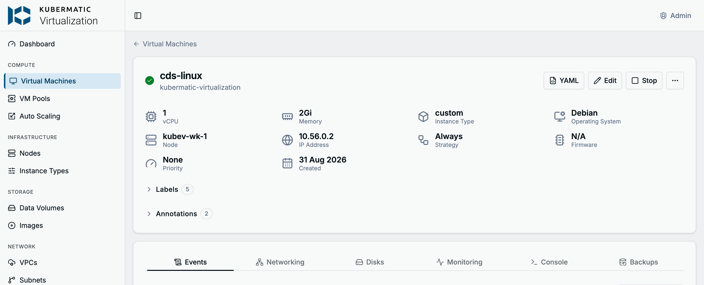

```bash
virtctl console web-01 -n kubermatic-virtualization
virtctl stop web-01 -n kubermatic-virtualization
virtctl start web-01 -n kubermatic-virtualization
```

## Edit a VM

**Edit** in the header opens an edit page with the same sections as the form. Run strategy, node, preset,
labels, size, GPUs, priority class, firmware and NICs can be changed; the name and namespace cannot. Disks are
managed on the VM's **Disks** tab, and cloud-init is read-only because it only runs on the first boot. Changes
that only apply after a restart are marked as such, and saving them on a running VM offers to restart it.

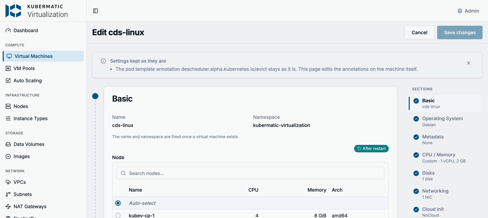

## Troubleshooting

| Message | What to do |
| --- | --- |
| `Below the preset minimum (...)` on the VM Type or the custom size | Pick a larger instance type or size, or choose **None (manual configuration)** as the preset. |
| `VM "<name>" already exists` | Choose another name. |
| `DataVolume "<name>" already exists with a different configuration` | A deleted VM of the same name left its disk behind. Delete it under **Storage** > **Data Volumes**, or use another VM name. |
| **Cannot be scheduled** on the VM's page | Read the scheduler message and the likely causes. For instance type mismatches, enable the missing node feature or change the type with **Edit**. |
| The status icon keeps spinning (**Provisioning**) | The DataVolume is still importing the image. Follow it under **Storage** > **Data Volumes**; check the image URL and the storage class when it does not progress. |
