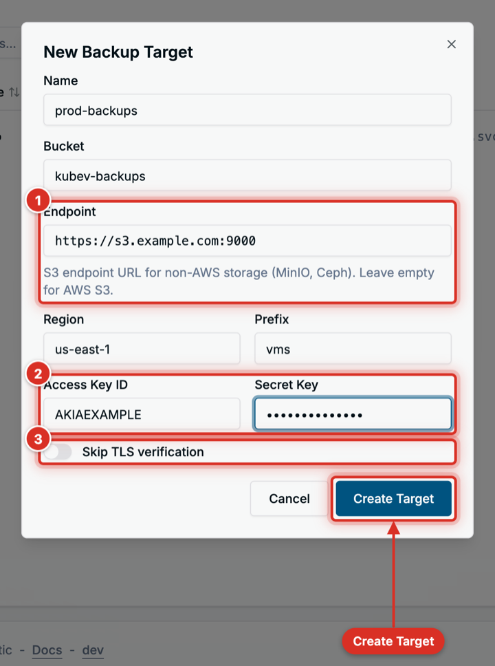
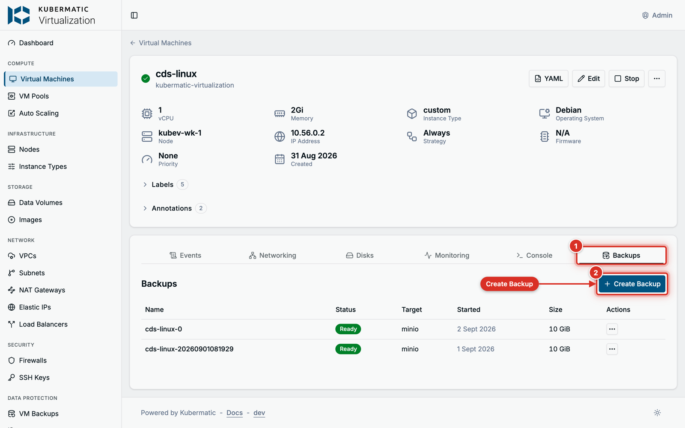
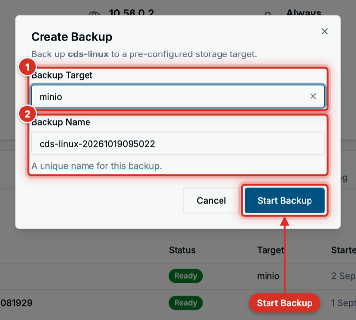
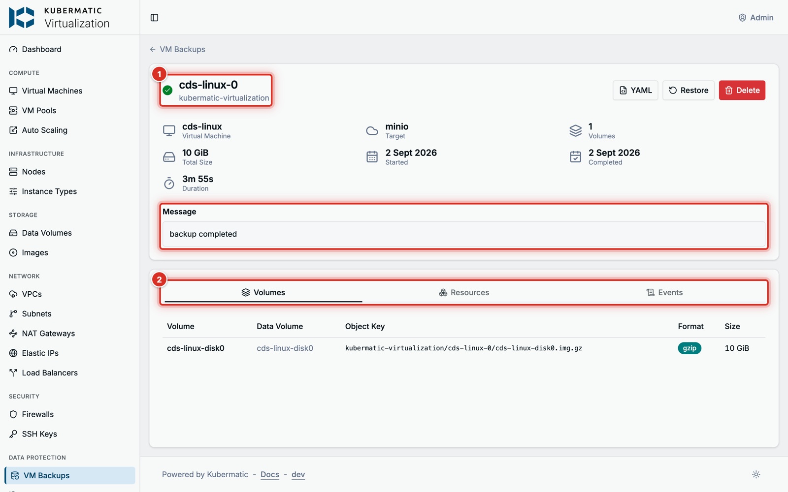
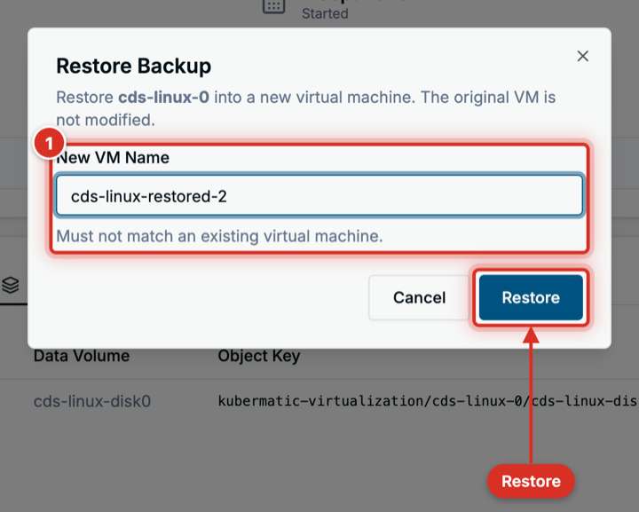

+++
title = "VM Backup and Restore"
date = 2026-10-19T00:00:00+00:00
weight = 2
+++

This guide backs up a virtual machine to S3-compatible object storage and restores it as a new VM.
Every step shows the dashboard first, then the equivalent YAML for `kubectl`.

Running KubeV inside a KDP project? Read [VM Backups and Restores in KDP]()
instead: the steps are the same, but the restore and the endpoint rules differ.

## Before you start

- A cluster installed with `kubermatic-virtualization apply`. The installer enables KubeVirt snapshots
  and installs the snapshot controller, so a **running** VM can be backed up on Longhorn storage.
  On other storage, add a `VolumeSnapshotClass` for your CSI driver, or stop the VM before backing it up.
- An S3-compatible bucket and an access key for it: AWS S3, MinIO, Ceph RGW or similar.
- A VM whose disks are backed by DataVolumes. VMs created in the dashboard are. Container disks are
  left out of a backup, and a disk that references a PersistentVolumeClaim directly cannot be backed up.

| Object | Dashboard name | What it is |
| --- | --- | --- |
| `BackupStorageLocation` | **Backup Target** | A bucket plus the Secret holding its access key. |
| `VMBackup` | **VM Backup** | One backup of one VM, to one target. |
| `VMRestore` | **VM Restore** | One restore of a backup, into a new VM. |

All three live in the VM's namespace. A backup can only use a target in its own namespace.
The three pages sit under **Data Protection** in the sidebar.


## Step 1: Create a backup target

Go to **Data Protection** > **Backup Targets** and choose **New Backup Target**.


| Field | What to enter |
| --- | --- |
| **Name** | A name for the target, for example `prod-backups`. |
| **Bucket** | The bucket name. |
| **Endpoint** | The S3 endpoint as a full URL, such as `https://s3.example.com:9000`. Leave it empty for AWS S3. An in-cluster service such as `http://minio.minio.svc:9000` works too. |
| **Region** | The bucket's region. `us-east-1` when empty. |
| **Prefix** | Optional. A path inside the bucket, so several targets can share one bucket. |
| **Access Key ID** / **Secret Key** | The S3 credentials. The dashboard stores them in a Secret named `<name>-creds`. |
| **Skip TLS verification** | Only for an endpoint whose certificate the cluster does not trust. Such a target can be backed up to, but a restore from it also needs a CA bundle, see [Private certificate authorities](#private-certificate-authorities). |



The target turns **Ready** once its Secret is found. KubeV checks the target's settings, not the
bucket: a wrong key or bucket name shows up when the first backup runs.

**The same with YAML**

```yaml
apiVersion: v1
kind: Secret
metadata:
  name: prod-backups-creds
  namespace: kubermatic-virtualization
stringData:
  accessKeyId: AKIAEXAMPLE
  secretKey: example-secret
---
apiVersion: virtualization.k8c.io/v1alpha1
kind: BackupStorageLocation
metadata:
  name: prod-backups
  namespace: kubermatic-virtualization
spec:
  provider: s3
  bucket: kubev-backups
  endpoint: https://s3.example.com:9000
  region: us-east-1
  prefix: vms
  credentialsSecretRef: prod-backups-creds
```

```bash
kubectl get backupstoragelocations -n kubermatic-virtualization
```

### Private certificate authorities

For an endpoint signed by a private CA, put the CA certificate in a ConfigMap in the target's
namespace and name it in `spec.caBundleConfigMapRef`, with **Edit YAML** on the target or `kubectl`.
Backups upload with that bundle or with **Skip TLS verification**; restores import through CDI,
which needs the bundle and cannot skip verification.

## Step 2: Back up a VM

Open the VM, switch to its **Backups** tab and choose **Create Backup**.



Pick a **Backup Target** in the VM's namespace, keep or change the **Backup Name** (at most 50
characters) and choose **Start Backup**.



The backup shows **Pending** or **Provisioning** while it runs, then **Ready** or **Failed**. Both are
final: to retry a failed backup, delete it and create a new one. Follow it on the VM's **Backups** tab
or under **Data Protection** > **VM Backups**.


What KubeV does:

1. Saves the VM's definition, so a restore can rebuild the VM.
2. Reads the disks from a volume snapshot when every disk's storage supports snapshots. The VM keeps
   running. Otherwise it reads the disks directly, and the VM must be stopped.
3. Streams each disk, compressed, to `<prefix>/<namespace>/<backup name>/` in the bucket, next to a
   `manifest.yaml` of the VM.

Open a backup to see its message, the uploaded volumes with their sizes, the saved VM manifest and the
events of the run.



**The same with YAML**

```yaml
apiVersion: virtualization.k8c.io/v1alpha1
kind: VMBackup
metadata:
  name: web-01-20261019
  namespace: kubermatic-virtualization
spec:
  vmName: web-01
  storageLocation: prod-backups
```

```bash
kubectl get vmbackups -n kubermatic-virtualization
```

{}
**A backup can only be restored while its VM Backup object exists.** Deleting the VM Backup also
deletes its data in the bucket.
{}

## Step 3: Restore a VM

A restore always creates a **new** VM in the backup's namespace. The original VM is never changed.

Go to **Data Protection** > **VM Backups**, open a **Ready** backup and choose **Restore**. Enter a
**New VM Name** that no VM in the namespace uses yet, and choose **Restore**.



Follow the restore under **Data Protection** > **VM Restores**. KubeV creates the VM stopped and
imports each disk from the bucket. Once the restore is **Ready**, open the restored VM and start it.


**The same with YAML**

```yaml
apiVersion: virtualization.k8c.io/v1alpha1
kind: VMRestore
metadata:
  name: web-01-restore
  namespace: kubermatic-virtualization
spec:
  backupName: web-01-20261019
  targetVMName: web-01-restored
  # Optional. The cluster's default storage class when empty.
  storageClassName: longhorn
```

```bash
kubectl get vmrestores -n kubermatic-virtualization
virtctl start web-01-restored -n kubermatic-virtualization
```

Deleting a restore removes only the record. The restored VM stays.

## Delete backups and targets

- **Deleting a backup** also deletes its data in the bucket.
- **Deleting a target** deletes its credentials Secret and leaves the bucket alone. Delete its backups
  first: a backup deleted after its target cannot reach the bucket, and its data stays there.

## Troubleshooting

The message is on the backup's or restore's page, and in `kubectl get vmbackups`.

| Message | What to do |
| --- | --- |
| `credentials secret <name> not found` | Create the Secret in the target's namespace with the keys `accessKeyId` and `secretKey`. |
| `no VolumeSnapshotClass exists for CSI driver <driver>; ...` | Add a `VolumeSnapshotClass` for the driver, or stop the VM, then delete the backup and create a new one. |
| `volume snapshots are unavailable on this cluster; stop the virtual machine ...` | Stop the VM, then delete the backup and create a new one. Re-run `kubermatic-virtualization apply` to install snapshot support. |
| `volume "<name>" uses a PersistentVolumeClaim, which restore does not support` | The VM cannot be backed up as it is. See [Before you start](#before-you-start). |
| `image pull secret "<name>" not found in namespace "<namespace>"` | The cluster pulls from a private registry. Copy the controller-manager's pull Secret into the VMBackup's namespace; the backup continues on its own. |
| `upload job failed` | Check the target's bucket, endpoint and credentials, then create a new backup. |
| `target virtual machine "<name>" already exists` | Restore again with a name no VM uses. |
| `timed out waiting for volume imports to complete` | The disks did not import within an hour. Check that the bucket is reachable from the cluster, then restore again. |
