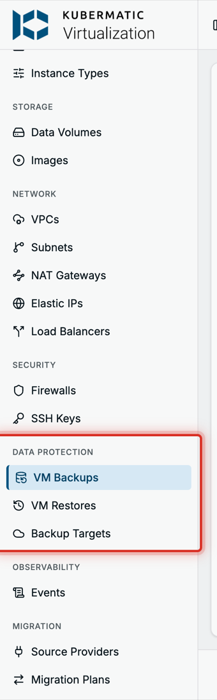
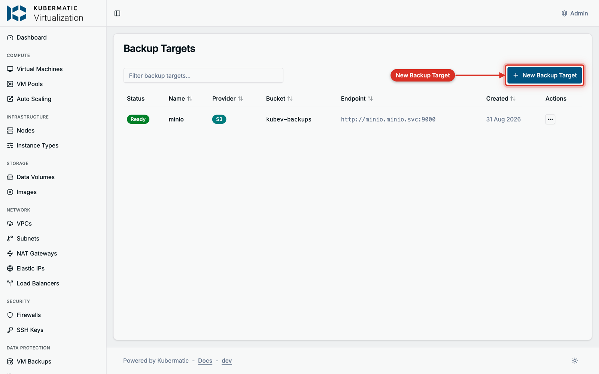
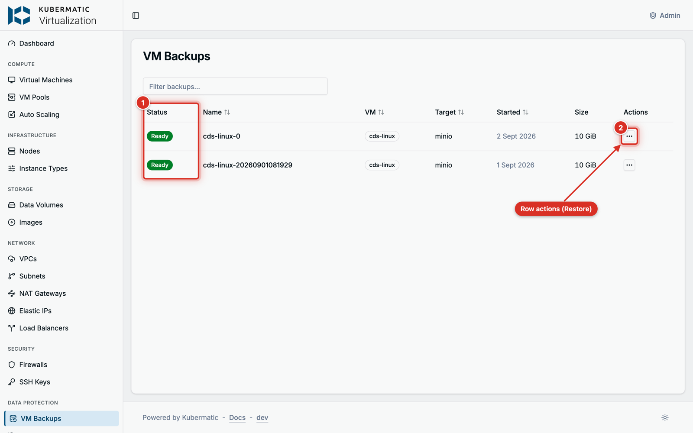
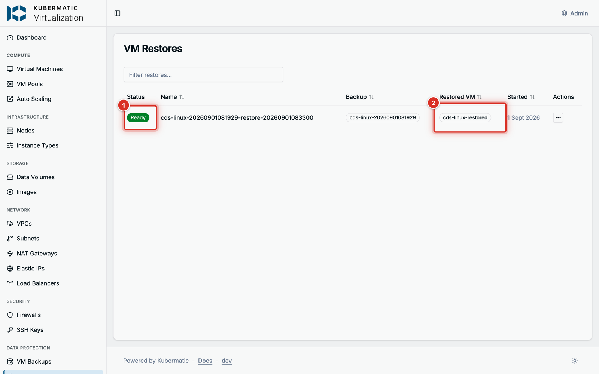
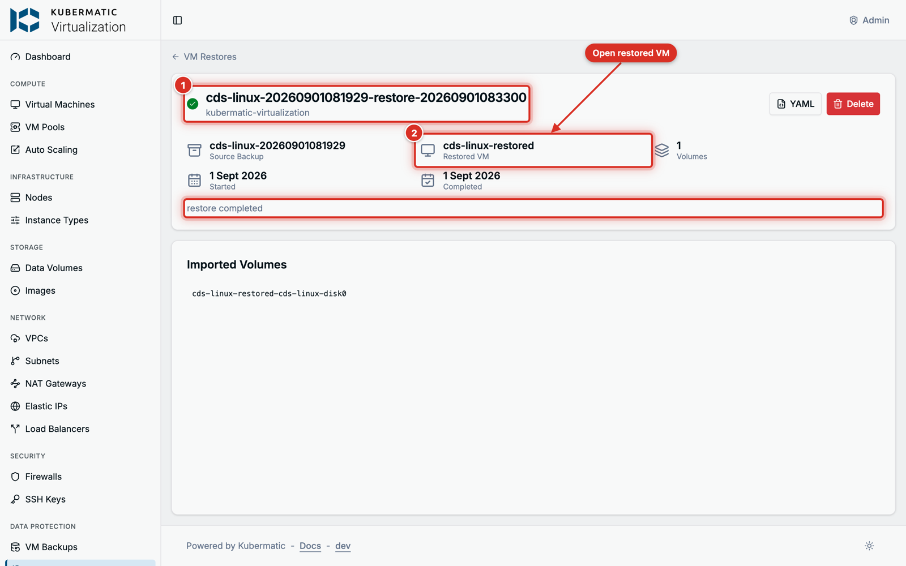

+++
title = "VM Backup and Restore"
date = 2026-10-19T00:00:00+00:00
weight = 2
+++

This guide backs up a virtual machine to S3-compatible object storage and restores it as a new VM.
Every step shows the dashboard first, then the equivalent YAML for `kubectl`.

Running KubeV inside a KDP project? Read [VM Backups and Restores in KDP]()
instead: the steps are the same, but the restore and the endpoint rules differ.

## Before you start

- A cluster installed with `kubermatic-virtualization apply`. The installer enables KubeVirt snapshots
  and installs the snapshot controller, so a **running** VM can be backed up on Longhorn storage.
  On other storage, add a `VolumeSnapshotClass` for your CSI driver, or stop the VM before backing it up.
- An S3-compatible bucket and an access key for it: AWS S3, MinIO, Ceph RGW or similar.
- A VM with at least one disk backed by a DataVolume. VMs created in the dashboard qualify. Container
  disks are left out of a backup, and a disk that references a PersistentVolumeClaim directly cannot be
  backed up.

| Object | Dashboard name | What it is |
| --- | --- | --- |
| `BackupStorageLocation` | **Backup Target** | A bucket plus the Secret holding its access key. |
| `VMBackup` | **VM Backup** | One backup of one VM, to one target. |
| `VMRestore` | **VM Restore** | One restore of a backup, into a new VM. |

All three live in the VM's namespace. A backup can only use a target in its own namespace.
The three pages sit under **Data Protection** in the sidebar.



## Step 1: Create a backup target

Go to **Data Protection** > **Backup Targets** and choose **New Backup Target**.



| Field | What to enter |
| --- | --- |
| **Name** | A name for the target, for example `prod-backups`. |
| **Bucket** | The bucket name. |
| **Endpoint** | The S3 endpoint as a full URL, such as `https://s3.example.com:9000`. Leave it empty for AWS S3. An in-cluster service such as `http://minio.minio.svc:9000` works too. |
| **Region** | The bucket's region. `us-east-1` when empty. |
| **Prefix** | Optional. A path inside the bucket, so several targets can share one bucket. |
| **Access Key ID** / **Secret Key** | The S3 credentials. The dashboard stores them in a Secret named `<name>-creds`. |
| **Skip TLS verification** | Only for an `https` endpoint whose certificate the cluster does not trust. See [Private certificate authorities](#private-certificate-authorities). |

, credentials (2), TLS switch (3)")

The target turns **Ready** once its Secret is found; a target whose Secret is missing turns **Failed**
and is checked again every five minutes. KubeV checks the target's settings, not the bucket: a wrong
key or bucket name shows up when the first backup runs.

**The same with YAML**

```yaml
apiVersion: v1
kind: Secret
metadata:
  name: prod-backups-creds
  namespace: kubermatic-virtualization
stringData:
  accessKeyId: AKIAEXAMPLE
  secretKey: example-secret
---
apiVersion: virtualization.k8c.io/v1alpha1
kind: BackupStorageLocation
metadata:
  name: prod-backups
  namespace: kubermatic-virtualization
spec:
  provider: s3
  bucket: kubev-backups
  endpoint: https://s3.example.com:9000
  region: us-east-1
  prefix: vms
  credentialsSecretRef: prod-backups-creds
```

```bash
kubectl get backupstoragelocations -n kubermatic-virtualization
```

### Private certificate authorities

An `https` endpoint signed by a private CA needs two settings, because backups and restores take
different paths:

- **Backups** upload with the cluster's trusted CAs only. Turn on **Skip TLS verification**.
- **Restores** import through CDI, which cannot skip verification. Put the CA certificate in a
  ConfigMap in the target's namespace and name it in `spec.caBundleConfigMapRef`, with **Edit YAML**
  on the target or `kubectl`.

A target that skips verification without a CA bundle can be backed up to, but not restored from.
Plain `http` endpoints need neither.

## Step 2: Back up a VM

Open the VM, switch to its **Backups** tab and choose **Create Backup**. The VM's actions menu offers
it too.

 and its Create Backup button (2)")

Pick a **Backup Target** in the VM's namespace, keep or change the **Backup Name** (at most 50
characters) and choose **Start Backup**.

 and name (2)")

The backup shows **Pending** or **Provisioning** while it runs, then **Ready** or **Failed**. Both are
final: to retry a failed backup, delete it and create a new one. Follow it on the VM's **Backups** tab
or under **Data Protection** > **VM Backups**.



What KubeV does:

1. Saves the VM's definition, so a restore can rebuild the VM.
2. Reads the disks from a volume snapshot when every disk's storage supports snapshots. The VM keeps
   running. Otherwise it reads the disks directly, and the VM must be stopped.
3. Streams each disk, compressed, to `<prefix>/<namespace>/<backup name>/` in the bucket, next to a
   `manifest.yaml` of the VM.

Open a backup to see its message, the uploaded volumes with their sizes, the names of its snapshot,
export and manifest object, and the events of the run. The upload must finish within an hour.

, Volumes, Resources and Events tabs (2)")

**The same with YAML**

```yaml
apiVersion: virtualization.k8c.io/v1alpha1
kind: VMBackup
metadata:
  name: web-01-20261019
  namespace: kubermatic-virtualization
spec:
  vmName: web-01
  storageLocation: prod-backups
```

```bash
kubectl get vmbackups -n kubermatic-virtualization
```

{}
**A backup can only be restored while its VM Backup object exists.** Deleting the VM Backup also
deletes its data in the bucket.
{}

## Step 3: Restore a VM

A restore always creates a **new** VM in the backup's namespace. The original VM is never changed.

Go to **Data Protection** > **VM Backups**, open a **Ready** backup and choose **Restore**. Enter a
**New VM Name** (at most 63 characters) that no VM in the namespace uses yet, and choose **Restore**.

")

Follow the restore under **Data Protection** > **VM Restores**. KubeV creates the VM stopped and
imports each disk from the bucket. Once the restore is **Ready**, open the restored VM and start it.





**The same with YAML**

```yaml
apiVersion: virtualization.k8c.io/v1alpha1
kind: VMRestore
metadata:
  name: web-01-restore
  namespace: kubermatic-virtualization
spec:
  backupName: web-01-20261019
  targetVMName: web-01-restored
  # Optional. Keeps each disk's original storage class when empty.
  storageClassName: longhorn
```

```bash
kubectl get vmrestores -n kubermatic-virtualization
virtctl start web-01-restored -n kubermatic-virtualization
```

Deleting a restore removes only the record. The restored VM stays.

## Delete backups and targets

- **Deleting a backup** also deletes its data in the bucket.
- **Deleting a target** leaves the bucket alone; the dashboard also deletes its credentials Secret.
  Delete its backups first: a backup deleted after its target cannot reach the bucket, and its data
  stays there.

## Troubleshooting

The message is on the target's, backup's or restore's page, and in `kubectl get backupstoragelocations`,
`vmbackups` and `vmrestores`.

| Message | What to do |
| --- | --- |
| `credentials secret <name> not found` or `... must contain keys accessKeyId and secretKey` | Create the Secret in the target's namespace with both keys. The target recovers within five minutes. |
| `CA bundle configmap <name> not found` | Create the ConfigMap in the target's namespace. See [Private certificate authorities](#private-certificate-authorities). |
| `no VolumeSnapshotClass exists for CSI driver <driver>; ...` | Add a `VolumeSnapshotClass` for the driver, or stop the VM, then delete the backup and create a new one. |
| `volume snapshots are unavailable on this cluster; stop the virtual machine ...` | Stop the VM, then delete the backup and create a new one. Re-run `kubermatic-virtualization apply` to install snapshot support. |
| `timed out waiting for snapshot to be ready; ...` | No `VolumeSnapshotClass` matched the disk's CSI driver within ten minutes. Add one, or stop the VM, then delete the backup and create a new one. |
| `volume "<name>" uses a PersistentVolumeClaim, which restore does not support` or `virtual machine has no DataVolume-backed disks` | The VM cannot be backed up as it is. See [Before you start](#before-you-start). |
| `image pull secret "<name>" not found in namespace "<namespace>"` | The cluster pulls from a private registry. Copy the controller-manager's pull Secret into the VMBackup's namespace; the backup continues on its own. |
| `upload job failed` | Check the target's bucket, endpoint and credentials, then create a new backup. |
| `target virtual machine "<name>" already exists` | Restore again with a name no VM uses. |
| `storage location "<name>" skips TLS verification but sets no caBundleConfigMapRef` | Add a CA bundle to the target. See [Private certificate authorities](#private-certificate-authorities). |
| `timed out waiting for volume imports to complete` | The disks did not import within an hour. Check that the bucket is reachable from the cluster, then restore again. |
