+++
title = "VM Migration from vSphere"
date = 2026-10-19T00:00:00+00:00
weight = 3
+++

This guide moves virtual machines from a VMware vCenter into KubeV with a migration plan. KubeV uses
<a href="https://github.com/kubev2v/forklift" target="_blank" rel="noopener noreferrer">Forklift</a> for the transfer. Every step shows the dashboard
first, then the equivalent YAML for `kubectl`.

Running KubeV inside a KDP project? Read [Migrating VMs from vSphere]()
instead: the steps are the same, but plans are cold only and the migrated VMs are added to the project.

## Before you start

- A cluster installed with `kubermatic-virtualization apply`. The installer installs Forklift unless
  `migration.enabled: false` is set in the configuration.
- A vCenter account for the migration. Grant its rights at the **datacenter** level and let them
  propagate: rights on the VMs alone are not enough for Forklift to read the inventory.
- Network access from the cluster nodes to the vCenter on port 443 and to every ESXi host on ports
  443 and 902. Disk data is read from the ESXi hosts directly.
- For a **cold** migration, power off the VMs in vSphere. For a **warm** migration, enable Changed
  Block Tracking on each VM and its disks, and give the provider a VDDK image.
- Optional: a **VDDK image**. VMware's disk library makes transfers faster, allows warm migration
  and is required for VMs on vSAN storage. VMware does not permit redistributing it, so build the
  image from the VDDK tarball and push it to a registry the cluster can pull from. Set it on each
  provider. A cluster-wide image, set with `migration.vddk.image` and, for a private registry,
  `migration.vddk.imagePullSecret` in the installer configuration, is used for transfers, but the
  dashboard offers **Warm** only when the provider has its own image.
- Enough free capacity in the target storage class for the full provisioned size of every disk,
  not its used size.
- Disable vMotion and Storage vMotion for the VMs while they migrate, and take no snapshots of
  them: either can corrupt the copy.
- Adding, editing and deleting providers needs the admin role. Plans follow the usual permissions.

| Object | Dashboard name | What it is |
| --- | --- | --- |
| `Provider` | **Source Provider** | A vCenter connection, with its login in a Secret. |
| `NetworkMap`, `StorageMap` | **Networks**, **Storage** sections of a plan | Where each vSphere network and datastore lands. |
| `Plan` | **Migration Plan** | The machines to move, their mappings and options. |
| `Migration` | **Run** | One execution of a plan. |

All of them live in the KubeV namespace, `kubermatic-virtualization`, and the migrated VMs are
created there too. The credentials Secret lives in Forklift's namespace, `konveyor-forklift`.
The two pages sit under **Migration** in the sidebar.

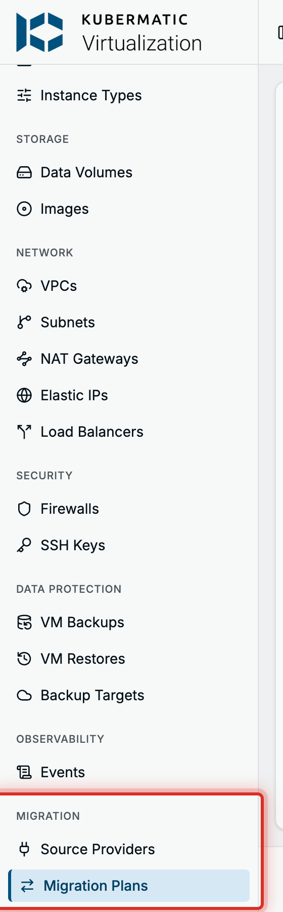

## Step 1: Add a source provider

Go to **Migration** > **Source Providers** and choose **Add Provider**.

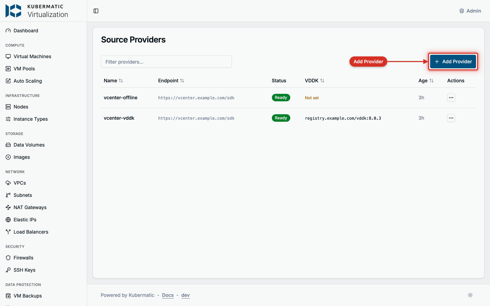

| Field | What to enter |
| --- | --- |
| **Name** | A name for the vCenter, for example `vcenter-prod`. It cannot be changed later. |
| **vCenter URL** | `https://vcenter.example.com/sdk`. A bare host name gets `https://` and `/sdk` added. |
| **Username** / **Password** | The migration account, for example `migration@vsphere.local`. |
| **Skip TLS Verification** | Only for a lab: credentials and disk data then travel over an unverified connection. |
| **CA Certificate** | The vCenter's CA certificate in PEM form. Leave it empty when the cluster already trusts the certificate. Hidden while verification is skipped. |
| **VDDK Image** | Optional. The VDDK image, such as `registry.example.com/vddk:8.0.3`. Leave it empty to use the cluster-wide image, if one is set. |
| **SDK Endpoint** | **vCenter**, or **ESXi host** when the URL points at a single host. |
| **Storage copy-offload clone method** | Only matters with copy offload to NetApp ONTAP. Keep the default otherwise. |

Choose **Test Connection** to check the URL and login from the API server, then **Add Provider**.

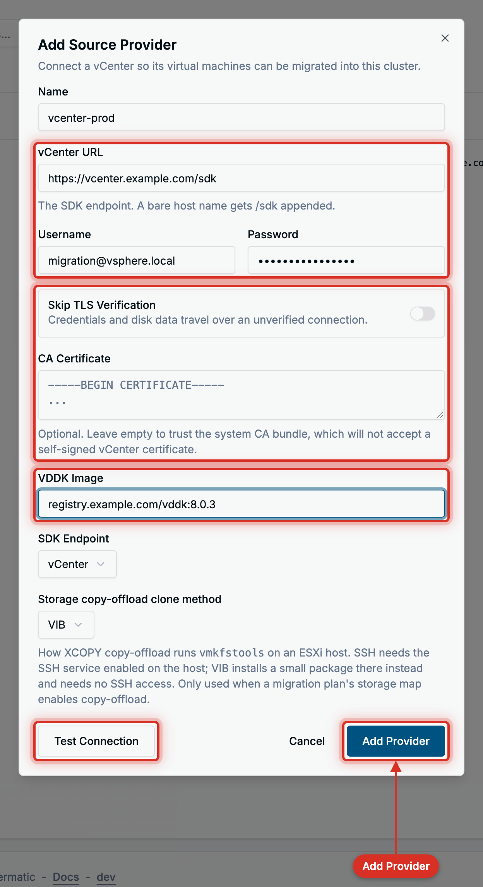

Forklift checks the login from inside the cluster before the provider is saved. The provider then
shows **Connecting**, then **Inventorying** while Forklift reads the vCenter, then **Ready**, or
**Failed** with the reason on hover. Open it to browse its virtual machines, networks, datastores,
hosts, clusters and datacenters, the plans that use it, and its events. **Edit** changes the VDDK
image, the SDK endpoint and the clone method; turn on **Replace Credentials** in the dialog to
enter a new URL, login and TLS settings, because the stored ones cannot be read back.

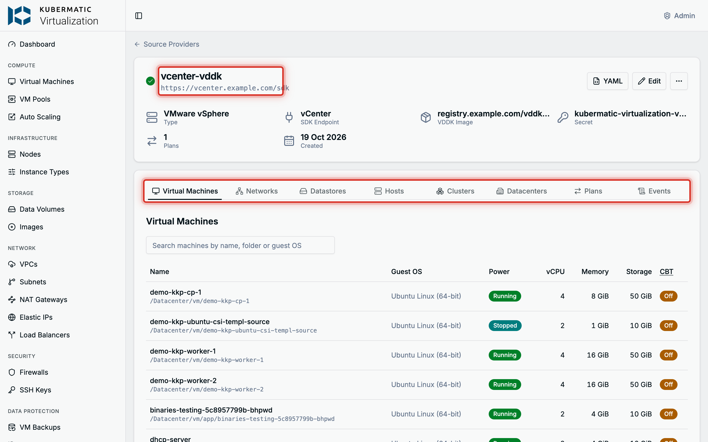

**The same with YAML**

```yaml
apiVersion: v1
kind: Secret
metadata:
  name: kubermatic-virtualization-vcenter-prod-vsphere-creds
  namespace: konveyor-forklift
  labels:
    createdForProviderType: vsphere
    createdForResourceType: providers
    # Lets the dashboard replace and delete the credentials later.
    migration.k8c.io/owner-namespace: kubermatic-virtualization
type: Opaque
stringData:
  url: https://vcenter.example.com/sdk
  user: migration@vsphere.local
  password: example-password
  insecureSkipVerify: "false"
  # Optional. The vCenter's CA certificate in PEM form.
  cacert: |
    -----BEGIN CERTIFICATE-----
    ...
    -----END CERTIFICATE-----
---
apiVersion: forklift.konveyor.io/v1beta1
kind: Provider
metadata:
  name: vcenter-prod
  namespace: kubermatic-virtualization
spec:
  type: vsphere
  url: https://vcenter.example.com/sdk
  secret:
    name: kubermatic-virtualization-vcenter-prod-vsphere-creds
    namespace: konveyor-forklift
  settings:
    sdkEndpoint: vcenter
    vddkInitImage: registry.example.com/vddk:8.0.3
---
# The destination. The dashboard creates it with the first source provider.
apiVersion: forklift.konveyor.io/v1beta1
kind: Provider
metadata:
  name: host
  namespace: kubermatic-virtualization
spec:
  type: openshift
  secret: {}
```

```bash
kubectl get providers -n kubermatic-virtualization
```

## Step 2: Create a plan

Go to **Migration** > **Migration Plans** and choose **New Plan**. The **Import VM** button on the
Virtual Machines page opens the same form. The form is one page; the **Create Plan** button stays
disabled until every section is complete, and the reason is shown under it with a **Go to Section**
link.

1. **Source**: pick the **Source Provider** and enter a **Plan Name**, such as `web-tier-1`.
2. **Migration Type**: **Cold** copies the disks while the machines are powered off. **Warm** copies
   them while the machines keep running, then cuts over; it needs a VDDK image on the provider.

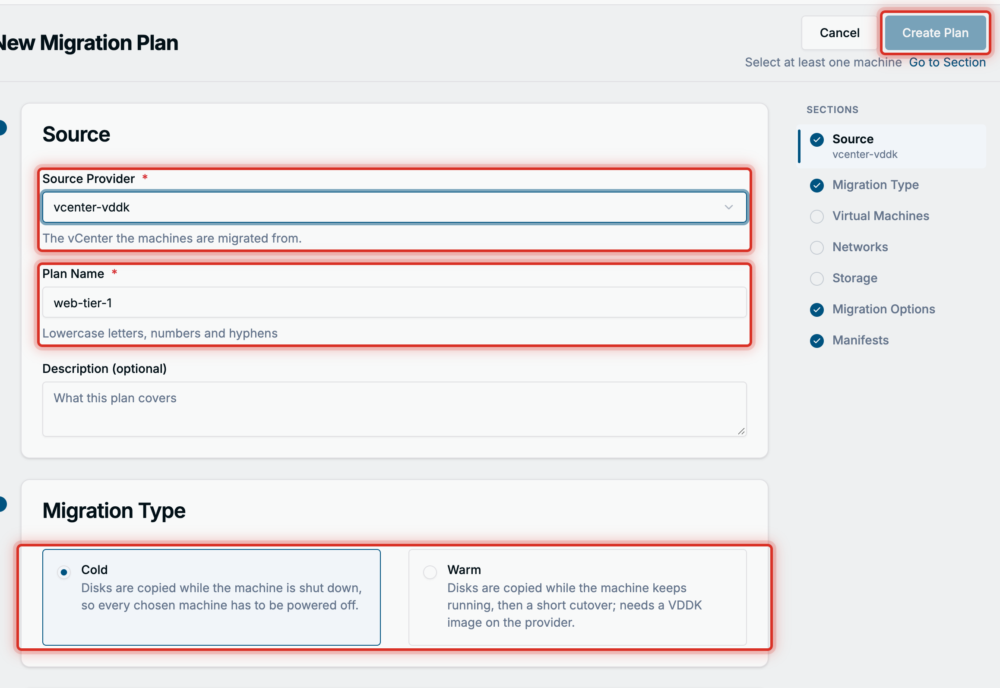

3. **Virtual Machines**: tick the machines to move. The list comes from vCenter one page at a time:
   search by name, folder or guest OS, switch between **All**, **Powered On** and **Powered Off**,
   and review your picks on the **Selected** tab. A machine that cannot join the plan has its
   checkbox disabled and the reason on hover: it is running in a cold plan, has Changed Block
   Tracking off in a warm plan, or has a critical concern.

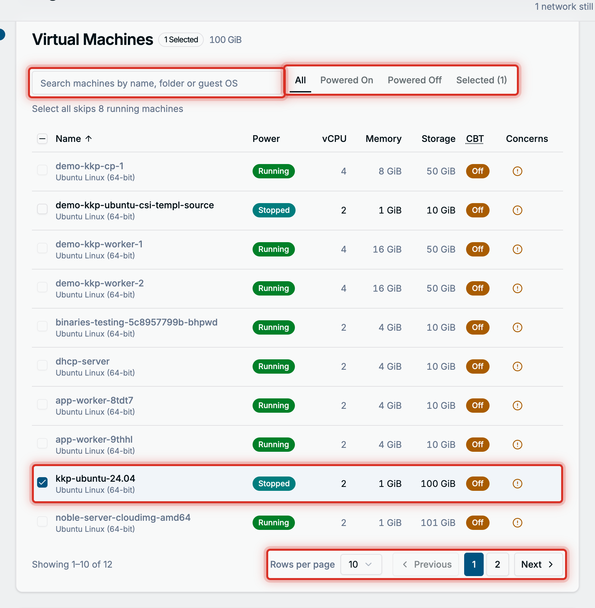

   KubeV checks the picks against the cluster. A machine whose name is already taken gets a
   **Target name** field. A machine whose MAC address belongs to an existing VM shows
   **Give ... a New MAC**, which assigns the existing VM a new address when it next restarts,
   because the migrated machine keeps its source MAC.

4. **Networks**: every network the selected machines use needs a **Destination**: the **Pod Network**,
   an **Overlay Network** subnet, an **Underlay Network** subnet, or **Ignore** to drop those
   interfaces. **Map All to Pod Network** fills them at once.
5. **Storage**: every datastore gets a **Storage Class**. The plan's **Access Mode** and **Volume Mode**
   apply to each datastore unless its **Override** switch sets its own.

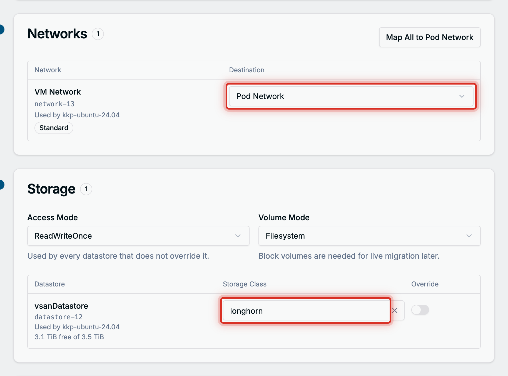

6. **Migration Options**: **Power State After Migrating** and **Preserve Static IP Addresses**.
   **Advanced Options** holds the disk bus, guest conversion, shared disks, legacy Windows drivers
   and the PVC name template. The defaults are right for most plans.
7. **Manifests** holds **View Manifests**, the YAML the dashboard is about to create. Choose
   **Create Plan**.

Forklift validates the plan against the vCenter. The plan's page shows **Ready to run**, or
**Not ready** with the findings under **This plan cannot run yet**.

**The same with YAML**

```yaml
apiVersion: forklift.konveyor.io/v1beta1
kind: NetworkMap
metadata:
  name: web-tier-1-netmap
  namespace: kubermatic-virtualization
spec:
  provider:
    source:
      name: vcenter-prod
      namespace: kubermatic-virtualization
    destination:
      name: host
      namespace: kubermatic-virtualization
  map:
    # The source id is the vSphere network's moRef, from the provider's Networks tab.
    - source:
        id: network-13
      destination:
        type: pod
        name: pod
---
apiVersion: forklift.konveyor.io/v1beta1
kind: StorageMap
metadata:
  name: web-tier-1-storagemap
  namespace: kubermatic-virtualization
spec:
  provider:
    source:
      name: vcenter-prod
      namespace: kubermatic-virtualization
    destination:
      name: host
      namespace: kubermatic-virtualization
  map:
    - source:
        id: datastore-12
      destination:
        storageClass: longhorn
        accessMode: ReadWriteOnce
        volumeMode: Filesystem
---
apiVersion: forklift.konveyor.io/v1beta1
kind: Plan
metadata:
  name: web-tier-1
  namespace: kubermatic-virtualization
spec:
  type: cold
  targetNamespace: kubermatic-virtualization
  provider:
    source:
      name: vcenter-prod
      namespace: kubermatic-virtualization
    destination:
      name: host
      namespace: kubermatic-virtualization
  map:
    network:
      name: web-tier-1-netmap
      namespace: kubermatic-virtualization
    storage:
      name: web-tier-1-storagemap
      namespace: kubermatic-virtualization
  vms:
    # The vSphere moRef of each machine, from the provider's Virtual Machines tab.
    - id: vm-1026
    - id: vm-1031
      targetName: web-02-migrated
  targetPowerState: auto
  preserveStaticIPs: false
```

```bash
kubectl get plans -n kubermatic-virtualization
```

To use an overlay or underlay subnet instead of the pod network, set the destination to
`type: multus` with the `name` and `namespace` of the subnet's `NetworkAttachmentDefinition`.

## Step 3: Run the plan and follow it

Open the plan and choose **Start Migration**. The button is enabled once the plan is **Ready to run**.

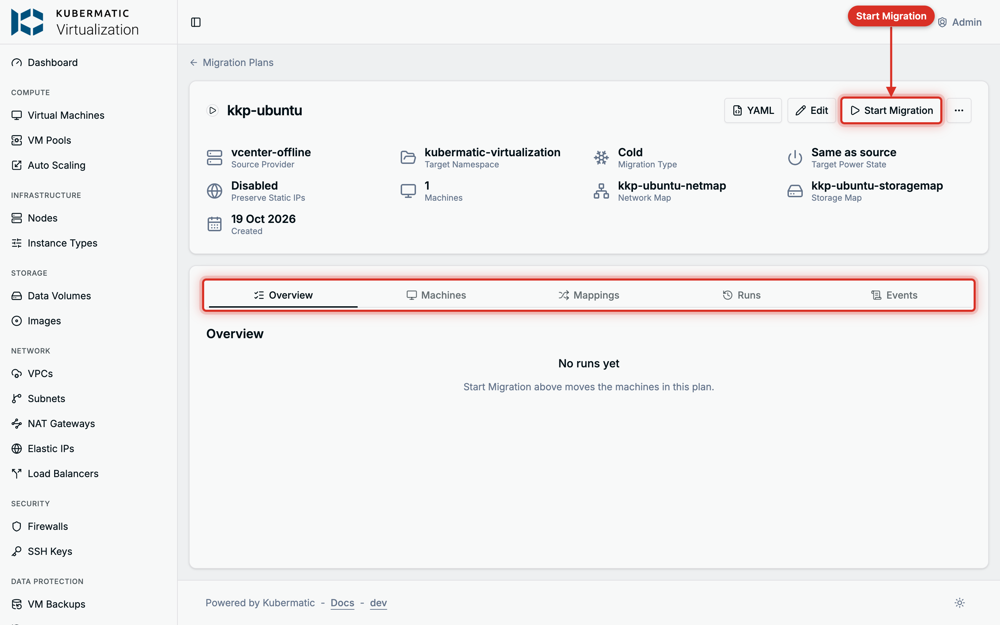

The **Overview** tab shows the current run with every machine's phase, progress and pipeline steps.
A finished machine links to the new VM. The **Runs** tab keeps the history, and the **Machines**
tab lists each source machine with its target name and the VM it became.

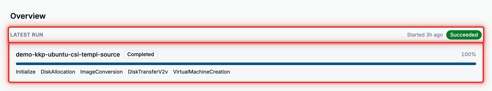

- **Cold**: the disks are copied, converted for KVM and the VM is created. Nothing in vCenter is
  changed.
- **Warm**: the disks are copied while the machines run and kept in sync. Choose **Cut Over** to
  shut the machines down in vCenter, copy the last changes and create the VMs, now or at a scheduled
  time.
- **Cancel Run** stops the whole run and removes it from the **Runs** tab; the **X** next to a
  machine stops that machine only. Source VMs are untouched either way. Partial disks can remain in
  the namespace; delete them before the next run.

Once a run has **Succeeded**, the VMs are in the Virtual Machines list in the plan's namespace,
powered as the plan's **Power State After Migrating** says. Check their console and network before
you retire the source.

**The same with YAML**

```yaml
apiVersion: forklift.konveyor.io/v1beta1
kind: Migration
metadata:
  name: web-tier-1-2026-10-19-09-00-00
  namespace: kubermatic-virtualization
spec:
  plan:
    name: web-tier-1
    namespace: kubermatic-virtualization
```

```bash
kubectl get migrations -n kubermatic-virtualization
kubectl get plan web-tier-1 -n kubermatic-virtualization -o jsonpath='{.status.migration.vms[*].phase}'
```

For a warm plan, cut over by setting a time on the Migration, and cancel one machine by listing it:

```bash
kubectl patch migration web-tier-1-2026-10-19-09-00-00 -n kubermatic-virtualization --type merge \
  -p '{"spec":{"cutover":"2026-10-19T22:00:00Z"}}'
kubectl patch migration web-tier-1-2026-10-19-09-00-00 -n kubermatic-virtualization --type merge \
  -p '{"spec":{"cancel":[{"id":"vm-1031"}]}}'
```

Deleting the Migration cancels the whole run.

## Step 4: Edit, archive or delete a plan

**Edit** opens the same form with the provider and the name locked; everything else, including the
machines and the mappings, can change. A plan can be edited while no run is active and its latest
run did not succeed. After a successful run, create a new plan for the next batch.

**Archive**, under the plan's **...** menu, keeps the plan, its maps and its run history but moves it
to the **Archived** tab, where it can neither run nor be edited. **Restore** brings it back.

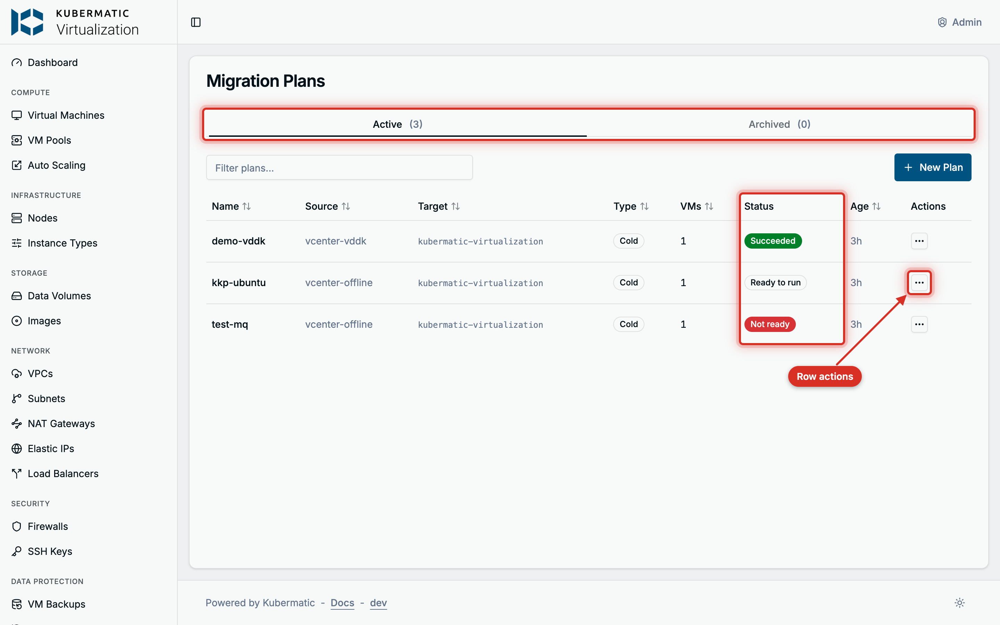

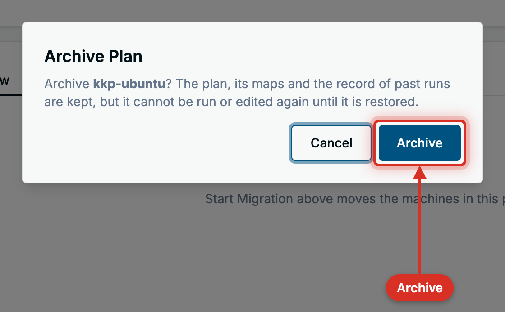

**Delete** removes the plan, its maps and its run history. The migrated VMs stay, and nothing in
vCenter is touched. Deleting a provider also removes its credentials Secret, and the plans that use
it stop working.

**The same with YAML**

```bash
kubectl patch plan web-tier-1 -n kubermatic-virtualization --type merge -p '{"spec":{"archived":true}}'
kubectl delete plan web-tier-1 -n kubermatic-virtualization
```

The dashboard sets an owner reference from the maps to the plan, so deleting the plan removes its
maps too. Maps created by hand stay.

## Troubleshooting

A provider's conditions are under its **Events** tab, behind **View Conditions**. A plan's findings
are on its **Overview** tab. The same text is in `kubectl describe` of the object.

| What you see | What to do |
| --- | --- |
| `Forklift could not reach that vCenter from inside the cluster` when adding a provider | The login passed from the API server, but the cluster nodes cannot reach the vCenter on port 443. |
| The provider stays **Connecting** or turns **Failed** | Check the URL, the login and the certificate settings, and that the cluster nodes can reach the vCenter on port 443. The message is on the status badge and under **Events** > **View Conditions**. |
| The provider is **Ready** but its Virtual Machines tab stays empty | The account cannot read the inventory. Grant its rights at the datacenter level and let them propagate. |
| **Warm** is greyed out with `this provider has no VDDK image` | Set a VDDK image on the provider. |
| A machine cannot be selected | Hover its checkbox: power it off for a cold plan, enable Changed Block Tracking for a warm plan, or resolve the critical concern in vCenter. |
| `<name> already exists in the destination` | Enter a different **Target name** for that machine. |
| `MAC address already in use` | Choose **Give ... a New MAC** to move the existing VM to a new address. |
| The plan stays **Not ready** | Open **This plan cannot run yet** on the Overview tab. Forklift names the machine and the reason, such as an unsupported guest OS or a datastore without a storage class. |
| A migration pod shows `ImagePullBackOff` | The VDDK image cannot be pulled. Check the image name and the registry's pull secret. |
| The transfer starts, then fails | The cluster nodes cannot reach the ESXi hosts on ports 443 and 902. |
| The transfer is very slow | The provider has no VDDK image, so the disks go over the vCenter's HTTPS datastore path. |
| `warm import retry limit reached` | The machine reached vSphere's snapshot limit during a long precopy. Delete its snapshots in vSphere and start the plan again. |
| A new run fails on an existing disk | A cancelled run left partial disks behind. Delete the leftover `DataVolume` and `PersistentVolumeClaim` objects of that machine in the namespace, then run the plan again. |
