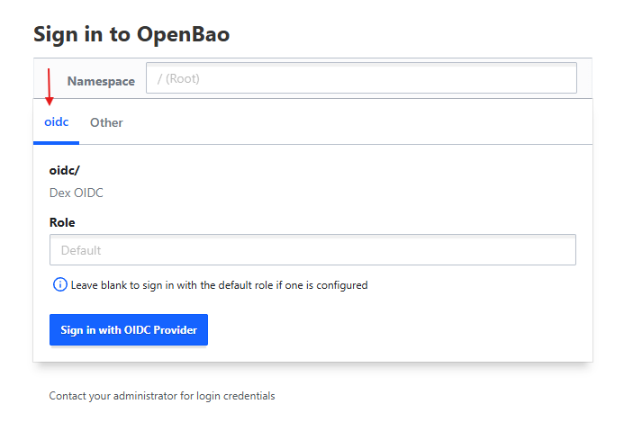
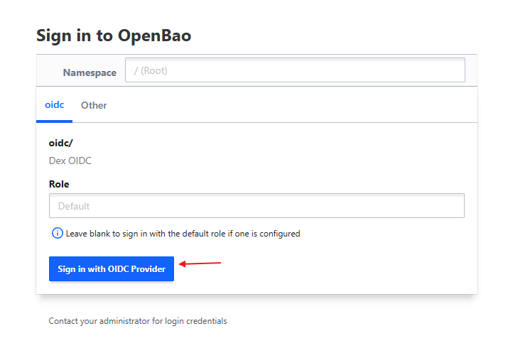
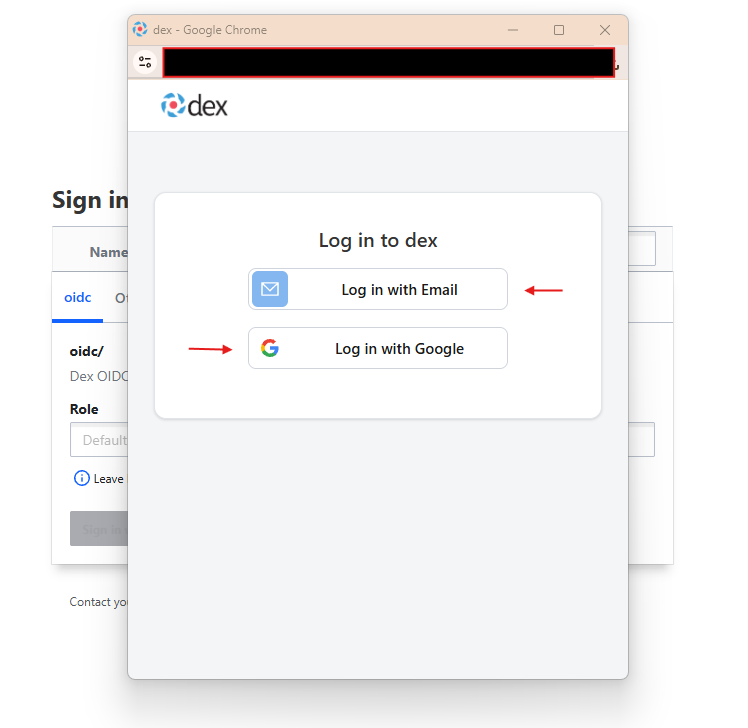

+++
title = "OpenBao User Guide"
date = 2026-06-13T09:00:00+02:00
weight = 4
description = "Understand OpenBao — the open-source, production-grade secrets vault bundled with Kubermatic SecureGuard — including secret engines, auth methods, and unsealing, plus how to enable OIDC sign-in and access the OpenBao web UI."
+++

[OpenBao](https://openbao.org/) is the open-source, production-grade secrets management backend at the heart of Kubermatic SecureGuard. It was forked from HashiCorp Vault to provide a completely open, community-driven cryptographic engine.

{}
**In plain English:** OpenBao is a high-security vault for your secrets — like a bank vault, but for passwords, API keys, and certificates. Instead of scattering credentials across config files and `.env` files, you store them in one encrypted, audited place and hand out access carefully. Apps don't open the vault themselves; ESO fetches what they need on their behalf (see [ESO Basics]()).

Unfamiliar with a term below (KV engine, auth method, unsealing)? The [Glossary]() defines each in one line.
{}

{}
**OpenBao is optional — it's an opinionated default, not a requirement.** SecureGuard bundles OpenBao so teams **without** an existing vault get a complete stack out of the box. If you already run a secrets backend, you don't need OpenBao at all: SecureGuard manages **ESO**, and ESO works with many providers — AWS Secrets Manager, GCP Secret Manager, Azure Key Vault, HashiCorp Vault, and [others](https://external-secrets.io/latest/introduction/stability-support/). Just point your `SecretStore`/`ClusterSecretStore` resources at your provider and disable the bundled OpenBao (`--set openbao.enabled=false`). The rest of this page applies only if you choose to use OpenBao as your backend.
{}

## What is OpenBao?

OpenBao provides a centralized, highly secure vault for managing sensitive data tightly. It effectively removes secrets from application source code, configuration files, and basic Kubernetes secrets until they are explicitly needed.

## Key Concepts

To effectively operate OpenBao within SecureGuard, you must understand three core concepts:

### 1. Secret Engines
Secret Engines are the components inside OpenBao where data is either stored, generated, or encrypted.
*   **Key/Value (KV)**: This is the most common engine used with SecureGuard. It stores static secrets, structured as JSON objects, at specific hierarchical paths (e.g., `secret/data/database/postgres/password`).
*   **Dynamic Secrets**: OpenBao can dynamically generate credentials for databases (e.g., MySQL, PostgreSQL), cloud providers (AWS, GCP), or message queues (RabbitMQ) on-the-fly when requested, ensuring credentials have a naturally limited Time-To-Live (TTL).
*   **Transit Engine**: Offers "encryption as a service," allowing applications to encrypt or decrypt data without actually storing it in OpenBao.

### 2. Auth Methods
Auth methods represent how users or machines prove their identity to OpenBao.
*   **OIDC (OpenID Connect)**: Dashboard authentication and OpenBao authentication are separate flows. Dashboard users authenticate via Dex (OIDC) to access the UI. Independently, ESO authenticates to OpenBao using Kubernetes Service Account tokens via the `kubernetes` auth method — dashboard users do not authenticate to OpenBao directly.
*   **Kubernetes Auth**: Used by the External Secrets Operator (ESO). ESO running in your cluster presents a Kubernetes Service Account token to OpenBao. OpenBao verifies the token's validity with the Kubernetes API server before granting access.

### 3. Audit Devices
Every request to OpenBao, whether it is a read from ESO or a write from a developer, is securely logged. These Audit Devices output JSON-formatted logs directly to stdout, syslog, or a file, which can then be ingested by tools like Elasticsearch or Splunk for compliance and anomaly detection.

## The Role of OpenBao in SecureGuard

Within the SecureGuard ecosystem, OpenBao acts purely as the **Central Vault**.
It handles:
1.  **Encryption**: Ensuring all secrets are encrypted both in transit and at rest using industry-standard encryption (AES-256-GCM for storage, TLS 1.2+ for transit).
2.  **RBAC (Role-Based Access Control)**: Enforcing strict least-privilege policies. You define *who* (which OIDC group or which Kubernetes Service Account) can read *what* paths.
3.  **Multi-Tenancy**: Through its namespace features, OpenBao allows large organizations to isolate teams. "Team A" vault paths are completely invisible to "Team B". For stronger, infrastructure-level isolation, you can instead run one OpenBao instance per tenant — see [Installation → Tenant Isolation]().

## Understanding Unsealing & High Availability

By default, an OpenBao server starts in a **Sealed** state. It knows where to find the encrypted data, but it does not know how to decrypt it because it lacks the master key. There are three ways to unseal it:

*   **Automated Self-Initialization (SecureGuard default)**: The chart runs `operator init` for you, splits the master key into Shamir key shares, unseals every node, and stores the key shares in the `<release>-openbao-keys` Kubernetes Secret — so no manual bootstrap is needed after `helm install`. The one-time root token is revoked immediately after setup and never persisted. **Back up that Secret**: it is the only way to unseal the cluster (or, for break-glass admin, to run `bao operator generate-root`). With this Shamir seal, a restarted pod comes back sealed and is re-unsealed on the next `helm upgrade` (or by an optional periodic CronJob).
*   **Manual Unsealing**: Requires multiple operators to independently enter shards of the master key. This is the most controlled but impractical for cloud-native orchestration (e.g., if a pod simply restarts).
*   **KMS Auto-Unseal**: OpenBao is configured with a cloud KMS (AWS KMS, GCP KMS, Azure Key Vault, or Transit). When a pod starts it reaches out to the KMS to decrypt itself — so it survives restarts with **no key shares stored in a Secret**. This is the higher-security production option; see [Installation → Automatic Unsealing with a KMS]().

The bundled OpenBao runs as a **3-node cluster with Integrated Raft Storage** by default. Only one node is the "Active" node processing writes, while the others serve as "Standbys". If the active node fails, another node instantly takes over, guaranteeing virtually zero downtime for your secret synchronization. Raft keeps each node's data in its own storage with no external Consul/etcd dependency.


## Enabling OIDC Authentication

This section lets people sign in to the OpenBao web UI with their SecureGuard (Dex) login instead of tokens. An administrator with `kubectl` access to the cluster runs these steps once.

The commands below use these placeholders. Replace them with your own values before you run anything:

- <code style="color:#98c379;background:#483b31;font-weight:bold;border-radius:3px;padding:0 2px">&lt;openbao-host&gt;</code> — the OpenBao address, e.g. `openbao.example.com`
- <code style="color:#98c379;background:#483b31;font-weight:bold;border-radius:3px;padding:0 2px">&lt;dex-host&gt;</code> — the SecureGuard/Dex address, e.g. `secureguard.example.com`
- <code style="color:#98c379;background:#483b31;font-weight:bold;border-radius:3px;padding:0 2px">&lt;admin-email&gt;</code> — the email of a user who should get admin access

**How to find these values**

To find `<openbao-host>` and `<dex-host>`, list the ingresses in the SecureGuard namespace:

```bash
kubectl -n secureguard-system get ingress
```

Look at the **HOSTS** column. The host on the OpenBao ingress is `<openbao-host>`, and the host on the SecureGuard ingress (the one that serves `/dex`) is `<dex-host>`. Fill in the placeholders without `https://`.

`<admin-email>` is not looked up from the cluster. It is the email address the person uses when they log in through Dex, for example their company Google account. For the built-in admin account, it is `admin@secureguard.local`.

The commands also assume the default release name `secureguard` and the namespace `secureguard-system`. If you installed SecureGuard under different names, change them to match.

1. **Install the OpenBao CLI**
   This installs the `bao` command-line tool on a Linux (amd64) machine.

   ```bash
   VER=$(curl -s https://api.github.com/repos/openbao/openbao/releases/latest | grep -oP '"tag_name": "v\K[^"]+')
   curl -L -o /tmp/bao.tar.gz "https://github.com/openbao/openbao/releases/download/v${VER}/openbao_${VER}_linux_amd64.tar.gz"
   tar xzf /tmp/bao.tar.gz -C /tmp
   sudo mv /tmp/bao /usr/local/bin/
   bao version
   ```

   You should see a version string printed.

   {}
   The release file is named `openbao_<version>_...`, not `bao_<version>_...`. If you download it by hand, look for the `openbao_` prefix.
   {}

2. **Get a temporary admin session**
   This logs you in to OpenBao as an administrator for a short time, using your `kubectl` access to the cluster.

   ```bash
   export BAO_ADDR=https://<openbao-host>
   export BAO_TOKEN=$(bao write -field=token auth/kubernetes/login \
     role=secureguard-admin \
     jwt="$(kubectl -n secureguard-system create token secureguard-proxy --duration=10m)")
   bao token lookup
   ```

   You should see `admin` in the `policies` line.

   {}
   The session expires after about 15 minutes. If a later command says `permission denied`, repeat this step.
   {}

3. **Check whether OIDC is already enabled**
   This lists the sign-in methods OpenBao already has.

   ```bash
   bao auth list
   ```

   If `oidc/` is in the list, skip to step 7. Otherwise, continue with step 4.

4. **Enable OIDC and connect it to Dex**
   This turns on OIDC sign-in, shows it on the sign-in screen, and points it at your SecureGuard (Dex) login.

   ```bash
   export OIDC_CLIENT_SECRET=$(kubectl -n secureguard-system get secret secureguard-auth \
     -o jsonpath='{.data.oidc-client-secret}' | base64 -d)
   bao auth enable -description="Dex OIDC" oidc
   bao auth tune -listing-visibility=unauth oidc/
   bao write auth/oidc/config \
     oidc_discovery_url="https://<dex-host>/dex" \
     oidc_client_id="secureguard" \
     oidc_client_secret="${OIDC_CLIENT_SECRET}" \
     default_role="secureguard"
   ```

   You should see a `Success!` message after each `bao` command.

5. **Create the read-only user policy**
   This creates a policy that lets users read and list secrets, but not change them.

   ```bash
   printf 'path "secret/data/*" { capabilities = ["read","list"] }\npath "secret/metadata/*" { capabilities = ["read","list"] }\n' \
     | bao policy write secureguard-user -
   ```

   You should see `Success! Uploaded policy: secureguard-user`.

6. **Create the default sign-in role**
   This creates the role everyone gets when they sign in, which gives read-only access.

   ```bash
   bao write auth/oidc/role/secureguard \
     bound_audiences="secureguard" \
     allowed_redirect_uris="https://<openbao-host>/ui/vault/auth/oidc/oidc/callback","http://localhost:8250/oidc/callback" \
     user_claim="email" \
     oidc_scopes="openid,email,profile" \
     role_type="oidc" \
     token_policies="secureguard-user" \
     token_ttl="1h"
   ```

   You should see `Success! Data written to: auth/oidc/role/secureguard`.

7. **Create the admin sign-in role**
   This creates a role that gives admin access, but only to the email addresses you list.

   ```bash
   bao write auth/oidc/role/secureguard-admin - <<'EOF'
   {
     "role_type": "oidc",
     "bound_audiences": ["secureguard"],
     "allowed_redirect_uris": [
       "https://<openbao-host>/ui/vault/auth/oidc/oidc/callback",
       "http://localhost:8250/oidc/callback"
     ],
     "user_claim": "email",
     "oidc_scopes": ["openid", "email", "profile"],
     "bound_claims": {"email": ["admin@secureguard.local", "<admin-email>"]},
     "token_policies": ["admin"],
     "token_ttl": "1h"
   }
   EOF
   ```

   You should see `Success! Data written to: auth/oidc/role/secureguard-admin`.

   To give more people admin access, add their email to the `email` list under `bound_claims` and run this step again.

   {}
   This step must use the JSON form shown above. The `key=value` form used in step 6 does not work here.
   {}

8. **Check it worked**
   This confirms that OIDC sign-in and the admin role are set up.

   ```bash
   bao auth list
   bao read auth/oidc/role/secureguard-admin
   ```

   You should see `oidc/` in the first list, and the emails you added under `bound_claims`.

9. **End the temporary session**
   This clears the secret from your shell and closes your admin session.

   ```bash
   unset OIDC_CLIENT_SECRET
   bao token revoke -self
   unset BAO_TOKEN
   ```

   You should see `Success! Revoked token (if it existed)`.

{}
These settings are stored inside OpenBao. If OpenBao is reinstalled with empty storage, repeat this section.
{}

## Accessing OpenBao

This section shows how to sign in to the OpenBao web UI. Open `https://<openbao-host>/ui` in your browser, then follow these steps.

1. **Choose the oidc tab**
   On the **Sign in to OpenBao** screen, click the **oidc** tab. Leave **Namespace** as it is.

   

2. **Enter the role and sign in**
   Fill in the **Role** field, then click **Sign in with OIDC Provider**.

   - Leave **Role** blank to get read-only access.
   - Type `secureguard-admin` to get admin access. This only works if your email was added in [Enabling OIDC Authentication](#enabling-oidc-authentication), step 7.

   

3. **Choose how to log in**
   A **Log in to dex** window opens. Choose one of the options.

   

   - **Log in with Email** — use the built-in admin account created when SecureGuard was installed. The username is `admin@secureguard.local`. Get the password with:

     ```bash
     kubectl get secret secureguard-dex-admin \
       -n secureguard-system \
       -o jsonpath='{.data.password}' | base64 -d && echo
     ```

   - **Log in with Google** — only shown if your installation has Google sign-in set up. You get admin access only if your email was added in [Enabling OIDC Authentication](#enabling-oidc-authentication), step 7.

4. **You're in**
   The window closes and OpenBao opens.

{}
If you left **Role** blank, the **Secrets Engines** page can look empty. That is normal for read-only access. To see everything, sign in again with `secureguard-admin` as the role.
{}
